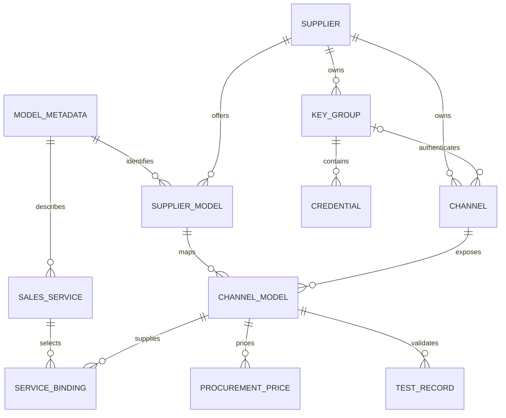

# MoMA 运营后台模型接入优化 Spec

| 项目 | 内容 |
| --- | --- |
| 文档版本 | v1.1 · 2026-10-31（目录外接入、维护与专属 Key 轮换修订） |
| 文档状态 | A／B／C 已按 mock 范围实施；本轮按第 23 节继续实施，实际完成情况以同目录验收台账为准 |
| 适用范围 | MoMA 运营后台；以独立 5.12.0 原型为现状基线 |
| 主要读者 | 产品、交互设计、前端、后端、网关、测试人员 |
| 本次交付 | 功能流程、页面规格、业务规则、数据与接口契约、实施范围、验收用例 |
| 实施边界 | 后续用户已授权修改独立 5.12.0 原型并本地提交；仅使用 mock，不接入真实上游，不推送或部署，不清除存量数据 |

## 1. 目标与核心决策

让运营从“获得供应商地址与凭证”开始，在一个连续任务中完成连接配置、模型选择、映射、测试和启用，并清楚知道距离对外服务还缺哪些条件。

保留模型资料、供应、销售服务三个业务层次。减少重复填写和页面往返，不把不同层次合并成一条难以维护的记录。

### 1.1 本方案采用的设计

1. 保留“添加供应商、添加模型、添加渠道”三个入口。三个入口分别负责主体登记、供应关系登记、技术接入，不改成单一创建入口。
2. “添加渠道”仍只创建新渠道。连接、主体和模型在同一表单配置，保存后进入“测试与启用”；支持一个渠道接入多个模型。
3. 向已有渠道补充模型使用独立动作“添加关联模型”。不能在“添加渠道”中悄悄复用已有渠道。
4. 渠道保存供应商、接口类型、地址及凭证引用；渠道模型映射保存模型资料引用、上游模型 ID、接口任务和采购价。
5. 模型可以从上游发现、内置参考目录或手动输入。三种来源明确区分；保存映射前必须匹配到统一模型资料。
6. 接入测试不依赖价格。采购价未知时允许保存、测试和技术启用，但禁止用于正式客户流量。
7. 保存、测试、启用、关联服务、发布路由、上架分别产生明确结果，不相互隐式触发。
8. 有效测试证据绑定配置版本及凭证版本。基础调用成功不代表所有能力都通过。
9. 被在线服务引用的连接变更采用“候选配置测试 → 明确应用”；失败不覆盖当前有效配置。
10. 服务管理保留“统一服务／分供应商”的现有边界和路由配置，不恢复独立路由管理页面。

### 1.2 成功标准

| 编号 | 可观察结果 |
| --- | --- |
| G01 | 已有模型资料与供应商时，运营可从“添加渠道”进入并完成接入，无需先执行“添加模型”。 |
| G02 | 一个账号接入 20 个模型时，地址、接口类型和密钥组各配置一次；模型映射可批量确认和测试。 |
| G03 | 不支持模型发现的上游仍能手动接入；获取列表失败不被解释为“没有模型”。 |
| G04 | 采购价为空不阻止测试；空值、明确免费、有效报价在展示和发布校验中可区分。 |
| G05 | 运营能区分“已保存、验证通过、已启用、可用于服务、已对外服务”。 |
| G06 | 临时换 Key 测试和编辑候选地址都不会改变线上生效配置。 |
| G07 | 测试失败可定位到具体模型、请求阶段、凭证版本和可采取的动作；无需凭一个红色状态猜测。 |
| G08 | 任意创建、同步和测试动作都不会自动上架、改售价、扩大授权范围或发布路由。 |

本稿不承诺尚未测量的接入耗时或成功率提升。可在交互验收中记录任务完成时长、重复输入次数与中途退出位置，再制定量化目标。

## 2. 现状证据、竞品依据与约束

### 2.1 现状与问题的准确边界

| 现状 | 设计问题／能力缺口 | 本稿处理 |
| --- | --- | --- |
| 添加渠道可原子补齐供应商与模型的目录关系 | 并非必须先点“添加模型”；真正问题是首次接入任务分散、含义易混淆 | 保留三个入口，明确各自结果 |
| 模型选择器支持原地新增资料 | 不是完全没有快捷创建；但不能从上游列表批量匹配 | 增加发现与映射步骤 |
| 密钥组可复用，配置／测试内可添加密钥 | 不重新建设凭证库 | 沿用密钥组，补充版本与有效性规则 |
| 当前添加渠道一次选择一个模型，要求完整价格 | 批量登记不等于批量接入；报价前置阻碍技术验证 | 一连接多模型；报价允许待补 |
| 新增渠道按模型类型指定协议，编辑渠道允许选择协议 | 入口行为不一致；模型类型不能决定上游协议 | 统一按接口类型呈现字段 |
| 当前要求完整调用 URL | 对常见接口重复填路径；一个地址难覆盖多任务 | 预设接口使用服务根地址，自定义接口保留明确任务地址 |
| 保存后进入测试，测试后单独启用 | 已有正确闭环雏形 | 保留独立启用，扩展批量与证据 |
| `providerModelConnectivityTest` 返回 `simulated: true` | 只能证明本地原型状态流转，不证明真实上游可用 | 区分原型验收与生产接入验收 |
| 服务内已有路由及价格规则 | 不能笼统判定“缺少路由能力” | 只补供应到服务的准入和验收衔接 |

源码证据见第 22 节。上述事实来自本地文件，不是本次线上运行验收。

### 2.2 竞品依据与采纳范围

| 产品／官方来源 | 可借鉴的已文档化行为 | MoMA 设计选择 |
| --- | --- | --- |
| [LiteLLM 快速接入](https://docs.litellm.ai/docs/proxy/docker_quick_start) | 选择 Provider 和模型，配置凭证，连接测试后添加 | 接入围绕可调用配置组织；使用接口预设减少填写 |
| [LiteLLM 模型管理](https://docs.litellm.ai/docs/proxy/model_management) | 可复用命名凭证；凭证字段随 Provider 变化 | 复用现有密钥组；将商业供应商与技术接口类型区分 |
| [LiteLLM 健康检查](https://docs.litellm.ai/docs/proxy/health) | 真实模型检查、错误详情、检查时间 | 测试结果必须有来源、范围和版本，保留失败诊断 |
| [New API 渠道管理](https://docs.newapi.pro/zh/docs/guide/feature-guide/admin/channel) | 渠道聚合服务商类型、密钥、模型；支持测试、模型映射和批量操作 | 一个连接配置对应多个模型映射；基础操作与高级配置分层 |
| [New API 模型管理](https://docs.newapi.pro/zh/docs/guide/feature-guide/admin/model) | 上游同步先预览新增、变更、删除，再应用 | 发现与同步都必须经过匹配和影响预览 |
| [New API 获取上游模型列表](https://docs.newapi.pro/zh/docs/api/management/channel-management/channel-fetch_models-id-get) | 管理侧获取渠道上游模型列表 | 模型发现由服务端执行，不能依赖浏览器跨域直连 |

资料核对日期：2026-10-30。依据为官方文档，不代表对所有版本、所有供应商或商业版本能力做了实测。内置参考目录不等于账号已授权目录；上游返回列表也不等于逐个调用已成功。

不照搬竞品的倍率计费或所有高级开关，不以技术 Provider 替代 MoMA 的采购供应商，也不把自动发现的模型直接变成在售服务。

### 2.3 必须保留的现有约定

| 约束 | 本稿遵循方式 |
| --- | --- |
| 三个独立添加入口 | 保留原按钮名称和直接打开行为；不增加单项下拉菜单 |
| 模型／供应商双视图 | 切换仍在左侧目录顶部；同一对象和同一数据源，不复制业务记录 |
| 渠道名称为文本，新渠道 ID 自动生成 | 名称不改成已有渠道选择框，不提供用户手填内部 ID |
| 默认密钥组不可删除，其他组删除须无密钥且无引用 | 保留前端提示与服务端约束 |
| 表格动作在最右侧操作列 | 测试、维护、复制、启停、关联与移除等动作统一右置；数据列只读 |
| 统一资料身份 | 不按相似名称合并；供应模型必须引用资料主档 |
| 供应和销售价格分离 | 成本不自动生成客户售价，切换供给不自动改客户单价 |
| 运营配置业务，运维监控故障 | 不把接入配置职责移给运维 |
| 服务模式和服务内路由 | 不改变当前模式切换影响，不新增独立路由入口 |
| 正式产品文案 | 产品页面不增加“原型／模拟”常驻标签；证据来源和未接通边界写入研发文档 |
| 版本隔离和数据保护 | 不改其他版本，不重置浏览器记录，不隐式迁移或清除数据 |

修正上一轮分析：不再建议合并三个添加入口。现有“保存后测试、单独启用、原地添加密钥”等能力应直接复用，不列为从零新增。

## 3. 范围、角色与权限

### 3.1 功能范围

本期目标包括：连接配置、接口预设、批量模型发现与映射、手动录入、采购价后补、真实测试契约、启停、共享变更影响、候选配置切换、服务准入、平台试调用及审计。

不包括：新建推理集群、下载模型权重、供应商开户或充值、合同审批、客户订购规则重做、任意协议转换器、脚本插件市场、自动最优采购、重构全部路由算法。

定时模型同步、后台周期探测和多 Key 自动轮询作为后续扩展。第一期提供手动发现、手动复测和现有运行指标的关联查看，不用这些后续能力阻塞核心接入交付。

### 3.2 权限矩阵

| 动作 | 系统管理员 | 运营 | 运维 |
| --- | --- | --- | --- |
| 查看供应与采购配置 | 可 | 可 | 不新增供应后台访问权 |
| 创建供应商、资料、渠道、模型映射 | 可 | 可 | 不可 |
| 新增、替换或停用供应商凭证 | 可 | 可，沿用现有动作权限 | 不可 |
| 发现模型、执行接入测试、启停 | 可 | 可 | 不通过本模块执行 |
| 配采购价、销售价、服务关联、路由、上架 | 可 | 可 | 不可 |
| 查看调用故障和请求追踪 | 按已有权限 | 接入结果摘要；不扩大客户日志权限 | 沿用运维监控权限 |

后端必须校验动作权限及供应商归属。隐藏按钮、角色切换控件和前端事务校验不构成生产鉴权。

## 4. 业务对象与术语

### 4.1 对象定义

| 对象 | 职责 | 不能承载的内容 |
| --- | --- | --- |
| 模型资料 | 统一模型身份、名称、业务编码、类型和参考能力 | 凭证、渠道启停、客户售价 |
| 供应商 | 直接采购主体、自建供给主体及基本资料 | 不能自动等同模型研发厂商或协议适配器 |
| 供应模型 | 某供应商声明提供某模型资料的关系 | 不等于已接通，不隐含渠道 |
| 渠道 | 一个供应商下的连接配置：接口类型、地址、凭证引用及连接限制 | 不拥有独立零售价格，不与 API Key 一对一绑定 |
| 渠道模型映射 | 某模型通过某渠道实际调用的上游 ID、任务、能力限制及采购价引用 | 不创建新的模型资料身份 |
| 密钥组 | 同供应商凭证的组织与引用单元 | 不作为跨供应商凭证共享方式 |
| 接入测试记录 | 针对指定配置、凭证及模型的不可变验证证据 | 不是永久可用承诺或 SLA |
| 销售服务 | 对外模型 ID、服务模式、客户价格、权限范围和允许供给 | 不保存一份复制的上游密钥 |

“接口类型”是面向运营的技术选项，例如 OpenAI 兼容、Anthropic 原生。“供应商”仍指实际采购关系。同一供应商可以拥有多个接口类型的渠道。

界面在采购侧统一称“采购价”；历史“供应商售价／渠道售价”属于上游向 MoMA 报价，不得与服务管理的“对外售价”混淆。文案调整不改变历史金额、币种或单位。

### 4.2 关系图



无需把图中每项机械实现成新表。已有结构能表达的对象继续复用；内部模型资料 ID、业务编码、上游模型 ID 和对外模型 ID 必须保持不同语义。

### 4.3 关键不变量

- 每个渠道只归属一个供应商，创建后不得改归属。改供应商需要新建渠道和显式重新关联。
- 一个渠道可以关联多个模型；同一模型可以关联多家供应商和多个渠道。
- 第一阶段，同一渠道与同一模型资料只允许一条有效映射。需要同模型的多个上游部署时，创建不同渠道；不引入隐式版本覆盖。
- 同一供应商下渠道名称去除首尾空白后唯一，允许中文、数字和常用符号。名称变化不改变内部 ID。
- 同一渠道不允许把一个上游模型 ID 重复保存为多个模型资料。发现重复时要求修正，不自动合并资料。
- 上游模型 ID 保留大小写和 `/`、`.`、`:`、`-` 等合法字符；不套用平台资料编码的校验。禁止控制字符和空白，长度沿用 1–200 字符。
- 上游名称变化不能自动更改已对外使用的模型 ID。
- 新渠道和新映射保存后默认未启用；测试不改变启停状态。
- 资料不完整、技术可用、成本完整、服务已上架为不同判断，不共用一个布尔字段。

### 4.4 贯穿示例

以下仅用于说明关系，不是实际供应商或已部署模型。

| 对象 | 示例 |
| --- | --- |
| 统一模型资料 | 名称 Alpha Chat，业务编码 `alpha-chat`，内部资料 ID `model-001` |
| 供应商甲的渠道一 | 名称“甲方生产账号”，OpenAI 兼容，根地址 `https://gateway.example.com/v1` |
| 渠道一的模型映射 | 引用 `model-001`，上游模型 ID `vendor/alpha-chat-v2`，采购价属于此映射 |
| 渠道一的第二个模型 | 引用向量模型资料 `model-002`，使用同一地址和密钥组，走 Embeddings 任务 |
| 供应商乙的渠道二 | 同样引用 `model-001`，但上游 ID、凭证及采购价独立 |
| 统一销售服务 | 对外 ID `moma/alpha-chat`，引用两条已准入映射，拥有独立对外售价 |

客户发送 `moma/alpha-chat`，平台按已发布策略选渠道一，发往上游时替换为 `vendor/alpha-chat-v2`。客户按销售服务计费，平台成本按渠道一映射的采购价计算。下一次选择渠道二不改变客户对外模型 ID 或单价。

渠道一的文本测试成功不能替代向量测试。供应商乙在上游发布了新版本，也不能仅因名称相似而改绑 `model-001`。

## 5. 信息架构与页面规格

### 5.1 导航不新增一级模块

继续使用“资料管理、供应管理、服务管理”和“入门指导 → 运营入门”。路由在服务管理内部维护。供应页不恢复旧使用引导弹窗。

供应页页头保留三个按钮：“添加供应商”“添加模型”“添加渠道”，其中“添加渠道”为主按钮。只保留一句模块介绍。

左侧目录顶部为“模型｜供应商”。按模型聚合多供应商渠道，按供应商查看同一批资源。搜索和选中状态分别保存，切换不改变正在处理的业务记录。

### 5.2 供应详情表

| 列 | 内容与交互 |
| --- | --- |
| 模型 | 主档名称／编码；模型视图中不重复固定的当前模型列 |
| 供应商 | 主体名称；供应商视图中不重复固定的当前供应商列 |
| 渠道 | 仅名称和 ID；共享模型数量放详情，不堆入名称单元格 |
| 上游模型 ID | 完整值可查看，主表长值截断；复制动作在操作列 |
| 接入状态 | 未测试、测试失败、待复测、未启用、可用、已停用等主状态 |
| 采购价 | 摘要；缺失显示“待配置”，明确免费显示“0”及单位 |
| 操作 | 测试、配置、启用／停用；次要动作在“更多”中 |

供应模型没有渠道时，显示“未配置渠道”，不伪造渠道占位记录。全局创建入口仍在页头，不在每个空行重复添加同名按钮。

单条映射详情使用抽屉，分为“配置、测试记录、关联服务”。共享渠道信息在配置区域呈现一次。渠道级与映射级动作明确分组，执行前展示影响范围。

批量工具栏只在选中记录后出现，可测试、启用符合条件项、停用。跨页选择由显式“选择全部筛选结果”触发，不能把本页全选解释为全部。执行时固定对象 ID 清单。

### 5.3 创建弹窗框架

保留居中弹窗。供应商、供应模型使用短表单；添加渠道使用宽弹窗和“配置接入／测试与启用”两段指示，不新增独立导航页。

```text
添加渠道                                                关闭
配置接入  →  测试与启用
──────────────────────────────────────────────────────────
当前步骤内容；主体独立滚动；表格错误定位到行
──────────────────────────────────────────────────────────
取消／关闭                         保存草稿／保存接入／启用模型
```

按钮随阶段变化；同一区域只突出一个主动作。已有记录直接选择，目录外主体和模型在当前表单输入，不要求先完成独立登记向导。

主流程最多嵌套一层短表单，用于添加供应商、密钥或模型资料。关闭子表单后恢复父表单草稿和焦点，不叠加第三层模态框。

## 6. 主流程：创建新渠道并接入模型

### 6.1 进入与上下文

- 模型视图进入：预选当前模型资料；供应商未唯一确定时要求选择，不猜测。
- 供应商视图进入：预选当前供应商；同页可选一个或多个模型。
- 已有供应模型不是前置条件；保存渠道与映射时原子补齐缺少的供应关系。
- 有未保存输入时切换供应商或接口类型，要提示将清除的字段。取消切换保留全部输入。
- 未发生修改时可直接关闭；已保存草稿与尚未保存修改分别处理。

### 6.2 配置接入：连接与主体

| 字段 | 必填与默认 | 规则 |
| --- | --- | --- |
| 供应商 | 必填；按进入上下文带入 | 选择已有主体、内置参考项，或明确输入新供应商名称；仅保存时登记，不按相似名称合并 |
| 渠道名称 | 必填；可按供应商自动建议新名称 | 文本输入，1–60 字；可修改，重复时定位名称错误 |
| 渠道 ID | 只读 | 新对象保存后生成，保持现有稳定 ID 和展示规则 |
| 接口类型 | 必填；优先使用供应商预设；直接输入新供应商默认 OpenAI 兼容且可修改 | 与模型类型无关；所有创建／编辑入口共用选项与校验 |
| 服务根地址／任务地址 | 由接口类型决定 | 预设可带默认值但须可核对；不得默默把用户地址换成另一域名 |
| API 密钥 | 认证接口需要可用 Key | 可复用当前供应商组，或内联填写新 Key 随接入保存；空组不能执行测试 |
| 无需认证 | 仅自建接口且部署策略允许 | 显式选择；不得用空 Key 自动推断 |
| 高级连接设置 | 折叠 | 连接超时、账号请求限制及适配器支持的版本字段；不放销售路由权重 |

可保存未完成的非敏感草稿；目录外主体名称和模型编码允许尚未填完，保存接入时严格校验。草稿不创建渠道或资料，不进入可用集合，也不包含明文 Key。

连接和模型同页填写，不再要求“下一步”。保存前可显式获取上游模型；发现失败不阻止合法的手动接入，也不等于连接成功。

### 6.3 配置接入：模型选择与目录外输入

提供“获取上游模型”主动作和“手动添加”次动作。接口不支持发现时，直接呈现手动添加及可用的参考目录。

候选表：选择框、上游模型 ID、来源、匹配模型资料、任务类型、处理状态、操作。

匹配规则：

1. 先用已维护的供应商／接口型号别名及明确业务编码匹配。
2. 精确匹配仍呈现给用户确认；相似名称只提供候选，不自动选中。
3. 多个候选显示“待确认”；没有候选显示“待关联资料”。
4. 用户可选已有主档，或原地新增最小资料；不能把上游 ID 当作新的平台主键。
5. 从模型视图带入的主档不能自动套给所有发现结果；只预选能明确对应的目标行。
6. 类型和接口任务冲突的行不能提交。发现结果未给类型时，要求运营选择，不默认全部为语言模型。

目录外快速接入只要求模型编码和模型类型；显示名称默认同编码，普通手动输入默认语言模型且可修改。上游模型 ID 默认使用本次输入值，仍独立保存并允许改为实际调用别名。未填写的任务、输入／输出模态、上下文和工具能力保持未知，资料标为“待完善”，不按模型类型补造能力。单独的完整资料登记及编辑保留原校验；正式服务创建、能力承诺与上架继续检查必要资料和测试证据。

“参考目录”只是填写辅助，不宣称账号已开通。上游发现也只证明列表可见，仍需模型调用测试。

选中条目均完成映射后可保存。采购价在展开的“采购价”区域批量或逐项配置，允许全部留空；不默认复制其他供应商报价。

### 6.4 保存规则

“保存接入”和测试分成两个明确动作：

1. 保存阶段：一次事务创建渠道、选中映射及缺少的供应关系，默认停用；本表单内的新供应商、最小资料和脱敏 Key 一起提交，全部成功才保存。通过独立登记入口已经保存的资源继续保留。
2. 测试阶段：保存后由用户明确点击标明产生用量的测试按钮。测试失败不回滚已保存配置，显示逐项结果；保存本身不启动调用。

选中条目存在校验错误时不保存任何渠道或映射。可由用户明确取消选择错误行后提交其余行，不能自动跳过。

点击“保存草稿”不启动测试。保存响应不确定时通过同一操作 ID 查询结果，不能重新生成渠道再提交。

### 6.5 测试与启用

- 按模型行显示排队、测试中、通过、失败、取消；顶部汇总使用“通过 18／失败 2／待执行 0”等真实数量。
- 可重试失败项、查看详情、返回修改，或关闭后稍后继续。
- 单模型新接入及向已有渠道新追加的一条映射，若从未启停、没有服务影响且验证仍有效，可直接明确点击“启用模型”；底层仍固定范围并完整预检。其他情况由用户选择通过项再确认启用，不自动勾选历史恢复集合。
- 启用前服务端重新验证版本、凭证和供应商状态。显示启用数量及采购价待补数量。
- 新渠道首次启用时，确认范围包含“启用本渠道及所选映射”，一次事务打开渠道和所选映射，其他映射保持未启用。不能只开映射却保留关闭的渠道，造成成功提示与实际状态不一致。
- 已停用渠道的恢复使用“启用渠道并启用所选”，列出可能恢复的服务引用；只恢复明确选中的映射，其余保持停用。不能借单条映射操作悄悄恢复整条渠道上的历史模型。
- 启用只允许技术使用；采购价未配置的映射仍不能承接客户正式流量。
- 完成页提供“配置采购价”“前往服务管理”“完成”。不自动创建销售服务，不自动切换页面导致用户误以为已上架。

## 7. 其他任务流程

### 7.1 只登记供应商

“添加供应商”只保存主体名称、编码、供给类型和选填联系方式、备注。不得强制填地址、Key、模型或价格。保存后可停留查看或主动添加渠道。

### 7.2 只登记供应模型

“添加模型”仍从统一资料库选择模型并选择供应商；批量入口位于该弹窗内部。保存只建立供应关系，不创建空渠道、不测试、不启用。

重复登记显示“已登记”，不能产生第二条相同关系。移除无渠道的供应关系不删除资料主档；重新登记不恢复已删除渠道。

### 7.3 向已有渠道添加关联模型

在渠道操作列“更多 → 添加关联模型”进入。展示渠道摘要和已有模型，不能在此编辑共享地址或凭证。

执行第 6.3–6.5 节，跳过连接配置。已有映射不可重复选择；发现时匹配到已有映射只用于展示，不自动覆盖上游 ID、能力或价格。

保存只新增明确选中的映射，不影响已有映射测试与启停，不发布任何服务路由。

### 7.4 同一模型增加第二条渠道

从“添加渠道”创建新连接，选择同一资料和供应商或另一供应商。新渠道独立测试、配置采购价和启用。

服务管理由运营显式关联并决定路由权重、优先级和回退范围。不得因为发现了更便宜渠道而自动替换当前供给。

### 7.5 保存与恢复草稿

未保存输入只保存在当前交互会话；“保存草稿”才持久化非敏感配置。恢复草稿必须重新读取当前权限、资源版本和凭证可用性。

新 Key 可随“保存接入”提交脱敏元数据；通过独立“保存密钥”已经登记的凭证保留。未保存的明文 Key 不进入草稿、本地存储、URL或审计，恢复后需重新输入。

草稿列表可在添加渠道弹窗内的“继续草稿”入口访问，不新增全局模块。被供应商停用、资料删除或权限变化影响的草稿保留可读内容和阻塞原因。

## 8. 接口类型与地址契约

### 8.1 第一阶段支持矩阵

| 接口类型 | 地址配置 | 认证 | 模型发现 | 测试范围 |
| --- | --- | --- | --- | --- |
| OpenAI 兼容 | 服务根地址；例 `https://gateway.example.com/v1` | API Key 组；自建可显式无认证 | 适配器支持时请求模型列表 | Chat Completions、Embeddings；其他任务仅在适配器明确支持时开放 |
| Anthropic 原生 | 原生服务根地址及适配器要求的版本字段 | API Key 组 | 按适配器能力开放；不支持则手动 | Messages 及声明支持的流式／工具能力 |
| 自定义任务端点 | 选择已支持的请求／响应格式，填写该任务完整 URL | Key 组或受限无认证 | 默认不提供通用发现 | 仅所选格式支持的任务 |

自建推理是供给来源，不是独立协议。兼容 OpenAI 的自建服务选择 OpenAI 兼容；其他协议必须有明确适配器。

Gemini 原生、Azure、Bedrock、Vertex 等不能用“其他”冒充已支持。对应适配器未完成时不显示可用选项；新增适配器须带字段、认证、地址、发现、测试和用量解析的完整契约。本稿不承诺一次接通所有厂商。

### 8.2 地址规则

- 预设接口保存根地址，由适配器构造任务路径；不使用字符串猜测方式无限追加 `/v1` 或 `/chat/completions`。
- 粘贴了完整任务 URL 时，只有已知适配器能无歧义识别才提示“使用识别出的服务根地址”；由用户确认，不静默截断。
- 自定义模式的完整路径绑定任务；同一渠道可显式维护多个已支持任务地址。不同认证或主机安全边界须拆成不同渠道。
- 展示最终请求地址预览，但不展示认证值。检查 URL 长度、协议、控制字符、嵌入用户名密码；密钥不能放 URL 参数。
- 版本等合法查询参数只能通过适配器白名单字段构造；不能把任意查询串当作凭证载体。
- 正式生产的请求从后端发出。公网连接仅允许策略批准的目的地址；私有化内网地址按部署允许范围处理，不能一刀切禁止自建内网接口。
- 服务端验证 DNS 解析结果、重定向目标和出站策略；禁止云元数据及平台自身管理接口。跨目标重定向不能携带原凭证。

这些是新增服务端调用的信任边界要求，不代表现有浏览器原型已实现。

### 8.3 容量与超时

第一阶段沿用现有连接超时字段，并明确“连接配置上限”和“服务路由超时”分别属于不同对象。一次请求的有效超时不得大于任一适用上限。

共享账号限制由账号／密钥组维度聚合；模型级限制在映射层设置。不能把同一账号 100 RPM 配成 20 个模型各 100 RPM 而宣称合计可用 2000 RPM。未知额度显示“未配置”，不解释为无限供应能力。

路由权重、回退策略、重试次数仍在服务内路由维护；接入表单不再复制第二套开关。

## 9. 凭证与密钥组

### 9.1 复用规则

- 密钥组严格归属供应商；不同供应商不能通过输入组 ID 越权引用。
- 保留默认组及自建组、Key 替换／停用／移除、短展示 ID 和完整内部引用。
- 同一 Key 不同时加入多个组，沿用当前组分配语义。
- 第一阶段不新增自动轮询或自动备用 Key 语义。默认测试当前组内生效的主要 Key，必须记录实际使用的 Key ID 和版本。
- 若运行网关未来引入多 Key 调度，必须逐一验证参与调度的 Key 与模型权限；测试一个 Key 不能为整个组背书。

### 9.2 临时凭证测试

测试弹窗可选择临时密钥组，仅创建独立测试记录，不改变渠道配置和正式准入结果。临时测试通过不能点亮当前渠道的“已验证”状态。

“应用到渠道”是独立动作，必须经过共享影响预览和候选配置应用流程。当前渠道没有可用 Key 时可以保存草稿，但发现、测试、启用均显示具体阻塞原因。

### 9.3 凭证安全与撤销

生产实现只向前端返回脱敏预览和引用。明文写入服务端受控密钥存储；不写入 localStorage、错误响应、下载文件或审计差异。复用现有掩码规则，不改变既有 ID。

正常轮换通过“新增凭证版本 → 测试 → 应用”完成。紧急停用属于显式中断操作：立即阻止该凭证的新调用，影响范围包括所有引用渠道；不能为维持可用性继续使用已撤销的 Key。

默认组主要 Key 的改变不是无害排序：必须列出受影响渠道和模型，验证候选版本后再应用；若直接停用旧 Key，则相关映射立即转为不可用，路由按既有策略处理。

共享组采用带版本的凭证快照。编辑主要 Key 或替换 Key 先生成候选组版本，运行请求继续解析当前生效版本；测试显式指定候选版本。正常应用覆盖该组的完整引用集合，校验所有在线映射后原子切换组版本并刷新受影响资格，不能通过先改全局 Key 再逐渠道测试来实现。没有测到的非在线映射转为待复测。撤销标记独立于版本快照，旧版本也必须遵守，不能通过保留快照绕过撤销。

## 10. 模型发现、同步与身份匹配

### 10.1 一次发现

发现使用配置快照和指定凭证版本。返回发现时间、来源、分页完整性、候选 ID 及上游明确提供的字段。

不得推断列表里不存在的价格、上下文和能力。未知为未知，不能填 `0`、`false` 或“全支持”。

| 结果 | 用户反馈 | 是否能继续手动接入 |
| --- | --- | --- |
| 成功且有模型 | 展示候选，默认不全选 | 能 |
| 成功但为空 | “未返回模型”，可核对权限或手动添加 | 能 |
| 不支持发现 | 提供手动添加／参考目录 | 能 |
| 401／403 | 凭证或权限错误，保留输入 | 能保存草稿；不能按通过处理 |
| 超时／网络失败 | 显示请求阶段，允许重试 | 能 |
| 仅取得部分分页 | 标明未完整获取；已返回项可选 | 能；不得据此判断模型删除 |

### 10.2 更新已有渠道目录

“检查模型变更”在已有渠道操作中执行，结果分为新增、已存在、疑似移除和属性差异。

- 新增：运营选择并映射后添加，默认停用。
- 已存在：保持当前映射、价格、服务关联不变。
- 疑似移除：仅在成功取得完整列表时提示，仍不能自动删除、停用或下架；可单独测试核实。
- 属性差异：展示来源和前后值；不能覆盖运营维护的模型主档或采购合同价。

应用前再次检查渠道版本及权限。返回列表与应用之间配置发生变化，要求重新发现或明确重新验证，不使用旧预览覆盖。

定时同步后续仍遵循“生成差异，不自动发布”的边界。

## 11. 测试与诊断规格

### 11.1 三层验证

| 层级 | 检查内容 | 能证明什么 | 不能证明什么 |
| --- | --- | --- | --- |
| 配置检查 | 必填、地址、认证引用、格式、模型匹配 | 配置结构可执行 | 不能证明网络、账号和模型可用 |
| 上游模型测试 | 对指定模型发送最小有效请求并解析响应 | 本次配置下该任务调用成功 | 不证明永久可用、全部 Key 有权限或全部能力支持 |
| 平台试调用 | 使用候选服务配置及受限测试身份，经过平台鉴权、路由、适配、计量 | 候选服务端到端链路能工作 | 不证明所有客户权限、全部路由分支或生产负载表现 |

不存在通用“探测根 URL 返回 200 即渠道通过”的规则。一个模型成功不能使同渠道其他模型自动通过。

### 11.2 各任务最小探针

| 任务 | 最小验证内容 | 通过判据 |
| --- | --- | --- |
| 文本／Messages | 短输入、限制输出 | 状态和响应结构有效，能取到该任务有效输出 |
| 向量 | 一条短文本 | 返回非空、有限数值向量；维度与明确配置相符 |
| 重排 | 查询及少量候选文档 | 返回合法索引和分数；数量与范围有效 |
| 图像理解 | 受控小图片及短问题 | 可处理指定输入类型，返回合法响应 |
| 图片生成 | 最小支持尺寸、数量 1 | 得到可访问或可解码的有效产物 |
| 语音识别／合成 | 受控短音频／短文本 | 分别得到转写／有效音频，不能用 chat 成功代替 |
| 视频及异步任务 | 最小支持任务，跟踪任务状态 | 创建成功只算进行中；取得成功终态与有效结果才通过 |

适配器没有对应探针时显示“暂不支持此任务测试”，不能伪造通过。该任务不能获得正式可发布资格，直到完整链路可验收。

流式、工具调用、结构化输出等按服务承诺按需增加专项测试。运行时能力取“主档参考能力、适配器能力、渠道实测／明确限制”的交集；冲突提示具体项。

### 11.3 测试记录字段

必须保存：测试 ID、操作者、供应商／渠道／映射 ID、配置版本、凭证 ID 与版本、任务与测试模板版本、开始结束时间、请求阶段、结果、状态码、耗时、上游请求 ID（如有）、平台追踪 ID、脱敏错误、用量及费用可得性。

结果枚举：排队、执行中、通过、失败、已取消、结果未知。异步超时但上游可能仍在执行时使用“结果未知”，不认定零消耗。

详情默认展示结论、失败位置和建议；技术详情折叠。仅保存受控探针所需的脱敏摘要，不记录用户生产提示词或完整 Key。

### 11.4 批量测试与费用

本稿建议默认：每渠道并发 2、每次最多 50 个模型；超过上限拆批。普通同步探针超时 30 秒，异步任务允许最长观察 10 分钟；这些是待负载验证的产品默认值，不是业界标准。

首次点击测试时展示本次模型数、任务类型、单次探针上限及“产生上游用量”。费用可算则展示估算；缺价显示“费用未知”，不能显示为免费。图片、视频等高成本任务需明确勾选，不被“测试全部”隐式包含。

测试不自动重试生成请求。人工重试前提示前次可能已产生用量；异步接口有任务 ID 时优先查询现有任务，不能再次创建。

取消停止尚未派发的测试；已提交请求尽力取消并继续记录结果。关闭弹窗不等于取消任务，再打开可查看后台进度。

### 11.5 错误分类

| 错误 | 建议动作 |
| --- | --- |
| 地址／TLS／DNS／网络不可达 | 核对最终地址、网络范围与证书；不建议关闭 TLS 校验 |
| 401 | 检查密钥有效性和认证方式 |
| 403 | 检查模型授权、账号范围或来源限制；不能一律归为 Key 错误 |
| 404／模型不存在 | 区分接口路径与模型 ID，核对大小写、部署 ID |
| 429 | 显示限流及可得重试时间；不立即停用整个供应商 |
| 余额／配额不足 | 展示上游明确返回的错误，提示检查供应账号 |
| 协议解析失败 | 核对接口类型、任务和实际响应格式 |
| 超时／结果未知 | 保留追踪 ID；避免重复付费请求 |
| 本地配置已变化 | 结果存入历史，标“旧配置结果”，不得更新当前准入 |

## 12. 状态、准入与失效规则

### 12.1 状态分维度保存

| 维度 | 状态 |
| --- | --- |
| 配置 | 草稿、完整 |
| 管理启停 | 未启用、已启用、已停用 |
| 资格验证 | 未测试、通过、失败、待复测 |
| 运行健康 | 未知、正常、异常；来自近期真实请求或探测 |
| 采购价 | 待配置、有效、明确免费、已失效 |
| 服务使用 | 未关联、仅关联草稿、已被生效路由引用 |

“测试中”是任务状态，不覆盖旧的有效证据。测试历史和运行健康分别保存；一次排障测试失败不能隐式执行停用或下架。

### 12.2 派生判断

**可执行测试**：权限满足 ∧ 配置完整 ∧ 有可用凭证或合法无认证 ∧ 适配器支持该任务。

**技术可用**：供应商启用 ∧ 渠道启用 ∧ 映射启用 ∧ 当前配置和凭证具备有效基础测试证据 ∧ 无明确撤销或不兼容阻塞。

**可作为服务正式供给**：技术可用 ∧ 必需能力满足服务承诺 ∧ 采购计费项完整且可核算 ∧ 服务显式授权该映射。

**当前可被调度**：可作为服务正式供给 ∧ 生效路由包含该映射 ∧ 服务和客户权限允许 ∧ 路由运行时健康、容量等规则允许。

价格待补不会影响“技术可用”，但会阻止“可作为服务正式供给”。此差异通过采购价列和服务选择器的禁用原因表达，不增加第三套模糊的“可用”标签。

### 12.3 资格证据有效性

验证签名至少包含：接口类型及适配器版本、规范化地址、认证模式、实际凭证 ID／版本、上游模型 ID、任务、影响请求的参数与映射能力版本。

只有该签名匹配，且所需专项测试通过，才能用于相应准入。名称、备注、采购金额变化不使连接测试失效。

接入证据不按固定天数自动下架；界面展示检查时间。发布／应用候选配置前要求最近 24 小时内的当前签名证据；该窗口为本稿默认建议。存量流量的异常摘除由既有运行策略决定，不由证据时间直接执行。

新增启用、重新启用、应用候选和发布时，对每个必需测试项采用该签名下最近一次已完成的真实结果，必须为通过；不能在新失败后挑选更早成功放行。排队、执行中、取消和无有效响应的“结果未知”不产生新的通过证据，并阻止本次发布性动作，直到明确复测。现有在线资格不因一次人工排障任务直接执行启停；其运行故障仍由当前策略处理，凭证撤销、协议确定不兼容等硬阻塞立即生效。

### 12.4 变化影响矩阵

| 变化 | 测试影响 | 服务影响 |
| --- | --- | --- |
| 渠道名称、主体备注 | 不失效 | 不改 ID、售价和路由 |
| 地址、接口类型、认证参数、适配器请求行为 | 相关映射须重新测试 | 线上先测候选配置，通过后明确应用 |
| 主要 Key／Key 版本替换 | 使用该凭证的映射须重新测试 | 正常轮换不提前撤销当前版；紧急撤销立即阻止新调用 |
| 上游模型 ID、任务变更 | 当前映射全部相关测试失效 | 已被服务引用时禁止直接改；新建替代映射／渠道再显式切换 |
| 主档对外能力变更 | 受影响能力重新验证 | 保留现有确认、供给失效及自动下架规则，不静默放宽 |
| 采购价变化 | 基础连接证据不失效 | 更新成本核算；成本路由可比性重新校验，不能改客户售价 |
| 销售价变化 | 不影响上游测试 | 走现有价格生效规则；平台计费链路需按新版本检查 |
| 临时组测试 | 不改变正式证据 | 不改变任何生效配置 |
| 模型发现列表变化 | 不自动失效 | 生成差异待处理，不自动删除或换模型 |

## 13. 在线变更、启停与删除

### 13.1 共享渠道变更

编辑地址或凭证时先展示：受影响模型数量、已启用映射、关联服务、当前生效路由和是否存在替代供给。详细清单按需展开。

未被生效服务引用的渠道可保存新配置并使相关测试失效；保存不会自动启用。

被生效服务引用的渠道创建候选配置，原配置继续服务。候选测试必须覆盖所有当前启用且被线上引用的映射。失败或未完成时禁止正常应用，原配置保留。

应用时校验当前版本、引用清单、凭证状态和测试证据；期间新增了受影响模型则要求补测。应用为一次原子切换，新请求使用新版本；执行中的请求保留其已选版本用于追踪与成本记录。

切换后只有与候选签名一致的测试可成为当前资格。未覆盖的非在线映射保留配置和历史，但进入待复测，不能继承旧版通过状态。

正常应用不改变采购主体、客户售价、服务绑定和路由策略。无法在不中断的前提下完成时，用户可先显式停用相关供给，再按离线配置规则处理；不能把“强制应用”做成绕过校验按钮。

### 13.2 停用与紧急撤销

停用单条模型映射只影响该模型；停用渠道影响全部映射；停用供应商影响其全部渠道。界面必须明确动作对象。

存在服务引用时展示数量、无可用替代的服务及影响。用户确认后停止新请求；不删除绑定、不改客户价、不自动把另一家供应商加入允许范围。

既有回退仅在已发布路由允许范围内执行。无可用渠道时返回明确不可用，不伪造成功，不擅自跨服务模式或授权范围回退。

### 13.3 删除与解除关联

- 有模型映射的渠道不能删除；有服务或路由草稿引用的映射不能删除。
- 解除服务关联不删除上游渠道、密钥或采购历史。
- 删除模型资料前检查供应、服务和持久化草稿引用。
- 默认密钥组不可删除；自建组必须无密钥且无渠道引用。
- 被引用的 Key 应先移除引用或替换，不能留下悬空引用。
- 软删除与历史留存使用现有产品策略，不因本稿主动删除历史数据。

### 13.4 回滚

配置回滚以新的操作引用已存在旧版本，不删除新版本历史。回滚前检查旧凭证未撤销、地址仍获准、模型映射和服务约束仍成立，并重新取得有效测试证据。

不能把“回滚配置”描述为恢复上游已失效的 Key。候选变更尚未应用时，放弃候选即可，当前配置不变。

## 14. 采购价、销售服务与平台验收

### 14.1 采购价

采购价属于渠道模型映射，至少包含计费项、适用条件、单位、币种、单价和生效版本。名称采用采购语义；允许明确复制同供应商的报价作为草稿，但不能跨供应商自动继承。

“未配置”与“免费”分开。零价须显式输入，未知价不能自动填零。保存金额沿用既有精度，客户端显示转换不得改变计费值。

新采购价保存为候选版本，按明确生效时间应用，不追溯重算已完成请求。请求记录实际采用的采购价版本。若当前报价到期而无有效后续报价，该映射停止承接新的正式流量，已有请求按其开始时绑定版本结算；既有路由只能在已允许且仍满足准入的供给中回退。不能默用过期价，也不因成本缺失直接改客户价格。

采购和销售计费项可以不同，但发布前必须存在可执行的用量计量与计费规则。缺失计量依据不能靠字段名称相近自动换算；本稿不新增通用任意单位换算引擎。

### 14.2 进入服务管理

接入完成后“前往服务管理”携带模型资料 ID 和选定映射 ID。先显示已有关联服务；没有时提供“新增模型服务”。不能自动创建第二套资料身份。

服务模式未选时先完成模式选择。沿用当前“统一服务”和“分供应商”规则；本稿不重新定义模式切换、历史客户权益及跨供应商路由范围。

关联渠道选择器可查看技术可用但缺价的条目，默认不可加入正式可发布集合；明确标出缺项并链接补全。可以保留服务配置草稿引用，不能因此放行发布。

### 14.3 发布前检查顺序

1. 模型资料与服务模式有效，对外 ID 唯一且资料满足当前发布要求。
2. 服务已显式关联供给，所有参与候选路由的供给具备当前版本验证及能力证据。
3. 采购计量、销售计量和价格完整；未知金额、不可比较成本或缺少动态指标不能绕过现有路由规则。
4. 客户可见／授权范围明确，不自动开放给所有客户。
5. 候选路由及配置版本一致，运行平台试调用并通过。
6. 显示变更摘要，明确发布路由及确认上架。保留原有独立操作，不以测试完成代替发布。

### 14.4 平台试调用

使用平台生成的短期受限测试身份及候选服务版本，必须走与正式请求共用的鉴权、服务解析、适配和计量路径；仅允许指定服务和受控探针，不能成为通用管理员代理。

未上架服务只对该测试身份可访问。测试不临时向普通客户开放，也不将生产客户 Key 复制到浏览器。

必须记录：对外模型 ID、候选服务／路由版本、实际供应商、渠道、上游模型 ID、认证结果、响应、可得用量、采购成本状态和销售计费试算。

测试使用平台测试账户，纳入独立测试用量，不扣真实客户余额或订购额度。真实上游费用仍须记录；拿不到用量／费用时记“未知”或“待结算”，不得记零。

每个候选分支先完成上游测试，平台试调用验证至少一条完整服务链及配置解析；不把一次命中宣称为全部分支都已执行。发布后可对已发布版本做受控复验并记录实际版本，不重复扣客户费。

缺少真实网关、平台鉴权或计量实现时，只能完成原型交互验收，不能判定生产接入完成。

## 15. 数据与应用接口契约

本节为逻辑契约，不宣称已有这些后端 API，也不强制为每个动作新建一个微服务。沿用现有后端路径规范实现。

### 15.1 最小数据要求

| 对象 | 关键字段 |
| --- | --- |
| 渠道 | ID、供应商 ID、名称、接口类型／适配器版本、地址模式／地址配置、认证模式／组引用、生效配置版本、候选版本、启停、修订号 |
| 渠道模型映射 | ID、渠道 ID、资料 ID、上游模型 ID、任务、能力约束、采购价状态／版本、启停、修订号 |
| 凭证／密钥组版本 | ID、组／供应商归属、秘密存储引用、凭证版本、组生效／候选版本、主要 Key、掩码、启停／撤销、更新时间；不返回明文 |
| 发现快照 | ID、配置签名、发现时间、结果来源、完整性、候选及差异；不含秘密 |
| 测试任务／记录 | 批次 ID、各项状态、第 11.3 节证据字段、配置签名、是否临时凭证、证据来源 |
| 接入草稿 | 创建者、供应商、非敏感配置、候选映射、引用版本、保存时间；不含原始密钥 |
| 操作审计 | 操作 ID、操作者、对象／版本、动作、脱敏差异、影响集合、结果、关联测试与追踪 ID |

持久化测试历史不可被编辑覆盖。新测试写新记录，当前准入从有效记录派生。原型模拟证据与真实证据必须在数据上可区分，正式网关不得消费模拟证据。

### 15.2 应用操作

| 操作 | 输入要点 | 输出／副作用 |
| --- | --- | --- |
| 保存接入草稿 | 草稿 ID、修订号、非敏感字段 | 新修订；不创建可调度资源 |
| 发现上游模型 | 草稿／渠道版本、凭证引用、适配器 | 发现任务／快照；不改业务模型 |
| 预校验接入批次 | 连接配置、选中映射、资料引用 | 逐字段／逐行错误及影响摘要 |
| 创建渠道与映射 | 操作 ID、预期修订、选中有效数据 | 原子创建；全部默认未启用 |
| 添加关联模型 | 已有渠道 ID／版本、选中映射 | 原子新增；不改已有映射 |
| 启动／取消测试 | 固定对象 ID、配置签名、探针集合 | 后台任务；取消尽力而为 |
| 启用映射 | 对象 ID、预期版本、测试证据 ID | 按执行时条件重新校验；不发布服务 |
| 创建／应用候选配置 | 当前版本、候选配置、测试、影响确认 | 创建候选或原子切换；不改售价和路由范围 |
| 停用／移除 | 对象类型、对象 ID、修订及影响确认 | 明确范围内停止／解除；受引用保护 |
| 平台试调用 | 服务候选版本、路由版本、测试身份 | 端到端证据和独立测试用量 |

### 15.3 并发、幂等与批量语义

- 写操作带预期修订号；不一致返回冲突和最新摘要，不静默覆盖，不自动合并不同地址或价格。
- 创建操作采用幂等操作 ID；相同 ID 与相同内容返回原结果，不重复建渠道。相同 ID 与不同内容拒绝。
- 配置批量写入为原子事务；测试为独立异步任务，允许部分成功。两者不能共享一个笼统“成功”提示。
- 批量启用采用全选集预检并原子生效；某项已变化时返回失败项，用户重新选择后重试，不暗中只启用一部分。
- 测试启动后配置发生变化，旧结果只留历史；不能覆盖新配置的状态。
- HTTP 响应丢失时先按操作 ID 查询提交结果。没有确认前保留草稿，不显示“保存成功”。
- 操作错误返回稳定业务码、字段／行定位、可读原因及追踪 ID；不可包含上游密钥或敏感响应头。

## 16. 交互状态、文案和可访问性

视觉遵守 [MoMA 后台 DESIGN.md](../../DESIGN.md)。继续使用版本内组件，不修改前台共享样式。

| 状态 | 必须行为 |
| --- | --- |
| 空目录 | 解释无数据原因，保留三个入口；不填虚构模型或渠道 |
| 搜索无结果 | 保留条件与清除入口，不清空已选映射 |
| 发现／测试加载 | 本区域显示进度，可取消或离开查看其他内容，不锁全页 |
| 字段错误 | 错误紧邻字段；提交后定位首个错误，行错误保留原输入 |
| 保存失败 | 保留全部草稿及选中项，不关闭弹窗 |
| 修订冲突 | 展示冲突对象；允许复制非敏感草稿、重新载入后人工应用 |
| 权限被撤销 | 停止新动作，清除未保存敏感输入；不再显示可提交状态 |
| 长名称／长 ID | 表内截断且可查看完整值；复制、查看动作在操作列 |
| 只读 | 显示完整数据与阻塞原因，不通过降低透明度让正文难读 |

统一动作名：保存草稿、保存接入、测试所选、重试失败项、启用模型、启用所选、停用、添加关联模型、测试新配置（产生用量）、测试新密钥（产生用量）、应用配置、检查模型变更。

统一结果文案示例：

- “已保存 1 个渠道、8 个模型映射。尚未启用。”
- “6 个通过，2 个失败。查看失败项。”
- “技术接入已启用；采购价待配置，暂不能用于正式服务。”
- “配置已变化，本次结果仅保留在测试记录中。”
- “渠道正被 3 项服务使用。应用前需完成 5 个模型的测试。”

不常驻解释普通控件规则，不堆叠“温馨提示”。真正的费用、不可逆影响和异常原因就近显示。

键盘要求：Tab 顺序与视觉顺序一致；表格选择可键盘执行；模态焦点圈定，关闭恢复触发点；批量进度和保存结果有可访问通知；颜色与图标不能成为唯一状态表达。

布局验收：1280×800、1440×900、1920×1080；表格内部横向滚动；弹窗只滚动主体，标题与页脚可达；长错误、长 URL、字体放大和嵌套弹窗均不遮挡动作。

## 17. 审计与可观测性

记录创建、修改、发现、测试、启停、报价发布、候选应用、回滚、删除和服务关联。发现／测试记录操作和结果，不记录秘密内容。

测试诊断使用统一追踪 ID，能关联到上游请求、适配器和平台试调用。没有实际性能数据时显示“—”，不使用测试探针耗时冒充生产 P95 或 SLA。

接入详情可展示最近成功时间、最近失败原因、当前配置版本、有效测试范围、受影响服务。完整调用成功率及生产故障监控继续归运维调用数据；运营只看被授权的接入摘要。

用量区分客户业务、平台接入测试、平台健康探测；后两者不计入客户业务成功率和客户账单，但实际供应商成本不得丢失。

## 18. 实施顺序与完成定义

| 阶段 | 交付内容 | 出口条件 |
| --- | --- | --- |
| A：交互与规则 | 保留入口；统一接口表单；批量映射；报价待补；草稿、状态、错误与影响预览 | 原型相关场景和业务规则通过；明确仍为本地模拟 |
| B：真实接入 | 凭证存储、适配器、发现、真实任务测试、签名证据、并发幂等、候选应用 | 指定支持接口的真实集成验收通过，错误与费用可追踪 |
| C：服务闭环 | 服务准入、价格边界、候选平台试调用、发布校验、生产运行追踪 | 从接入到平台调用与计费试算端到端通过 |
| D：后续增强 | 定时发现、周期探测、更多适配器、多 Key 调度 | 独立规格和运行验证；不列入 A–C 完成前提 |

A–C 合起来才是本规格的正式接入能力。仅完成 A 不能宣称模型已经接入生产。

每个阶段保留最小完整任务闭环，不先移除可用旧入口再等待后续功能补齐。目标实现不增加长期兼容分支；旧实现仅在对应新流程验收后替换。切换代码不授权改变用户数据。

## 19. 当前代码影响面与数据处理边界

| 现有文件／区域 | 后续实施职责 |
| --- | --- |
| `ProviderManagement.jsx`、`SupplyModelView.jsx`、`ProviderCatalogue.jsx` | 三入口、双视图、批量选择、状态与操作列 |
| `SupplierChannelConfiguration.jsx` | 三步创建流程，支持一连接多模型、草稿与价格后补 |
| `SupplierResourceDialogs.jsx` | 已有渠道关联入口、配置候选、影响确认、删除边界 |
| `SupplyModelPicker.jsx`、`ModelLibraryEditor.jsx`、`ModelMetadataForm.jsx` | 明确匹配、原地最小资料创建、正式发布资料要求 |
| `SupplierKeyGroupField.jsx`、`ProviderApiKeys.jsx`、`provider-key-groups.js` | 凭证引用、版本、临时测试和轮换影响 |
| `supplier-resources.js`、`provider-channels.js`、`provider-management.js`、`connection-state.js` | 保存与启用规则、调用签名、无价状态、批量原子写入 |
| `SupplierChannelTest.jsx` | 任务进度、逐项结果、专项测试与诊断 |
| `service-workspace.js`、`service-routing.js`、`ServiceContent.jsx`、`ServiceCallGuide.jsx` | 供给准入、回跳、平台试调用和发布检查 |
| 运营入门及研发说明 | 步骤与新行为一致，区分原型和正式接入证据 |
| 定向测试与 fixtures | 不再以模拟成功断言真实可用；覆盖新状态与失败路径 |

本表是实施触达范围，不要求逐文件全部重写。所有改动限定独立 5.12.0；根 `src/` 和其他版本不随之变化。

现存完整 URL 记录不自动截断，旧 ID 不重新生成，现有价格不批量置空或合并。正式升级前需清点记录和引用，设计显式的数据处理计划并取得对应授权；本规格不提供自动数据迁移，也不以“删除旧兼容”名义删除业务记录。

旧模拟测试记录可留作原型历史，但不能转换成真实证据。生产切换必须重新测试拟接入供给；无法明确识别的旧记录保留并列为待处理，不按名称猜测归并。

## 20. 验收用例

以下均为待执行用例，不是已通过的测试报告。A 表示可在原型验证交互／规则；B 表示需真实接入环境；C 表示需平台网关与计量链路。

| ID | 层级 | 场景／操作 | 预期结果 |
| --- | --- | --- | --- |
| AC01 | A | 打开供应页两个视图 | 三个添加入口均保留，目录切换不改变业务记录 |
| AC02 | A | 已有资料和供应商，直接添加渠道 | 无需先登记供应模型；保存原子补齐关系 |
| AC03 | A | 只保存供应商 | 不要求 Key、模型、地址或价格 |
| AC04 | A | 添加／批量登记供应模型 | 只建立已匹配主档的供应关系，不生成空渠道 |
| AC05 | A | 添加渠道时寻找已有渠道选项 | 名称是文本输入；无暗中复用；已有渠道通过独立动作补模型 |
| AC06 | A | 新建 Anthropic 渠道 | 首次即可选择协议与对应字段，无需先保存为 OpenAI |
| AC07 | A | 一渠道选 20 个模型 | 地址和凭证只填一次，映射逐行独立 |
| AC08 | A | 存在相似名称不同版本 | 不自动合并、不自动替换资料 |
| AC09 | A | 一个候选无主档 | 保存前明确匹配或新增最小主档，不产生游离映射 |
| AC10 | A | 选择错误模型任务 | 定位到行并阻止正式提交 |
| AC11 | A | 重复渠道名、重复映射 | 服务端／事务校验拒绝，原输入保留 |
| AC12 | A | 合法带斜杠／点的上游 ID | 正常保留；不套用模型编码限制 |
| AC13 | A | 价格为空保存并测试 | 允许保存和测试；不补 0；正式服务准入阻止 |
| AC14 | A | 显式填写免费采购价 | 显示 0 和单位，区别于未知 |
| AC15 | A | 批次有一行无效 | 不创建部分渠道／映射；取消选中错误行后才能提交 |
| AC16 | A | 模型及映射保存成功，测试部分失败 | 已保存配置保留，显示逐项结果；失败项不自动启用 |
| AC17 | A | 测试全部通过 | 不自动启用、关联服务或上架 |
| AC18 | A | 启用前某条映射被他人修改 | 整批拒绝并指出冲突；不暗中部分启用 |
| AC19 | A | 父弹窗内添加 Key 后取消父表单 | 明确保存的 Key 保留；未保存明文不留存；父草稿不丢失 |
| AC20 | A | 临时组测试通过 | 不更新当前渠道正式证据或配置 |
| AC21 | A | 另一供应商组 ID 直接提交 | 拒绝越权引用 |
| AC22 | A | 修改名称或备注 | 不使连接证据失效、不修改稳定 ID |
| AC23 | A | 测试中修改地址，再返回成功 | 旧结果只进入历史，当前显示待复测 |
| AC24 | A | 配置冲突／存储失败 | 保留草稿，可恢复；不显示成功 |
| AC25 | A | 向已有渠道增加一个模型 | 已有模型的映射、价格与测试保持 |
| AC26 | B | 不支持模型发现 | 可手动接入；不标记渠道无模型或故障 |
| AC27 | B | 模型列表 403、空列表、分页中断 | 三种反馈不同；不自动删模型 |
| AC28 | B | 发现返回新、旧、疑似移除项 | 预览后明确应用新增；旧配置与正式服务不自动改变 |
| AC29 | B | 资料声明支持工具，专项测试失败 | 基础调用可通过；工具能力不能用于服务承诺 |
| AC30 | B | 向量／重排测试返回 chat 格式 | 协议验证失败，不能按 HTTP 200 算成功 |
| AC31 | B | 视频任务创建成功但最终失败 | 不标记通过；显示最终状态和任务 ID |
| AC32 | B | 429／超时／未知余额 | 错误归类正确，无自动付费重试或全供应商停用 |
| AC33 | B | 取消批量测试 | 未派发停止；已执行项保留结果和可能费用 |
| AC34 | B | 关闭测试弹窗再打开 | 后台任务可追踪，不重复执行 |
| AC35 | B | 重复发送同一创建操作 | 只创建一次；内容不同的同 ID 请求拒绝 |
| AC36 | B | 前端收到保存超时 | 查询操作结果后恢复，不重复建渠道 |
| AC37 | B | 请求私有化允许地址／禁止元数据地址 | 前者依策略允许，后者服务端拒绝；重定向不泄漏 Key |
| AC38 | B | 检查网络响应、日志、草稿、导出 | 无原始密钥或带凭证 URL |
| AC39 | B | 多个模型共用有限额账号 | 聚合遵守账号限制，不按模型重复放大额度 |
| AC40 | B | 当前凭证已撤销 | 新调用立即阻止，不能用旧通过记录放行 |
| AC41 | B | 正常轮换候选凭证测试失败 | 原生效配置不被覆盖，服务保持原链路 |
| AC42 | B | 候选测试后新增受影响模型再应用 | 版本／引用检查拒绝，要求补测 |
| AC43 | C | 已启用但缺采购价的映射加入服务 | 可见缺项，不能进入正式可发布供给 |
| AC44 | C | 切换实际渠道 | 客户销售单价不自动改变，成本归实际供给 |
| AC45 | C | 未上架服务执行平台试调用 | 只有受限测试身份可访问，普通客户仍不可访问 |
| AC46 | C | 平台测试完成 | 可关联服务／路由／渠道／请求证据；用量独立、不扣真实客户 |
| AC47 | C | 测试后价格、路由或认证版本变化 | 发布重新校验；不能使用不匹配证据 |
| AC48 | C | 停用最后可用渠道 | 显示影响并确认；请求明确不可用，不越界回退 |
| AC49 | A | 删除有映射渠道／有引用主档／默认组 | 均阻止，显示引用；不清除历史 |
| AC50 | A | 服务入口携参返回供应补配置 | 保留原服务草稿与选中状态，不自动提交服务 |
| AC51 | A | 三种桌面尺寸、长 URL、键盘操作 | 无整页横向溢出，页脚可达，焦点恢复正确 |
| AC52 | A | 权限撤销／直接访问写操作 | 服务端或原型事务拒绝；按钮隐藏不能替代校验 |
| AC53 | C | 使用原型模拟测试记录申请正式准入 | 明确拒绝；不能把模拟记录转成真实证据 |
| AC54 | A | 重开旧浏览器数据 | 不重置、不按名称合并、不重新生成 ID |
| AC55 | A | 新渠道首次启用所选模型 | 渠道与所选映射原子启用，未选映射保持未启用 |
| AC56 | A | 恢复一条已有停用渠道 | 明确展示服务影响，只恢复选中映射，不复活全部历史模型 |
| AC57 | B | 多条在线渠道共享密钥组，候选 Key 部分失败 | 组生效版本不改变，正常应用被阻止，无部分隐式切换 |
| AC58 | B | 候选 Key 测试完成后旧版凭证被撤销 | 所有使用撤销凭证的新调用被阻止，快照不能绕过撤销 |
| AC59 | B | 同签名先通过后失败，再申请启用／发布 | 不挑选旧成功放行，要求复测通过 |
| AC60 | B | 应用候选配置后查看未测试的非在线模型 | 保留映射，转待复测，不继承旧版通过 |
| AC61 | C | 采购价到期且无后续价 | 新正式流量受准入限制，不能记零或使用过期价格 |
| AC62 | C | 请求执行期间采购价生效切换 | 既有请求仍绑定原版本，新请求使用新版本，不追溯改账 |

### 20.1 目标到验收的追踪

| 目标 | 核心规则位置 | 核心验收 |
| --- | --- | --- |
| G01 直接接入 | 第 5–7 节 | AC01、AC02、AC03、AC04、AC05 |
| G02 批量接入 | 第 6、10、15 节 | AC07、AC15、AC16、AC18、AC25 |
| G03 发现与手动并存 | 第 8、10 节 | AC06、AC08、AC09、AC26、AC27、AC28 |
| G04 价格与技术解耦 | 第 12、14 节 | AC13、AC14、AC43、AC44、AC61、AC62 |
| G05 状态明确 | 第 6.5、12 节 | AC17、AC23、AC53、AC55、AC56、AC59 |
| G06 线上变更受控 | 第 9、13 节 | AC20、AC40、AC41、AC42、AC57、AC58、AC60 |
| G07 诊断可定位 | 第 11、17 节 | AC29、AC30、AC31、AC32、AC33、AC34 |
| G08 无隐式发布 | 第 7、10、14 节 | AC17、AC28、AC45、AC46、AC47、AC48、AC50 |

## 21. 评审决策清单

下列为本稿明确推荐方案。无需逐项回答才能阅读或评审；实施时若要改变这些行为，应修改规格与对应验收，不由开发临时决定。

| 决策 | 本稿推荐 | 与当前实现的差异／代价 |
| --- | --- | --- |
| D01 三入口与主流程 | 保留三入口，在添加渠道内串联接入 | 修正此前合并入口建议；不新增全局入口 |
| D02 一个渠道接多个模型 | 支持，已有渠道走独立关联动作 | 从当前单模型创建表单扩展为批量映射 |
| D03 价格后置 | 可无价技术启用，正式供给必须可计价 | 拆开技术资格与商业资格，调整现有必填 |
| D04 地址模式 | 标准接口根地址＋适配器；自定义任务完整地址 | 现有数据需单独评估，不自动重写 |
| D05 最小资料创建 | 快速接入只要求编码与类型，任务和能力待补；完整资料登记继续完整校验 | 放宽技术登记，保持服务创建和发布资料检查 |
| D06 线上配置切换 | 候选验证后原子应用 | 增加配置版本，避免一保存就使在线供给失效 |
| D07 第一阶段 Key 使用 | 保持主要 Key 语义，不引入轮询 | 不能宣称多 Key 调度已支持 |
| D08 测试默认值 | 单渠道并发 2、每批 50、同步 30 秒、异步观察 10 分钟、发布证据 24 小时 | 作为建议默认值，需真实环境验证后冻结 |
| D09 发布试调用 | 受限平台测试账户＋候选配置 | 依赖网关、鉴权和计量，纯前端无法完成 |
| D10 正式首批接口 | OpenAI 兼容、Anthropic 原生及已实现的自定义任务格式 | 不宣称所有同类 Provider 均已支持；逐任务验收 |

实施前还需明确外部环境事实：真实网关与适配器的拥有团队、服务端密钥存储方案、可用测试账号和预算、内网出站允许范围、测试记录留存期限。这些不影响本稿的交互和业务规则评审，但会阻塞相应生产能力交付。

## 22. 来源与文档维护

### 22.1 当前项目依据

- [项目后台规则](../../AGENTS.md)、[5.12.0 最新业务约定](./AGENTS.md)：优先采用 2026-10-30 三入口、双视图、统一主档和接入闭环约定。
- [后台视觉规范](../../DESIGN.md)：视觉与交互状态依据，不等于本次已完成界面验收。
- [现有术语表](./GLOSSARY.md)：采用后追加的“统一服务／分供应商”定义；不恢复已被覆盖的逐渠道零售价方案。
- [旧设计访谈](./docs/model-supply-design.md)：仅作历史背景，其中旧待定项和代码事实不能覆盖当前规则。
- [供应入口](./src/admin-v2/ProviderManagement.jsx)、[渠道创建](./src/admin-v2/SupplierChannelConfiguration.jsx)、[资源编辑](./src/admin-v2/SupplierResourceDialogs.jsx)。
- [模型选择与原地资料创建](./src/admin-v2/SupplyModelPicker.jsx)、[资料表单](./src/admin-v2/ModelMetadataForm.jsx)。
- [渠道测试界面](./src/admin-v2/SupplierChannelTest.jsx)、[模拟测试与协议定义](./src/admin-v2/provider-management.js)。
- [供应事务与价格约束](./src/admin-v2/supplier-resources.js)、[渠道有效性](./src/admin-v2/provider-channels.js)、[密钥组](./src/admin-v2/provider-key-groups.js)。
- [服务关系与配置状态](./src/admin-v2/service-workspace.js)、[路由策略与校验](./src/admin-v2/service-routing.js)。

### 22.2 使用方式

本稿不修改现有 AGENTS、GLOSSARY 或产品需求的已确认状态。评审通过后，将采纳的决策同步到目标版本规格，再按第 18 节实施；实施记录必须附实际证据，不能把本文的待验收用例标成已通过。

后续修订应注明：修改了哪条规则、影响哪个状态或流程、哪些验收用例随之变化。不要用新截图默默覆盖已确认的业务语义。

### 22.3 本次校验边界

初稿的文档核查不构成运行验收。后续 mock 实施、浏览器走查及本轮简化的实际证据分别见同目录实施和验收台账。第 2.2 节为官方文档依据；同版本竞品界面观察见 `MODEL_ONBOARDING_REVIEW.md`，不把未执行的保存或真实请求称为实测成功。

## 23. 目录外接入与日常维护简化（2026-10-31）

本节记录用户在竞品重计数后确认的继续优化范围，覆盖前文旧三步向导、先独立建主体／资料，以及维护过程中重复保存和确认的交互要求。技术配置、测试、明确启用或应用、正式服务上架仍是不同业务结果。本次仅实现独立 5.12.0 mock，不增加真实请求、生产密钥存储或自动发布。

### 23.1 目录外同页接入

1. 在添加渠道中直接输入新供应商名称。英文编码由保存事务生成并固定，不要求新手先命名内部编码，不从中文名推测主体，不自动合并同名供应商。
2. 模型行可直接输入目录外模型编码并核对类型。名称默认同编码，类型默认语言模型且可修改；上游 ID 默认联动，运营改写实际别名后保留该值。
3. 现有主体／预设／新主体三选一；现有资料／参考资料／新资料三选一。同编码或同名冲突要求明确选择已有记录，不能先创建再覆盖。
4. 新资料保留空任务、空模态、未知能力和“待完善”状态。基础技术测试与明确启用允许最低身份资料；不完整资料不能绕过正式服务的资料、能力、采购价、路由与平台发布检查。
5. 点击保存才原子创建必要主体、主档、脱敏 Key、渠道及映射。任一行、地址、凭证、权限或修订失败，整次提交不留下部分对象。取消表单不创建对象，也不删除其他入口明确保存的资源。
6. 草稿只保留安全文本和引用，可恢复未完成的新主体与新模型；恢复时重新解析资源冲突与权限。明文 Key 不持久化。

输入契约：`channelQuickCreate.data` 使用 `providerId | providerPresetId | newProvider:{name}`；每个 `values.models` 行使用 `libraryId | modelPresetId | newModel:{modelId,type,name?}`。模型资料 ID、平台业务编码和实际上游 ID 独立保存。新 Key 仅提交受控掩码、指纹及现有受支持元数据。

向已有渠道追加目录外模型使用同一事务，输入 `providerId` 与 `values:{endpointId,models}`。渠道必须属于该供应商；不允许夹带新主体、新 Key 或连接变更。新增资料和映射一起提交，原渠道和既有映射保留；关联草稿必须引用同一渠道。

### 23.2 地址与 Key 维护

维护表单先显示当前值、候选值及影响范围。普通基础检查使用明确的“测试新配置（产生用量）”或“测试新密钥（产生用量）”：一次点击保存当前候选并发起该次测试，省去独立保存候选和同义用量勾选。高成本任务仍明确选择任务范围并授权；费用未知保持未知。

测试只作用于候选。当前配置继续生效；失败、取消、未知结果、断线、权限变化或持久化失败均不得覆盖当前配置，也不自动创建重试。任务可追踪和恢复，原提交 ID 与配置签名继续约束结果。

测试派发前也须复核保存候选时冻结的模型集合、渠道引用与服务影响版本；共享组的每个渠道启动前复核全组范围。期间增删模型、增加组引用渠道或改变服务引用，拒绝新任务并要求重新核对候选，不能先扩大发起测试再等应用时阻断。

通过后保留单独的明确“应用配置／应用密钥”动作。影响范围在该动作前可见，按钮点击提交当前冻结范围，不再重复出现一个同义的“确认应用”步骤。应用时仍校验当前配置版本、候选签名、映射集合、服务引用、凭证状态及最新结果；任何变化拒绝整次应用并要求重新检查。

### 23.3 专属与共享 Key 轮换

- 渠道专属 Key 按实际引用的 endpoint 轮换。新 Key 只绑定该渠道，不误改组主要 Key，不给同组或其他供应商的渠道换 Key。
- 密钥组主要 Key 按该组全部真实 `group`／`inherit` 引用维护；逐项显示受影响渠道、模型和服务，并完整验证后原子应用，不只测试第一条。
- 同一 Key 同时具有组引用与专属引用时，界面明确本次操作范围；不能把“替换 Key”默认为只修改共享组，也不能遗漏专属绑定后仍显示替换成功。
- 旧 Key 不因正常轮换自动撤销或删除。紧急撤销继续是独立动作，所有版本和引用均遵守撤销状态。
- 应用仅提升匹配本次候选证据的映射资格，未覆盖的非在线映射转待复测；客户售价、路由、开放范围和历史记录保留。
- Key 列表按真实绑定显示“当前使用渠道”。未被渠道使用的备用 Key 可直接替换其脱敏资料，不使组引用渠道失效；组主要 Key 与专属绑定仍走候选验证。删除和紧急撤销继续使用完整保守引用检查，不能借当前使用数为零放宽保护。
- 从 Key 列表打开后固定本次轮换入口与所选渠道，应用成功不因旧 Key 已无当前引用而跳到另一个编辑器；保留成功结果、版本与新 Key ID。

### 23.4 追加模型与恢复路径

向已有渠道追加一个模型后，测试与启用只针对本次新增的固定映射。新追加且从未启停、没有服务影响的单映射可一次点击明确启用；不能借此启用既有兄弟映射。存在服务影响、历史恢复或多项选择时，展示固定范围并按既有完整预检提交。

列表、测试弹窗和详情中的恢复动作共用固定选择和有效性检查。移除只凭旧通过结果直达启用的旁路，避免不同入口采用不同恢复条件。测试通过仍不自动启用，启用或应用仍不自动上架。

### 23.5 动作数与验收

起点为已经打开的添加渠道表单，或目标已可见的供应商详情渠道列表；终点为配置测试通过并明确启用／应用。每独立选择、字段填写、保存、测试、必要确认算一项，不计选择器自身展开、搜索、滚动和等待，不称为鼠标点击数。以下为 mock 浏览器走查；未组织真实新手耗时测试。完整路径见 [简化记录](ONBOARDING_SIMPLIFICATION.md#8-同口径记录)。

| 场景 | 本轮目标 | 实际验收状态 |
| --- | --- | --- |
| 内置供应商＋新 Key＋单模型 | 保持 6 项 | 上一轮浏览器 6 项；本轮回归合同保留 |
| 内置供应商＋已有可用 Key＋单模型 | 保持 5 项 | 上一轮浏览器 5 项；本轮回归合同保留 |
| 目录外供应商＋目录外单模型＋新 Key，OpenAI 兼容 | 8–9 项 | **9 项**；原表单已选目录模型，需切换为输入新 ID；空行可自动进入新 ID 输入，未单独计时 |
| 同渠道追加一个已有资料模型，测试并启用 | 6 项 | **6 项**；已有运行渠道，单条新映射、无服务影响 |
| 修改一个地址，测试后应用 | 5 项 | **5 项**；另验鉴权失败保留当前地址 |
| 正常轮换专属或组主要 Key | 约 5 项；共享多渠道的测试范围另记 | **各 5 项**；专属按渠道入口，共享按详情转 Key 页，2 条组引用一次启动全部测试后原子应用 |

| 验收 ID | 场景 | 必须结果 |
| --- | --- | --- |
| AC63 | 目录外同页保存 | 不先建独立主体和完整资料；必要记录一次事务登记，内部编码稳定，原始上游 ID 保留 |
| AC64 | 最低身份资料 | 任务、模态及能力保持未知，技术验证可进行，正式服务完整资料检查仍生效 |
| AC65 | 目录外草稿、取消和失败 | 非敏感未完成输入可恢复，无明文 Key；取消不建对象，提交失败无部分记录 |
| AC66 | 冲突和明确引用 | 同名／同编码不自动合并，选择已有资料时保留稳定 ID，非法任务及越权引用拒绝 |
| AC67 | 测试当前地址候选 | 一次明确用量按钮保存候选并测试；不改当前配置，不自动应用，不自动重试 |
| AC68 | 候选明确应用 | 通过后一次明确点击应用，提交前完整预检；候选、映射、服务引用或权限变化阻止整次应用 |
| AC69 | 专属 Key 轮换 | 本渠道绑定新 Key，其他渠道、组主要 Key 和旧 Key 保留；失败保留原绑定 |
| AC70 | 共享／混合 Key 引用 | 明确范围并验证全部目标；任一失败不部分切换，不遗漏专属引用，不自动撤销旧 Key |
| AC71 | 追加单模型 | 新增映射测试后可明确启用，已有映射、资格、价格和服务保持；条件变化重新确认 |
| AC72 | 历史恢复与入口统一 | 列表和测试入口共用固定选择、有效性和服务影响检查，无旧结果直达旁路 |
| AC73 | 动作数、响应式和焦点 | 同口径记录实际动作及准备条件；三种桌面尺寸、错误定位、长文本和返回焦点可用 |
| AC74 | mock 与业务边界 | 无真实上游请求、无真实 Key、无自动服务创建／价格修改／发布，原版本和浏览器数据不重置 |
