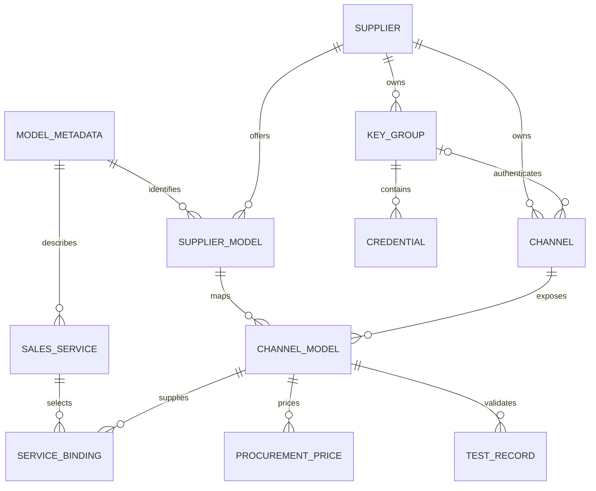

# MoMA 运营后台模型接入优化 Spec

| 项目 | 内容 |
| --- | --- |
| 文档版本 | 五模块管理端同步版 · 2026-11-06 |
| 文档状态 | 当前页面以五模块计划和 PAGE-SPEC 为准；历史四步首次上架目标已被替换，实际验证见实施台账 |
| 适用范围 | MoMA 运营后台；以独立 5.12.0 原型为现状基线 |
| 主要读者 | 产品、交互设计、前端、后端、网关、测试人员 |
| 本次交付 | 功能流程、页面规格、业务规则、数据与接口契约、实施范围、验收用例 |
| 实施边界 | 五模块管理端本地实现与验证，按用户要求本地提交留档；不自动推送、部署或清除存量数据，真人试用另行安排 |

## 1. 目标与核心决策

当前设计依据为[五模块执行计划](MODEL_OPERATIONS_REORGANIZATION_PLAN.md)。先完成内部使用的接入、服务、调用授权、模拟验证与技术启用，再按需维护成本、售价及销售；不新增租户身份、用户 Key、成员权限或跨端调用接口。

### 1.1 当前决定

1. 模型运营同级入口为渠道接入、模型服务、模型成本、模型售价、模型资料；模型服务为默认入口。
2. 新建服务从已登记供应模型选择唯一主档，明确服务模式及用途；不提供全局接入并上架四步主入口。旧任务记录保留，从对应模块带对象继续配置。
3. 渠道接入保留服务商／模型视角、服务商、模型登记、渠道、共享密钥及专业批量维护。
4. 渠道维护连接、上游凭证和映射；成本归属供给来源及模型关联；服务维护身份、路由、用途及现有模型级调用范围；售价维护价格及独立销售对象。
5. 未提交输入不改变客户当前配置；测试明确授权范围和用量，不自动发布。每项日常任务独立预览和发布，不夹带其他任务输入。
6. 路由、技术验证及启用、价格发布和销售上架分别确认。技术启用不要求采购价、售价、订单或销售上架；销售上架要求技术已启用和经营条件有效。
7. 备用供应满足必要采购条件和有效检查即可完成，明确未加入路由；投入当前服务另需关联、验证及发布路由。
8. 售价发布成功后立即影响后续新请求，含已有订购客户；历史和已开始请求保留原快照，展示与两条调用计价路径使用同一有效版本。
9. 停用技术服务与停止销售独立；停服保留销售配置但阻断新增上架，停售不连带停服。历史和稳定引用保留，恢复时重新检查。
10. 共享展示资料预览不更新客户，明确发布后同步引用；能力变化先检查、重验或明确下架不兼容服务。共享连接和 Key 继续候选测试、完整范围确认和原子应用。
11. 超时先核对原操作结果，冲突保留输入，离开仅提供放弃本次修改／继续编辑。不重复创建、不自动付费重试，不丢历史。

### 1.2 成功标准

验收使用[五模块计划验收矩阵](MODEL_ONBOARDING_ACCEPTANCE.md#五模块管理端验收2026-11-06)，与历史 UX／AC 成绩分别记录；实际结果和未覆盖范围见实施台账。

## 2. 现状证据、竞品依据与约束

### 2.1 现状与问题的准确边界

本轮只调整管理端结构、价格归属和技术／销售边界。旧 UX 设计用于追溯，不恢复已删除入口。独立 D1 后端与租户浏览器数据的衔接仍未完成，模拟通过不代表真实上游、用户调用或计费贯通。

早期问题清单、旧实施次序及 AC 原始定义见 [同步前规格快照](docs/history/MODEL_ONBOARDING_SPEC_PRE_UX_V1_20261101.md)。该快照只供追溯，不与当前目标同时生效。

### 2.2 竞品依据与采纳范围

| 产品／官方来源 | 可借鉴的已文档化行为 | MoMA 设计选择 |
| --- | --- | --- |
| [LiteLLM 快速接入](https://docs.litellm.ai/docs/proxy/docker_quick_start) | 选择 Provider 和模型，配置凭证，连接测试后添加 | 接入围绕可调用配置组织；使用接口预设减少填写 |
| [LiteLLM 模型管理](https://docs.litellm.ai/docs/proxy/model_management) | 可复用命名凭证；凭证字段随 Provider 变化 | 复用现有密钥组；将商业服务商与技术接口类型区分 |
| [LiteLLM 健康检查](https://docs.litellm.ai/docs/proxy/health) | 真实模型检查、错误详情、检查时间 | 测试结果必须有来源、范围和版本，保留失败诊断 |
| [New API 渠道管理](https://docs.newapi.pro/zh/docs/guide/feature-guide/admin/channel) | 渠道聚合服务商类型、密钥、模型；支持测试、模型映射和批量操作 | 一个连接配置对应多个模型映射；基础操作与高级配置分层 |
| [New API 模型管理](https://docs.newapi.pro/zh/docs/guide/feature-guide/admin/model) | 上游同步先预览新增、变更、删除，再应用 | 发现与同步都必须经过匹配和影响预览 |
| [New API 获取上游模型列表](https://docs.newapi.pro/zh/docs/api/management/channel-management/channel-fetch_models-id-get) | 管理侧获取渠道上游模型列表 | 模型发现由服务端执行，不能依赖浏览器跨域直连 |

历史资料核对日期：2026-10-30；本轮未重新核验竞品。依据为当时官方文档，不代表对所有版本、所有服务商或商业版本能力做了实测。内置参考目录不等于账号已授权目录；上游返回列表也不等于逐个调用已成功。

不照搬竞品的倍率计费或所有高级开关，不以技术 Provider 替代 MoMA 的采购服务商，也不把自动发现的模型直接变成在售服务。

### 2.3 必须保留的现有约定

| 约束 | 本稿遵循方式 |
| --- | --- |
| 三个独立添加入口 | 保留能力与直接打开行为；供应关系入口明确称“添加供应模型”，与首次主入口区分 |
| 模型／服务商双视图 | 保留视图切换；同一对象和同一数据源，不复制业务记录 |
| 渠道名称为文本，新渠道 ID 自动生成 | 名称不改成已有渠道选择框，不提供用户手填内部 ID |
| 默认密钥组不可删除，其他组删除须无密钥且无引用 | 保留前端提示与服务端约束 |
| 行操作的对象与边界 | 测试、维护、复制、启停、关联与移除等动作明确对应记录；数据列只读 |
| 统一资料身份 | 不按相似名称合并；供应模型必须引用资料主档 |
| 供应和销售价格分离 | 成本不自动生成客户售价，切换供给不自动改客户单价 |
| 运营配置业务，运维监控故障 | 不把接入配置职责移给运维 |
| 服务模式和服务内路由 | 不改变当前模式切换影响，不新增独立路由入口 |
| 正式产品文案 | 产品页面不增加“原型／模拟”常驻标签；证据来源和未接通边界写入研发文档 |
| 版本隔离和数据保护 | 不改其他版本，不重置浏览器记录，不隐式迁移或清除数据 |

五模块分别承担自己的配置维护；跨页保留稳定对象、筛选与页签，复用原保存、检测、候选应用及价格版本能力，不重复建设。

## 3. 范围、角色与权限

### 3.1 功能范围

本期目标为五模块、内部和经营两条管理端流程。复用 Workers／D1、连接验证、路由、角色、价格历史及审计；不迁移用户侧订购、身份、Key、调用或计费。生产状态和性能不能用本地结果替代。

不包括：新建推理集群、下载模型权重、服务商开户或充值、合同审批、客户订购/计费系统整体重做（仅落实本基线明确的下架准入与调价边界）、任意协议转换器、脚本插件市场、自动最优采购、重构全部路由算法。

定时模型同步、后台周期探测和多 Key 自动轮询作为后续扩展。第一期提供手动发现、手动复测和现有运行指标的关联查看，不用这些后续能力阻塞核心接入交付。

### 3.2 权限矩阵

| 动作 | 系统管理员 | 运营 | 运维 |
| --- | --- | --- | --- |
| 查看供应与采购配置 | 可 | 可 | 不新增供应后台访问权 |
| 创建服务商、资料、渠道、模型映射 | 可 | 可 | 不可 |
| 新增、替换或停用服务商凭证 | 可 | 可，沿用现有动作权限 | 不可 |
| 发现模型、执行接入测试、启停 | 可 | 可 | 不通过本模块执行 |
| 配采购价、销售价、服务关联、路由、上架 | 可 | 可 | 不可 |
| 查看调用故障和请求追踪 | 按已有权限 | 接入结果摘要；不扩大客户日志权限 | 沿用运维监控权限 |

后端必须校验动作权限及服务商归属。隐藏按钮、角色切换控件和前端事务校验不构成生产鉴权。

## 4. 业务对象与术语

### 4.1 对象定义

| 对象 | 职责 | 不能承载的内容 |
| --- | --- | --- |
| 模型资料 | 统一模型身份、名称、业务编码、类型和参考能力 | 凭证、渠道启停、客户售价 |
| 服务商 | 直接采购主体、自建供给主体及基本资料 | 不能自动等同模型研发厂商或协议适配器 |
| 供应模型 | 某服务商声明提供某模型资料的关系 | 不等于已接通，不隐含渠道 |
| 渠道 | 一个服务商下的连接配置：接口类型、地址、凭证引用及连接限制 | 不拥有独立零售价格，不与 API Key 一对一绑定 |
| 渠道模型映射 | 某模型通过某渠道实际调用的上游 ID、任务、能力限制及采购价引用 | 不创建新的模型资料身份 |
| 密钥组 | 同服务商凭证的组织与引用单元 | 不作为跨服务商凭证共享方式 |
| 接入测试记录 | 针对指定配置、凭证及模型的不可变验证证据 | 不是永久可用承诺或 SLA |
| 销售服务 | 对外模型 ID、服务模式、客户价格、权限范围和允许供给 | 不保存一份复制的上游密钥 |

“接口类型”是面向运营的技术选项，例如 OpenAI 兼容、Anthropic 原生。“服务商”仍指实际采购关系。同一服务商可以拥有多个接口类型的渠道。

界面在采购侧统一称“采购价”；历史“服务商售价／渠道售价”属于上游向 MoMA 报价，不得与模型服务的“平台售价”混淆。文案调整不改变历史金额、币种或单位。

### 4.2 关系图



无需把图中每项机械实现成新表。已有结构能表达的对象继续复用；内部模型资料 ID、业务编码、上游模型标识 和对外模型 ID 必须保持不同语义。

### 4.3 关键不变量

- 每个渠道只归属一个服务商，创建后不得改归属。改服务商需要新建渠道和显式重新关联。
- 一个渠道可以关联多个模型；同一模型可以关联多家服务商和多个渠道。
- 第一阶段，同一渠道与同一模型资料只允许一条有效映射。需要同模型的多个上游部署时，创建不同渠道；不引入隐式版本覆盖。
- 同一服务商下渠道名称去除首尾空白后唯一，允许中文、数字和常用符号。名称变化不改变内部 ID。
- 同一渠道不允许把一个上游模型标识 重复保存为多个模型资料。发现重复时要求修正，不自动合并资料。
- 上游模型标识 保留大小写和 `/`、`.`、`:`、`-` 等合法字符；不套用平台资料编码的校验。禁止控制字符和空白，长度沿用 1–200 字符。
- 上游名称变化不能自动更改已对外使用的模型 ID。
- 新渠道和新映射保存后默认未启用；测试不改变启停状态。
- 资料不完整、技术可用、成本完整、服务已上架为不同判断，不共用一个布尔字段。

### 4.4 贯穿示例

以下仅用于说明关系，不是实际服务商或已部署模型。

| 对象 | 示例 |
| --- | --- |
| 统一模型资料 | 名称 Alpha Chat，业务编码 `alpha-chat`，内部资料 ID `model-001` |
| 服务商甲的渠道一 | 名称“甲方生产账号”，OpenAI 兼容，根地址 `https://gateway.example.com/v1` |
| 渠道一的模型映射 | 引用 `model-001`，上游模型标识 `vendor/alpha-chat-v2`，采购价属于此映射 |
| 渠道一的第二个模型 | 引用向量模型资料 `model-002`，使用同一地址和密钥组，走 Embeddings 任务 |
| 服务商乙的渠道二 | 同样引用 `model-001`，但上游 ID、凭证及采购价独立 |
| 统一销售服务 | 对外 ID `moma/alpha-chat`，引用两条已准入映射，拥有独立对外售价 |

客户发送 `moma/alpha-chat`，平台按已发布策略选渠道一，发往上游时替换为 `vendor/alpha-chat-v2`。客户按销售服务计费，平台成本按渠道一映射的采购价计算。下一次选择渠道二不改变客户对外模型 ID 或单价。

渠道一的文本测试成功不能替代向量测试。服务商乙在上游发布了新版本，也不能仅因名称相似而改绑 `model-001`。

## 5. 信息架构与页面规格

### 5.1 导航与模型工作区

模型运营依次为渠道接入、模型服务、模型成本、模型售价、模型资料。服务详情依次为服务概览、渠道与路由、调用授权、验证与调用、操作记录；不新增独立路由或任务中心。

概览直接从时间筛选开始展示统计，不设置当前运营任务汇总。接入、未完成任务、待发布变更及供应异常在模型或服务商工作区处理，不因首次登录强制新建。

渠道接入保留服务商、供应模型、渠道、共享密钥和双资源视角；新建服务在模型服务中引用已接入模型。售价／成本编辑在独立模块，不复制主档或报价。

面包屑、步骤标题和返回语义见 [页面规格](PAGE-SPEC.md)。跨共享资源维护返回原模型、页签、筛选；未提交输入离开前明确确认；不存在对象不静默替换。元数据不复制为另一份主档。

### 5.2 供应详情表

| 列 | 内容与交互 |
| --- | --- |
| 模型 | 主档名称／编码；模型视图中不重复固定的当前模型列 |
| 服务商 | 主体名称；服务商视图中不重复固定的当前服务商列 |
| 渠道 | 仅名称和 ID；共享模型数量放详情，不堆入名称单元格 |
| 上游模型标识 | 完整值可查看，主表长值截断；复制动作在操作列 |
| 接入状态 | 未测试、测试失败、待复测、未启用、可用、已停用等主状态 |
| 采购价 | 摘要；缺失显示“待配置”，明确免费显示“0”及单位 |
| 操作 | 测试、配置、启用／停用；次要动作在“更多”中 |

供应模型没有渠道时，显示“未配置渠道”，不伪造渠道占位记录。全局创建入口仍在页头，不在每个空行重复添加同名按钮。

单条映射详情保留当前对象上下文，内容分为“配置、测试记录、关联服务”。共享渠道信息在配置区域呈现一次。渠道级与映射级动作明确分组，执行前展示影响范围。

批量工具栏只在选中记录后出现，可测试、启用符合条件项、停用。跨页选择由显式“选择全部筛选结果”触发，不能把本页全选解释为全部。执行时固定对象 ID 清单。

### 5.3 创建流程框架

独立资源保留表单、校验与保存／取消。以下框架只说明渠道及模型接入子任务，不构成四步上架向导；接入完成后进入模型服务配置技术能力。

```text
添加渠道                                                关闭
配置接入  →  测试与启用
──────────────────────────────────────────────────────────
当前步骤内容；主体独立滚动；表格错误定位到行
──────────────────────────────────────────────────────────
取消／关闭                         保存接入／启用模型
```

按钮随阶段变化；同一区域只突出一个主动作。已有记录直接选择，目录外主体和模型在当前表单输入，不要求先完成独立登记向导。

主流程最多嵌套一层短表单，用于添加服务商、密钥或模型资料。关闭子表单后恢复父表单输入和焦点，不叠加第三层模态框。

## 6. 供应子流程：创建新渠道并接入模型

### 6.1 进入与上下文

- 模型视图进入：预选当前模型资料；服务商未唯一确定时要求选择，不猜测。
- 服务商视图进入：预选当前服务商；同页可选一个或多个模型。
- 已有供应模型不是前置条件；保存渠道与映射时原子补齐缺少的供应关系。
- 有未保存输入时切换服务商或接口类型，要提示将清除的字段。取消切换保留全部输入。
- 未发生修改时可直接关闭；未提交修改通过继续编辑或放弃本次修改处理。

### 6.2 配置接入：连接与主体

| 字段 | 必填与默认 | 规则 |
| --- | --- | --- |
| 服务商 | 必填；按进入上下文带入 | 优先选择已有主体；从模板新增与自定义新增为明确动作；疑似重复提示复用，不按相似名称合并 |
| 渠道名称 | 必填；可按服务商自动建议新名称 | 文本输入，1–60 字；可修改，重复时定位名称错误 |
| 渠道 ID | 只读 | 新对象保存后生成，保持现有稳定 ID 和展示规则 |
| 接口类型 | 必填；优先使用服务商预设；直接输入新服务商默认 OpenAI 兼容且可修改 | 与模型类型无关；所有创建／编辑入口共用选项与校验 |
| 服务根地址／任务地址 | 由接口类型决定 | 预设可带默认值但须可核对；不得默默把用户地址换成另一域名 |
| API 密钥 | 认证接口需要可用 Key | 可复用当前服务商组，或内联填写新 Key 随接入保存；空组不能执行测试 |
| 无需认证 | 仅自建接口且部署策略允许 | 显式选择；不得用空 Key 自动推断 |
| 高级连接设置 | 折叠 | 连接超时、账号请求限制及适配器支持的版本字段；不放销售路由权重 |

未提交内容仅保留在当前表单；完整配置通过校验后，主体、模型、渠道、密钥元数据和接入记录一次提交。明文 Key 不持久化。

渠道的连接和模型同页填写；之后按第 26 节五模块路径维护。保存前可显式获取上游模型；发现失败不阻止合法的手动接入，也不等于连接成功。

### 6.3 配置接入：模型选择与目录外输入

提供“获取上游模型”主动作和“手动添加”次动作。接口不支持发现时，直接呈现手动添加及可用的参考目录。

候选表：选择框、上游模型标识、来源、匹配模型资料、任务类型、处理状态、操作。

匹配规则：

1. 先用已维护的服务商／接口型号别名及明确业务编码匹配。
2. 精确匹配仍呈现给用户确认；相似名称只提供候选，不自动选中。
3. 多个候选显示“待确认”；没有候选显示“待关联资料”。
4. 用户可选已有主档，或原地新增最小资料；不能把上游 ID 当作新的平台主键。
5. 从模型视图带入的主档不能自动套给所有发现结果；只预选能明确对应的目标行。
6. 类型和接口任务冲突的行不能提交。发现结果未给类型时，要求运营选择，不默认全部为语言模型。

目录外快速接入只要求模型编码和模型类型；显示名称默认同编码，普通手动输入默认语言模型且可修改。上游模型标识 默认使用本次输入值，仍独立保存并允许改为实际调用别名。未填写的任务、输入／输出模态、上下文和工具能力保持未知，资料标为“待完善”，不按模型类型补造能力。单独的完整资料登记及编辑保留原校验；正式服务创建、能力承诺与上架继续检查必要资料和测试证据。

“参考目录”只是填写辅助，不宣称账号已开通。上游发现也只证明列表可见，仍需模型调用测试。

选中条目均完成映射后可保存。采购价在模型成本按同一供给对象配置，可暂缺；不默认复制其他服务商报价。

### 6.4 保存规则

“保存接入”和测试分成两个明确动作：

1. 保存阶段：一次事务创建渠道、选中映射及缺少的供应关系，默认停用；本表单内的新服务商、最小资料和脱敏 Key 一起提交，全部成功才保存。通过独立登记入口已经保存的资源继续保留。
2. 测试阶段：保存后由用户明确点击标明产生用量的测试按钮。测试失败不回滚已保存配置，显示逐项结果；保存本身不启动调用。

选中条目存在校验错误时不保存任何渠道或映射。可由用户明确取消选择错误行后提交其余行，不能自动跳过。

保存接入不自动启动测试。保存响应不确定时通过同一操作 ID 查询结果，不能重新生成渠道再提交。

### 6.5 测试与启用

- 按模型行显示排队、测试中、通过、失败、取消；顶部汇总使用“通过 18／失败 2／待执行 0”等真实数量。
- 可重试失败项、查看详情、返回修改，或关闭后稍后继续。
- 单模型新接入及向已有渠道新追加的一条映射，若从未启停、没有服务影响且验证仍有效，可直接明确点击“启用模型”；底层仍固定范围并完整预检。其他情况由用户选择通过项再确认启用，不自动勾选历史恢复集合。
- 启用前服务端重新验证版本、凭证和服务商状态。显示启用数量及采购价待补数量。
- 新渠道首次启用时，确认范围包含“启用本渠道及所选映射”，一次事务打开渠道和所选映射，其他映射保持未启用。不能只开映射却保留关闭的渠道，造成成功提示与实际状态不一致。
- 已停用渠道的恢复使用“启用渠道并启用所选”，列出可能恢复的服务引用；只恢复明确选中的映射，其余保持停用。不能借单条映射操作悄悄恢复整条渠道上的历史模型。
- 启用只确认技术供给资格；内部配置和模拟验证可无成本，经营上架另检查采购与售价。
- 子流程结束后返回原模型工作区或明确继续销售配置；备用准备与投入服务分别判定完成。技术启用不自动创建销售服务、不自动发布路由或上架。

## 7. 其他任务流程

### 7.1 只登记服务商

“添加服务商”只保存主体名称、编码、供给类型和选填联系方式、备注。不得强制填地址、Key、模型或价格。保存后可停留查看或主动添加渠道。

### 7.2 只登记供应模型

“添加供应模型”从统一资料库选择模型并选择服务商；批量入口位于该弹窗内部。保存只建立供应关系，不创建空渠道、不测试、不启用。

重复登记显示“已登记”，不能产生第二条相同关系。移除无渠道的供应关系不删除资料主档；重新登记不恢复已删除渠道。

### 7.3 向已有渠道添加关联模型

在渠道操作列“更多 → 添加关联模型”进入。展示渠道摘要和已有模型，不能在此编辑共享地址或凭证。

执行第 6.3–6.5 节，跳过连接配置。已有映射不可重复选择；发现时匹配到已有映射只用于展示，不自动覆盖上游 ID、能力或价格。

保存只新增明确选中的映射，不影响已有映射测试与启停，不发布任何服务路由。

### 7.4 同一模型增加第二条渠道

从“添加渠道”创建新连接，选择同一资料和服务商或另一服务商。新渠道独立测试、配置采购价和启用。

准备备用任务在必要采购条件和有效检查具备后可结束，明确尚未加入当前路由；投入服务任务由运营显式关联、决定权重/优先级/回退范围并发布。不得因发现更便宜渠道自动替换供给。

### 7.5 提交与退出

后台不提供草稿保存、自动恢复或丢弃入口。选择模型到配置连接在当前表单内继续，完整接入与任务记录一次提交；失败保留当前输入，不留下半份资源。日常售价、客户范围、资料及路由预览不写状态，确认后一次提交。

离开未提交页面只提供继续编辑或放弃本次修改；刷新不恢复输入。已完成的资源操作与历史保留，已接入任务可继续后续步骤；不恢复旧未提交表单。供应密钥仍只保存脱敏元数据。

## 8. 接口类型与地址契约

### 8.1 第一阶段支持矩阵

| 接口类型 | 地址配置 | 认证 | 模型发现 | 测试范围 |
| --- | --- | --- | --- | --- |
| OpenAI 兼容 | 服务根地址；例 `https://gateway.example.com/v1` | API Key 组；自建可显式无认证 | 适配器支持时请求模型列表 | Chat Completions、Embeddings；其他任务仅在适配器明确支持时开放 |
| Anthropic 原生 | 原生服务根地址及适配器要求的版本字段 | API Key 组 | 按适配器能力开放；不支持则手动 | Messages 及声明支持的流式／工具能力 |
| 自定义任务端点 | 选择已支持的请求／响应格式，填写该任务完整 URL | Key 组或受限无认证 | 默认不提供通用发现 | 仅所选格式支持的任务 |

自建推理是供给来源，不是独立协议。兼容 OpenAI 的自建服务选择 OpenAI 兼容；其他协议必须有明确适配器。

Gemini 原生、Azure、Bedrock、Vertex 等不能用“其他”冒充已支持。对应适配器未完成时不显示可用选项；新增适配器须带字段、认证、地址、发现、测试和用量解析的完整契约。本稿不承诺一次接通所有厂商。

### 8.2 地址规则

- 预设接口保存根地址，由适配器构造任务路径；不使用字符串猜测方式无限追加 `/v1` 或 `/chat/completions`。
- 粘贴了完整任务 URL 时，只有已知适配器能无歧义识别才提示“使用识别出的服务根地址”；由用户确认，不静默截断。
- 自定义模式的完整路径绑定任务；同一渠道可显式维护多个已支持任务地址。不同认证或主机安全边界须拆成不同渠道。
- 展示最终请求地址预览，但不展示认证值。检查 URL 长度、协议、控制字符、嵌入用户名密码；密钥不能放 URL 参数。
- 版本等合法查询参数只能通过适配器白名单字段构造；不能把任意查询串当作凭证载体。
- 正式生产的请求从后端发出。公网连接仅允许策略批准的目的地址；私有化内网地址按部署允许范围处理，不能一刀切禁止自建内网接口。
- 服务端验证 DNS 解析结果、重定向目标和出站策略；禁止云元数据及平台自身管理接口。跨目标重定向不能携带原凭证。

这些是新增服务端调用的信任边界要求，不代表现有浏览器原型已实现。

### 8.3 容量与超时

第一阶段沿用现有连接超时字段，并明确“连接配置上限”和“服务路由超时”分别属于不同对象。一次请求的有效超时不得大于任一适用上限。

共享账号限制由账号／密钥组维度聚合；模型级限制在映射层设置。不能把同一账号 100 RPM 配成 20 个模型各 100 RPM 而宣称合计可用 2000 RPM。未知额度显示“未配置”，不解释为无限供应能力。

路由权重、回退策略、重试次数仍在服务内路由维护；接入表单不再复制第二套开关。

## 9. 凭证与密钥组

### 9.1 复用规则

- 密钥组严格归属服务商；不同服务商不能通过输入组 ID 越权引用。
- 保留默认组及自建组、Key 替换／停用／移除、短展示 ID 和完整内部引用。
- 同一 Key 不同时加入多个组，沿用当前组分配语义。
- 第一阶段不新增自动轮询或自动备用 Key 语义。默认测试当前组内生效的主要 Key，必须记录实际使用的 Key ID 和版本。
- 若运行网关未来引入多 Key 调度，必须逐一验证参与调度的 Key 与模型权限；测试一个 Key 不能为整个组背书。

### 9.2 临时凭证测试

测试弹窗可选择临时密钥组，仅创建独立测试记录，不改变渠道配置和正式准入结果。临时测试通过不能点亮当前渠道的“已验证”状态。

“应用到渠道”是独立动作，必须经过共享影响预览和候选配置应用流程。当前渠道没有可用 Key 时保留当前输入，发现、测试、启用均显示具体阻塞原因。

### 9.3 凭证安全与撤销

生产实现只向前端返回脱敏预览和引用。明文写入服务端受控密钥存储；不写入 localStorage、错误响应、下载文件或审计差异。复用现有掩码规则，不改变既有 ID。

正常轮换通过“新增凭证版本 → 测试 → 应用”完成。紧急停用属于显式中断操作：立即阻止该凭证的新调用，影响范围包括所有引用渠道；不能为维持可用性继续使用已撤销的 Key。

默认组主要 Key 的改变不是无害排序：必须列出受影响渠道和模型，验证候选版本后再应用；若直接停用旧 Key，则相关映射立即转为不可用，路由按既有策略处理。

共享组采用带版本的凭证快照。编辑主要 Key 或替换 Key 先生成候选组版本，运行请求继续解析当前生效版本；测试显式指定候选版本。正常应用覆盖该组的完整引用集合，校验所有在线映射后原子切换组版本并刷新受影响资格，不能通过先改全局 Key 再逐渠道测试来实现。没有测到的非在线映射转为待复测。撤销标记独立于版本快照，旧版本也必须遵守，不能通过保留快照绕过撤销。

## 10. 模型发现、同步与身份匹配

### 10.1 一次发现

发现使用配置快照和指定凭证版本。返回发现时间、来源、分页完整性、候选 ID 及上游明确提供的字段。

不得推断列表里不存在的价格、上下文和能力。未知为未知，不能填 `0`、`false` 或“全支持”。

| 结果 | 用户反馈 | 是否能继续手动接入 |
| --- | --- | --- |
| 成功且有模型 | 展示候选，默认不全选 | 能 |
| 成功但为空 | “未返回模型”，可核对权限或手动添加 | 能 |
| 不支持发现 | 提供手动添加／参考目录 | 能 |
| 401／403 | 凭证或权限错误，保留输入 | 保留当前输入；不能按通过处理 |
| 超时／网络失败 | 显示请求阶段，允许重试 | 能 |
| 仅取得部分分页 | 标明未完整获取；已返回项可选 | 能；不得据此判断模型删除 |

### 10.2 更新已有渠道目录

“检查模型变更”在已有渠道操作中执行，结果分为新增、已存在、疑似移除和属性差异。

- 新增：运营选择并映射后添加，默认停用。
- 已存在：保持当前映射、价格、服务关联不变。
- 疑似移除：仅在成功取得完整列表时提示，仍不能自动删除、停用或下架；可单独测试核实。
- 属性差异：展示来源和前后值；不能覆盖运营维护的模型主档或采购合同价。

应用前再次检查渠道版本及权限。返回列表与应用之间配置发生变化，要求重新发现或明确重新验证，不使用旧预览覆盖。

定时同步后续仍遵循“生成差异，不自动发布”的边界。

## 11. 测试与诊断规格

### 11.1 三层验证

| 层级 | 检查内容 | 能证明什么 | 不能证明什么 |
| --- | --- | --- | --- |
| 配置检查 | 必填、地址、认证引用、格式、模型匹配 | 配置结构可执行 | 不能证明网络、账号和模型可用 |
| 上游模型测试 | 对指定模型发送最小有效请求并解析响应 | 本次配置下该任务调用成功 | 不证明永久可用、全部 Key 有权限或全部能力支持 |
| 平台试调用 | 使用候选服务配置及受限测试身份，经过平台鉴权、路由、适配、计量 | 候选服务端到端链路能工作 | 不证明所有客户权限、全部路由分支或生产负载表现 |

不存在通用“探测根 URL 返回 200 即渠道通过”的规则。一个模型成功不能使同渠道其他模型自动通过。

### 11.2 各任务最小探针

| 任务 | 最小验证内容 | 通过判据 |
| --- | --- | --- |
| 文本／Messages | 短输入、限制输出 | 状态和响应结构有效，能取到该任务有效输出 |
| 向量 | 一条短文本 | 返回非空、有限数值向量；维度与明确配置相符 |
| 重排 | 查询及少量候选文档 | 返回合法索引和分数；数量与范围有效 |
| 图像理解 | 受控小图片及短问题 | 可处理指定输入类型，返回合法响应 |
| 图片生成 | 最小支持尺寸、数量 1 | 得到可访问或可解码的有效产物 |
| 语音识别／合成 | 受控短音频／短文本 | 分别得到转写／有效音频，不能用 chat 成功代替 |
| 视频及异步任务 | 最小支持任务，跟踪任务状态 | 创建成功只算进行中；取得成功终态与有效结果才通过 |

适配器没有对应探针时显示“暂不支持此任务测试”，不能伪造通过。该任务不能获得正式可发布资格，直到完整链路可验收。

流式、工具调用、结构化输出等按服务承诺按需增加专项测试。运行时能力取“主档参考能力、适配器能力、渠道实测／明确限制”的交集；冲突提示具体项。

### 11.3 测试记录字段

必须保存：测试 ID、操作者、服务商／渠道／映射 ID、配置版本、凭证 ID 与版本、任务与测试模板版本、开始结束时间、请求阶段、结果、状态码、耗时、上游请求 ID（如有）、平台追踪 ID、脱敏错误、用量及费用可得性。

结果枚举：排队、执行中、通过、失败、已取消、结果未知。异步超时但上游可能仍在执行时使用“结果未知”，不认定零消耗。

详情默认展示结论、失败位置和建议；技术详情折叠。仅保存受控探针所需的脱敏摘要，不记录用户生产提示词或完整 Key。

### 11.4 批量测试与费用

本稿建议默认：每渠道并发 2、每次最多 50 个模型；超过上限拆批。普通同步探针超时 30 秒，异步任务允许最长观察 10 分钟；这些是待负载验证的产品默认值，不是业界标准。

首次点击测试时展示本次模型数、任务类型、单次探针上限及“产生上游用量”。费用可算则展示估算；缺价显示“费用未知”，不能显示为免费。图片、视频等高成本任务需明确勾选，不被“测试全部”隐式包含。

测试不自动重试生成请求。人工重试前提示前次可能已产生用量；异步接口有任务 ID 时优先查询现有任务，不能再次创建。

取消停止尚未派发的测试；已提交请求尽力取消并继续记录结果。关闭弹窗不等于取消任务，再打开可查看后台进度。

### 11.5 错误分类

| 错误 | 建议动作 |
| --- | --- |
| 地址／TLS／DNS／网络不可达 | 核对最终地址、网络范围与证书；不建议关闭 TLS 校验 |
| 401 | 检查密钥有效性和认证方式 |
| 403 | 检查模型授权、账号范围或来源限制；不能一律归为 Key 错误 |
| 404／模型不存在 | 区分接口路径与模型 ID，核对大小写、部署 ID |
| 429 | 显示限流及可得重试时间；不立即停用整个服务商 |
| 余额／配额不足 | 展示上游明确返回的错误，提示检查供应账号 |
| 协议解析失败 | 核对接口类型、任务和实际响应格式 |
| 超时／结果未知 | 保留追踪 ID；避免重复付费请求 |
| 本地配置已变化 | 结果存入历史，标“旧配置结果”，不得更新当前准入 |

## 12. 状态、准入与失效规则

### 12.1 状态分维度保存

服务生命周期使用未上架／已上架／已下架；接入任务使用实际阶段与阻塞项，编辑区区分未提交修改和已生效。下表供供应明细使用，不将所有维度堆在模型清单。结果未知先核对，不等同失败或成功。

| 维度 | 状态 |
| --- | --- |
| 配置 | 待完善、完整 |
| 管理启停 | 未启用、已启用、已停用 |
| 资格验证 | 未测试、通过、失败、待复测 |
| 运行健康 | 未知、正常、异常；来自近期真实请求或探测 |
| 采购价 | 待配置、有效、明确免费、已失效 |
| 服务使用 | 未关联、已关联、已被生效路由引用 |

“测试中”是任务状态，不覆盖旧的有效证据。测试历史和运行健康分别保存；一次排障测试失败不能隐式执行停用或下架。

### 12.2 派生判断

**可执行测试**：权限满足 ∧ 配置完整 ∧ 有可用凭证或合法无认证 ∧ 适配器支持该任务。

**技术可用**：服务商启用 ∧ 渠道启用 ∧ 映射启用 ∧ 当前配置和凭证具备有效基础测试证据 ∧ 无明确撤销或不兼容阻塞。

**可作为服务正式供给**：技术可用 ∧ 必需能力满足服务承诺 ∧ 采购计费项完整且可核算 ∧ 服务显式授权该映射。

**当前可被调度**：可作为服务正式供给 ∧ 生效路由包含该映射 ∧ 服务和客户权限允许 ∧ 路由运行时健康、容量等规则允许。

价格待补不会影响“技术可用”，但会阻止“可作为服务正式供给”。此差异通过采购价列和服务选择器的禁用原因表达，不增加第三套模糊的“可用”标签。

### 12.3 资格证据有效性

验证签名至少包含：接口类型及适配器版本、规范化地址、认证模式、实际凭证 ID／版本、上游模型标识、任务、影响请求的参数与映射能力版本。

只有该签名匹配，且所需专项测试通过，才能用于相应准入。名称、备注、采购金额变化不使连接测试失效。

接入证据不按固定天数自动下架；界面展示检查时间。发布／应用候选配置前要求最近 24 小时内的当前签名证据；该窗口为本稿默认建议。存量流量的异常摘除由既有运行策略决定，不由证据时间直接执行。

新增启用、重新启用、应用候选和发布时，对每个必需测试项采用该签名下最近一次已完成的真实结果，必须为通过；不能在新失败后挑选更早成功放行。排队、执行中、取消和无有效响应的“结果未知”不产生新的通过证据，并阻止本次发布性动作，直到明确复测。现有在线资格不因一次人工排障任务直接执行启停；其运行故障仍由当前策略处理，凭证撤销、协议确定不兼容等硬阻塞立即生效。

### 12.4 变化影响矩阵

| 变化 | 测试影响 | 服务影响 |
| --- | --- | --- |
| 渠道名称、主体备注 | 不失效 | 不改 ID、售价和路由 |
| 地址、接口类型、认证参数、适配器请求行为 | 相关映射须重新测试 | 线上先测候选配置，通过后明确应用 |
| 主要 Key／Key 版本替换 | 使用该凭证的映射须重新测试 | 正常轮换不提前撤销当前版；紧急撤销立即阻止新调用 |
| 上游模型标识、任务变更 | 当前映射全部相关测试失效 | 已被服务引用时禁止直接改；新建替代映射／渠道再显式切换 |
| 主档展示内容变更 | 不清除连接证据 | 未提交输入不改客户展示，预览共享影响并明确发布后同步引用 |
| 主档对外能力变更 | 受影响能力重新验证 | 先核对共享影响；不兼容依赖修复或明确下架后发布，未提交输入不使在线服务失效 |
| 采购价变化 | 基础连接证据不失效 | 更新成本核算；成本路由可比性重新校验，不能改客户售价 |
| 销售价变化 | 不影响上游连接证据；检查相关发布依赖 | 预览不生效；发布成功后新请求用新价，历史/在途保持原快照，客户展示与两条调用路径一致 |
| 临时组测试 | 不改变正式证据 | 不改变任何生效配置 |
| 模型发现列表变化 | 不自动失效 | 生成差异待处理，不自动删除或换模型 |

## 13. 在线变更、启停与删除

### 13.1 共享渠道变更

编辑地址或凭证时先展示：受影响模型数量、已启用映射、关联服务、当前生效路由和是否存在替代供给。详细清单按需展开。

未被生效服务引用的渠道可保存新配置并使相关测试失效；保存不会自动启用。

被生效服务引用的渠道创建候选配置，原配置继续服务。候选测试必须覆盖所有当前启用且被线上引用的映射。失败或未完成时禁止正常应用，原配置保留。

应用时校验当前版本、引用清单、凭证状态和测试证据；期间新增了受影响模型则要求补测。应用为一次原子切换，新请求使用新版本；执行中的请求保留其已选版本用于追踪与成本记录。

切换后只有与候选签名一致的测试可成为当前资格。未覆盖的非在线映射保留配置和历史，但进入待复测，不能继承旧版通过状态。

正常应用不改变采购主体、客户售价、服务绑定和路由策略。无法在不中断的前提下完成时，用户可先显式停用相关供给，再按离线配置规则处理；不能把“强制应用”做成绕过校验按钮。

### 13.2 停用与紧急撤销

停用单条模型映射只影响该模型；停用渠道影响全部映射；停用服务商影响其全部渠道。界面必须明确动作对象。

存在服务引用时展示数量、无可用替代的服务及影响。用户确认后停止新请求；不删除绑定、不改客户价、不自动把另一家服务商加入允许范围。

既有回退仅在已发布路由允许范围内执行。无可用渠道时返回明确不可用，不伪造成功，不擅自跨服务模式或授权范围回退。

### 13.3 删除与解除关联

- 有模型映射的渠道不能删除；有活动服务或生效路由引用的映射不能删除。
- 解除服务关联不删除上游渠道、密钥或采购历史。
- 删除模型资料前检查供应、服务和生效路由引用。
- 默认密钥组不可删除；自建组必须无密钥且无渠道引用。
- 被引用的 Key 应先移除引用或替换，不能留下悬空引用。
- 软删除与历史留存使用现有产品策略，不因本稿主动删除历史数据。

### 13.4 回滚

配置回滚以新的操作引用已存在旧版本，不删除新版本历史。回滚前检查旧凭证未撤销、地址仍获准、模型映射和服务约束仍成立，并重新取得有效测试证据。

不能把“回滚配置”描述为恢复上游已失效的 Key。候选变更尚未应用时，放弃候选即可，当前配置不变。

## 14. 采购价、销售服务与平台验收

### 14.1 采购价

采购价属于渠道模型映射，至少包含计费项、适用条件、单位、币种、单价和生效版本。名称采用采购语义；允许明确复制同服务商的报价到当前表单，但不能跨服务商自动继承。

“未配置”与“免费”分开。零价须显式输入，未知价不能自动填零。保存金额沿用既有精度，客户端显示转换不得改变计费值。

新采购价经预览确认发布，按生效时间选用，不重算已完成请求。适用版本到期且无接续时成本待核算，不能默用过期价；经营上架阻断，后台普通技术验证及内部启用可继续。

采购和销售计费项可以不同，但发布前必须存在可执行的用量计量与计费规则。缺失计量依据不能靠字段名称相近自动换算；本稿不新增通用任意单位换算引擎。

### 14.2 模型工作区与独立任务发布

接入渠道后进入模型服务建立或维护技术配置。旧任务记录保留并定位当前渠道、资料及服务，删除任务中的第二套资料／价格编辑。

服务模式明确选择统一服务或分服务商，与内部／经营用途独立。切换模式按原下架与原子重置执行；用途切换先停服停售并核对活动商业依赖，不重写权益。

资料、调用范围、路由、成本、售价和销售设置在所属模块独立预览和提交；不夹带其他任务输入，共享连接和 Key 仍走候选测试与明确应用。

售价发布成功后立即作用于后续新请求，包括已有订购客户；请求开始时冻结版本，内部重试及历史不追算。原浏览器演示内的后台模拟调用、mock 客户 API 和客户展示必须同一有效版本；本期管理端 D1 售价仅作用于管理端模拟试调用，租户端消费云端发布目录需另行接入；不增加预约调价或专属协议价。客户范围发布展示增删对象，移出客户不能用已有订购绕过新范围。

### 14.3 发布前检查顺序

1. 模型资料与服务模式有效，对外 ID 唯一且资料满足当前发布要求。
2. 服务已显式关联供给，所有参与候选路由的供给具备当前版本验证及能力证据。
3. 技术启用不要求价格；经营上架另查适用采购与销售计量、成本及售价。最低延迟等策略仍要求自身有效依据。
4. 调用授权按现有模型级有效客户校验，销售对象单独保存；不自动扩大任一集合。
5. 候选路由及配置版本一致，运行平台试调用并通过。
6. 显示差异和影响，明确提交当前任务，成功后再继续；技术启用和销售上架是两个动作。失败原子回退、保留输入和原有效配置。

### 14.4 平台试调用

使用平台生成的短期受限测试身份及候选服务版本，必须走与正式请求共用的鉴权、服务解析、适配和计量路径；仅允许指定服务和受控探针，不能成为通用管理员代理。

未上架服务只对该测试身份可访问。测试不临时向普通客户开放，也不将生产客户 Key 复制到浏览器。

必须记录：对外模型 ID、候选服务／路由版本、实际服务商、渠道、上游模型标识、认证结果、响应、可得用量、采购成本状态及适用价格版本；后台技术验证的销售费用为不适用。

测试使用平台测试账户，纳入独立测试用量，不扣真实客户余额或订购额度。现有模拟记录拿不到用量／费用时记“未知”或“待核算”，不得记零；本轮不产生真实上游费用验收结论。

每个候选分支先完成上游测试，平台试调用验证至少一条完整服务链及配置解析；不把一次命中宣称为全部分支都已执行。发布后可对已发布版本做受控复验并记录实际版本，不重复扣客户费。

缺少真实网关、平台鉴权或计量实现时，只能完成原型交互验收，不能判定生产接入完成。

## 15. 数据与应用接口契约

本节为逻辑契约，不宣称已有这些后端 API，也不强制为每个动作新建一个微服务。沿用现有后端路径规范实现。

### 15.1 最小数据要求

| 对象 | 关键字段 |
| --- | --- |
| 渠道 | ID、服务商 ID、名称、接口类型／适配器版本、地址模式／地址配置、认证模式／组引用、生效配置版本、候选版本、启停、修订号 |
| 渠道模型映射 | ID、渠道 ID、资料 ID、上游模型标识、任务、能力约束、采购价状态／版本、启停、修订号 |
| 凭证／密钥组版本 | ID、组／服务商归属、秘密存储引用、凭证版本、组生效／候选版本、主要 Key、掩码、启停／撤销、更新时间；不返回明文 |
| 发现快照 | ID、配置签名、发现时间、结果来源、完整性、候选及差异；不含秘密 |
| 测试任务／记录 | 批次 ID、各项状态、第 11.3 节证据字段、配置签名、是否临时凭证、证据来源 |
| 已接入任务 | 复用现有稳定任务和对象引用，明确首次/备用/投入目标、编辑范围、基础修订、已创建资源和最近操作结果；不含原始密钥 |
| 操作审计 | 操作 ID、操作者、对象／版本、动作、脱敏差异、影响集合、结果、关联测试与追踪 ID |

持久化测试历史不可被编辑覆盖。新测试写新记录，当前准入从有效记录派生。原型模拟证据与真实证据必须在数据上可区分，正式网关不得消费模拟证据。

### 15.2 应用操作

| 操作 | 输入要点 | 输出／副作用 |
| --- | --- | --- |
| 提交完整接入 | 完整配置、资源引用、基础修订 | 一次提交渠道、映射与已接入任务；失败不写入 |
| 发现上游模型 | 当前表单／渠道版本、凭证引用、适配器 | 发现任务／快照；不改业务模型 |
| 预校验接入批次 | 连接配置、选中映射、资料引用 | 逐字段／逐行错误及影响摘要 |
| 创建渠道与映射 | 操作 ID、预期修订、选中有效数据 | 原子创建；全部默认未启用 |
| 添加关联模型 | 已有渠道 ID／版本、选中映射 | 原子新增；不改已有映射 |
| 启动／取消测试 | 固定对象 ID、配置签名、探针集合 | 后台任务；取消尽力而为 |
| 启用映射 | 对象 ID、预期版本、测试证据 ID | 按执行时条件重新校验；不发布服务 |
| 创建／应用候选配置 | 当前版本、候选配置、测试、影响确认 | 创建候选或原子切换；不改售价和路由范围 |
| 停用／移除 | 对象类型、对象 ID、修订及影响确认 | 明确范围内停止／解除；受引用保护 |
| 平台试调用 | 服务候选版本、路由版本、测试身份 | 端到端证据和独立测试用量 |
| 预览/发布任务变更 | 对象、任务范围、基础修订、差异、必要证据 | 预览不生效；明确发布仅替换对应配置，不包含其他未提交表单 |
| 首次发布并上架 | 当前候选集合、最新依赖、试调用证据及最终确认 | 对客配置和上架状态整体成功；失败保留当前版本与独立资源 |
| 下架并停用/重新上架 | 服务、当前修订、影响范围；恢复附有效检查 | 下架阻止后续请求，已开始请求保持原快照；恢复不复活失效依赖 |

### 15.3 并发、幂等与批量语义

- 写操作带预期修订号；不一致返回冲突和最新摘要，不静默覆盖，不自动合并不同地址或价格。
- 创建操作采用幂等操作 ID；相同 ID 与相同内容返回原结果，不重复建渠道。相同 ID 与不同内容拒绝。
- 配置批量写入为原子事务；测试为独立异步任务，允许部分成功。两者不能共享一个笼统“成功”提示。
- 批量启用采用全选集预检并原子生效；某项已变化时返回失败项，用户重新选择后重试，不暗中只启用一部分。
- 测试启动后配置发生变化，旧结果只留历史；不能覆盖新配置的状态。
- HTTP 响应丢失时先按操作 ID 查询提交结果。没有确认前保留当前输入，不显示“保存成功”。
- 操作错误返回稳定业务码、字段／行定位、可读原因及追踪 ID；不可包含上游密钥或敏感响应头。

## 16. 交互状态、文案和可访问性

视觉按当前任务中用户选定的方向与参考实施，并核对[后台视觉实施与验收](../../docs/PAGE-SPEC.md#后台视觉实施与验收)。继续使用版本内组件，不修改前台共享样式。

| 状态 | 必须行为 |
| --- | --- |
| 空目录 | 解释无数据原因，保留三个入口；不填虚构模型或渠道 |
| 搜索无结果 | 保留条件与清除入口，不清空已选映射 |
| 发现／测试加载 | 本区域显示进度，可取消或离开查看其他内容，不锁全页 |
| 字段错误 | 错误紧邻字段；提交后定位首个错误，行错误保留原输入 |
| 保存失败 | 保留当前输入及选中项，不关闭弹窗 |
| 修订冲突 | 展示冲突对象；允许复制非敏感输入、重新载入后人工应用 |
| 权限被撤销 | 停止新动作，清除未保存敏感输入；不再显示可提交状态 |
| 长名称／长 ID | 表内截断且可查看完整值；复制、查看动作在操作列 |
| 只读 | 显示完整数据与阻塞原因，不通过降低透明度让正文难读 |

首次与日常主动作名：接入并上架模型、确认接入、预览变更、确认发布售价／客户范围／路由／资料、完成备用准备、确认发布并上架、确认下架并停用、确认重新上架。专业供应动作保留明确保存、测试、启用与应用含义；步骤标签不得与标题漂移，不保留目标随页签变化的通用保存。

成功后在区域持续显示真实对象、版本和生效时间，不只使用通知。结果未知先核对操作状态，禁止重复创建或自动重放有费用测试。统一结果文案示例：

- “已保存 1 个渠道、8 个模型映射。尚未启用。”
- “6 个通过，2 个失败。查看失败项。”
- “技术接入已启用；采购价待配置，暂不能用于正式服务。”
- “配置已变化，本次结果仅保留在测试记录中。”
- “渠道正被 3 项服务使用。应用前需完成 5 个模型的测试。”

不常驻解释普通控件规则，不堆叠“温馨提示”。真正的费用、不可逆影响和异常原因就近显示。

键盘要求：Tab 顺序与视觉顺序一致；表格选择可键盘执行；模态焦点圈定，关闭恢复触发点；批量进度和保存结果有可访问通知；颜色与图标不能成为唯一状态表达。

布局验收：1280×800、1440×900、1920×1080；表格内部横向滚动；弹窗只滚动主体，标题与页脚可达；长错误、长 URL、字体放大和嵌套弹窗均不遮挡动作。

## 17. 审计与可观测性

记录创建、修改、发现、测试、启停、报价发布、候选应用、回滚、删除和服务关联。发现／测试记录操作和结果，不记录秘密内容。

测试诊断使用统一追踪 ID，能关联到上游请求、适配器和平台试调用。没有实际性能数据时显示“—”，不使用测试探针耗时冒充生产 P95 或 SLA。

接入详情可展示最近成功时间、最近失败原因、当前配置版本、有效测试范围、受影响服务。完整调用成功率及生产故障监控继续归运维调用数据；运营只看被授权的接入摘要。

用量区分客户业务、平台接入测试、平台健康探测；后两者不计入客户业务成功率和客户账单，但实际服务商成本不得丢失。

## 18. 实施顺序与完成定义

当前实施次序见[五模块计划](MODEL_OPERATIONS_REORGANIZATION_PLAN.md)：P0 基线 → P1 技术／销售规则 → P2 内部管理流程 → P3 渠道／成本／资料归位 → P4 售价经营页面 → P5 管理端整体验收。结果见实施台账；不自动部署或宣称用户端闭环。

复用已有模块和依赖，替换受影响旧路径，不增加长期兼容层、迁移或数据重置。各阶段只验证受影响范围及必要集成，阶段检查成功后不无依据重复全量。

## 19. 当前代码影响面与数据处理边界

| 现有文件／区域 | 后续实施职责 |
| --- | --- |
| `ProviderManagement.jsx`、`SupplyModelView.jsx`、`ProviderCatalogue.jsx` | 三入口、双视图、批量选择、状态与操作列 |
| `SupplierChannelConfiguration.jsx`、`ModelOnboarding.jsx`、`ModelCosts.jsx`、`ModelPrices.jsx` | 复用接入及版本表单；旧记录定位当前资源，成本与售价独立维护 |
| `SupplierResourceDialogs.jsx` | 已有渠道关联入口、配置候选、影响确认、删除边界 |
| `SupplyModelPicker.jsx`、`ModelLibraryEditor.jsx`、`ModelMetadataForm.jsx` | 明确匹配、原地最小资料创建、正式发布资料要求 |
| `SupplierKeyGroupField.jsx`、`ProviderApiKeys.jsx`、`provider-key-groups.js` | 凭证引用、版本、临时测试和轮换影响 |
| `supplier-resources.js`、`provider-channels.js`、`provider-management.js`、`connection-state.js` | 保存与启用规则、调用签名、无价状态、批量原子写入 |
| `SupplierChannelTest.jsx` | 任务进度、逐项结果、专项测试与诊断 |
| `service-workspace.js`、`service-routing.js`、`ServiceContent.jsx`、`ServiceCallGuide.jsx` | 供给准入、回跳、平台试调用和发布检查 |
| `OperationsOverview.jsx`、导航与面包屑 | 经营统计、模型主入口、上下文与返回 |
| `model-operations.js`、`domain.js`、mock 发布/同步、客户准入与体验 | 分任务发布、价格一致性、下架新请求/在途边界、存储失败恢复 |
| 运营入门及研发说明 | 首次四阶段和日常任务、按钮与结果一致；正式帮助不放内部实现，研发说明区分 mock 和生产证据 |
| 定向测试与 fixtures | 不再以模拟成功断言真实可用；覆盖新状态与失败路径 |

本表是实施触达范围，不要求逐文件全部重写。所有改动限定独立 5.12.0；根 `src/` 和其他版本不随之变化。

现存完整 URL 记录不自动截断，旧 ID 不重新生成，现有价格不批量置空或合并。正式升级前需清点记录和引用，设计显式的数据处理计划并取得对应授权；本规格不提供自动数据迁移，也不以“删除旧兼容”名义删除业务记录。

旧模拟测试记录可留作原型历史，但不能转换成真实证据。生产切换必须重新测试拟接入供给；无法明确识别的旧记录保留并列为待处理，不按名称猜测归并。

## 20. 验收用例

当前验收定义维护于[五模块管理端矩阵](MODEL_ONBOARDING_ACCEPTANCE.md#五模块管理端验收2026-11-06)，使用 R01—R08；包含管理端状态、D1、角色、价格及历史、失败恢复、跨页和界面证据。实际结果见进度记录，历史 UX 和前台成绩不替代本轮。

原接入 AC01—AC74、前台联动 AC01—AC28 的定义与旧验证结果保留作历史追踪。旧行为与新目标冲突时修改对应断言并保留其他安全保护，不删除整个测试集来获得通过。原定义见 [同步前规格快照](docs/history/MODEL_ONBOARDING_SPEC_PRE_UX_V1_20261101.md)，旧证据见验收文档历史部分。

### 20.1 目标到验收的追踪

| 当前目标 | 规格位置 | 验收 |
| --- | --- | --- |
| 五模块及同源 D1 | 第 1、3、5、15 节 | R01 |
| 无价内部服务、用途及调用范围 | 第 12、14、26 节 | R02、R03 |
| 成本、售价、独立销售状态 | 第 14、15、26 节 | R04、R05 |
| 技术证据、候选与历史保护 | 第 9、12、13、15 节 | R06、R07 |
| 异常、返回、页面及构建 | 第 7、16、18 节 | R07、R08 |

## 21. 已确认决策与执行边界

本轮按用户确认的[五模块计划](MODEL_OPERATIONS_REORGANIZATION_PLAN.md)执行。身份、用户 Key、多层授权、用户侧 D1、实际调用及结算均已明确排除；不因历史 UX 范围扩大交付。复用稳定身份、现有后台权限、修订、原子提交、幂等及历史保护。

真实网关、生产凭证库、真实测试账号/预算及出站规则仍属于未来生产集成条件；不因此阻塞当前文档交付，也不视为已获生产调用授权。

## 22. 来源与文档维护

### 22.1 当前项目依据

- [项目后台规则](../../AGENTS.md)、[5.12.0 页面当前约束](PAGE-SPEC.md)：五模块、双供应视图、统一主档及管理端流程在页面规格维护；AGENTS 仅保留执行约束与阅读入口。
- [后台视觉实施与验收](../../docs/PAGE-SPEC.md#后台视觉实施与验收)：样式隔离、组件复用及界面检查要求，不等于本次已完成界面验收。
- [现有术语表](./GLOSSARY.md)：采用后追加的“统一服务／分服务商”定义；不恢复已被覆盖的逐渠道零售价方案。
- [旧设计访谈](./docs/model-supply-design.md)：仅作历史背景，其中旧待定项和代码事实不能覆盖当前规则。
- [供应入口](./src/admin-v2/ProviderManagement.jsx)、[渠道创建](./src/admin-v2/SupplierChannelConfiguration.jsx)、[资源编辑](./src/admin-v2/SupplierResourceDialogs.jsx)。
- [模型选择与原地资料创建](./src/admin-v2/SupplyModelPicker.jsx)、[资料表单](./src/admin-v2/ModelMetadataForm.jsx)。
- [渠道测试界面](./src/admin-v2/SupplierChannelTest.jsx)、[模拟测试与协议定义](./src/admin-v2/provider-management.js)。
- [供应事务与价格约束](./src/admin-v2/supplier-resources.js)、[渠道有效性](./src/admin-v2/provider-channels.js)、[密钥组](./src/admin-v2/provider-key-groups.js)。
- [服务关系与配置状态](./src/admin-v2/service-workspace.js)、[路由策略与校验](./src/admin-v2/service-routing.js)。

### 22.2 使用方式

本文、页面规格、术语表和验收要求按五模块范围同步；实际实现与验证只在适用进度记录登记，不用文档同步替代运行结果，历史完成记录不冒充本轮证据。

后续修订应注明：修改了哪条规则、影响哪个状态或流程、哪些验收用例随之变化。不要用新截图默默覆盖已确认的业务语义。

### 22.3 本次校验边界

本节只说明文档维护边界，代码和界面实际结果见进度记录。此前 mock 实施、浏览器走查与维护简化证据保留于历史台账。第 2.2 节为当时的官方资料依据，同期竞品观察见 `MODEL_ONBOARDING_REVIEW.md`；本轮不把这些旧记录当成新流程实测。

## 23. 目录外接入与日常维护简化（2026-10-31）

本节保留专业资源接入和候选维护的有效细节，供第 26 节完整任务复用。技术配置、测试、启用、应用和客户上架分别校验；技术启用与经营上架分开处理，不取消这些条件；旧动作数和完成记录不作为五模块验收。

### 23.1 目录外同页接入

1. 在添加渠道中直接输入新服务商名称。英文编码由保存事务生成并固定，不要求新手先命名内部编码，不从中文名推测主体，不自动合并同名服务商。
2. 模型行可直接输入目录外模型编码并核对类型。名称默认同编码，类型默认语言模型且可修改；上游 ID 默认联动，运营改写实际别名后保留该值。
3. 优先展示已有主体，从模板新增和自定义新增是明确动作，不把模板与已登记主体平铺为同类记录。资料可复用或明确新增；疑似重复提示复用，明确引用不按名称猜测，不能先创建再覆盖。
4. 新资料保留空任务、空模态、未知能力和“待完善”状态。基础技术测试与明确启用允许最低身份资料；不完整资料不能绕过正式服务的资料、能力、采购价、路由与平台发布检查。
5. 点击保存才原子创建必要主体、主档、脱敏 Key、渠道及映射。任一行、地址、凭证、权限或修订失败，整次提交不留下部分对象。取消表单不创建对象，也不删除其他入口明确保存的资源。
6. 未提交输入仅留在当前表单；完整配置一次提交，失败不产生资源；明文 Key 不持久化。

输入契约：`channelQuickCreate.data` 使用 `providerId | providerPresetId | newProvider:{name}`；每个 `values.models` 行使用 `libraryId | modelPresetId | newModel:{modelId,type,name?}`。模型资料 ID、平台业务编码和实际上游 ID 独立保存。新 Key 仅提交受控掩码、指纹及现有受支持元数据。

向已有渠道追加目录外模型使用同一事务，输入 `providerId` 与 `values:{endpointId,models}`。渠道必须属于该服务商；不允许夹带新主体、新 Key 或连接变更。新增资料和映射一起提交，原渠道和既有映射保留；本次提交必须引用同一渠道。

### 23.2 地址与 Key 维护

维护表单先显示当前值、候选值及影响范围。普通基础检查使用明确的“测试新配置（产生用量）”或“测试新密钥（产生用量）”：一次点击保存当前候选并发起该次测试，省去独立保存候选和同义用量勾选。高成本任务仍明确选择任务范围并授权；费用未知保持未知。

测试只作用于候选。当前配置继续生效；失败、取消、未知结果、断线、权限变化或持久化失败均不得覆盖当前配置，也不自动创建重试。任务可追踪和恢复，原提交 ID 与配置签名继续约束结果。

测试派发前也须复核保存候选时冻结的模型集合、渠道引用与服务影响版本；共享组的每个渠道启动前复核全组范围。期间增删模型、增加组引用渠道或改变服务引用，拒绝新任务并要求重新核对候选，不能先扩大发起测试再等应用时阻断。

通过后保留单独的明确“应用配置／应用密钥”动作。影响范围在该动作前可见，按钮点击提交当前冻结范围，不再重复出现一个同义的“确认应用”步骤。应用时仍校验当前配置版本、候选签名、映射集合、服务引用、凭证状态及最新结果；任何变化拒绝整次应用并要求重新检查。

### 23.3 专属与共享 Key 轮换

- 渠道专属 Key 按实际引用的 endpoint 轮换。新 Key 只绑定该渠道，不误改组主要 Key，不给同组或其他服务商的渠道换 Key。
- 密钥组主要 Key 按该组全部真实 `group`／`inherit` 引用维护；逐项显示受影响渠道、模型和服务，并完整验证后原子应用，不只测试第一条。
- 同一 Key 同时具有组引用与专属引用时，界面明确本次操作范围；不能把“替换 Key”默认为只修改共享组，也不能遗漏专属绑定后仍显示替换成功。
- 旧 Key 不因正常轮换自动撤销或删除。紧急撤销继续是独立动作，所有版本和引用均遵守撤销状态。
- 应用仅提升匹配本次候选证据的映射资格，未覆盖的非在线映射转待复测；客户售价、路由、开放范围和历史记录保留。
- Key 列表按真实绑定显示“当前绑定渠道”。未被渠道使用的备用 Key 可直接替换其脱敏资料，不使组引用渠道失效；组主要 Key 与专属绑定仍走候选验证。删除和紧急撤销继续使用完整保守引用检查，不能借当前使用数为零放宽保护。
- 从 Key 列表打开后固定本次轮换入口与所选渠道，应用成功不因旧 Key 已无当前引用而跳到另一个编辑器；保留成功结果、版本与新 Key ID。

### 23.4 追加模型与恢复路径

向已有渠道追加一个模型后，测试与启用只针对本次新增的固定映射。新追加且从未启停、没有服务影响的单映射可一次点击明确启用；不能借此启用既有兄弟映射。存在服务影响、历史恢复或多项选择时，展示固定范围并按既有完整预检提交。

列表、测试弹窗和详情中的恢复动作共用固定选择和有效性检查。移除只凭旧通过结果直达启用的旁路，避免不同入口采用不同恢复条件。测试通过仍不自动启用，启用或应用仍不自动上架。

### 23.5 动作数与验收

旧 5/6/9 项操作计数仅描述当时技术启用或候选应用路径，未包含完整销售上架，不能用作 UX v1.0 首次接入的时长或动作数承诺。历史定义与证据见 [旧规格快照](docs/history/MODEL_ONBOARDING_SPEC_PRE_UX_V1_20261101.md#235-动作数与验收) 和 [历史验收](MODEL_ONBOARDING_ACCEPTANCE.md)。

当前按 UX01—UX12 验收任务完成、对象识别、生效判断、异常恢复及数据一致性。记录真实新人试用的耗时、求助和误操作，不预设无依据的提升比例。

## 24. 模型运营概念与字段口径（2026-10-31）

运营入门先提供“接入并上架模型”的四阶段任务与日常维护路径，在需要决定的位置解释资料、供应和服务关系，不要求新人先学三个模块。关键名词可按需展开，支持键盘；入口、按钮、结果和失败恢复与当前工作区一致，不把内部实现或验收计数塞入步骤。

- 内部稳定关联标识称“资料 ID”；业务 `modelId` 称“模型编码”，保留各表单实际格式约束。服务商模型调用参数称“上游模型标识”，客户平台调用参数称“对外调用标识”，不强制三者同值或固定斜杠格式。
- 模型作者与直接采购服务商分开；服务商编码用于主体标识。渠道是一组接口、地址与认证配置，可关联多个模型；完整任务 URL 称“请求地址”，服务根地址与请求地址分别表达。
- 采购参考价、折扣系数、实际采购价、Token 成本与平台售价分别说明；不能把采购值标为服务商售价。分服务商模式下同一服务商的多个渠道共用平台售价。
- 当前绑定渠道数按配置绑定统计，不代表调用量。测试通过、启用模型、应用配置、发布配置与上架服务是不同结果，互不隐式替代。
- 模型资料导入 CSV 首两列表头统一“模型编码／模型名称”，模板、导入校验与错误信息同步；旧表头拒绝，需使用新模板。不重置或迁移既有业务记录。

权威术语见 [GLOSSARY.md](GLOSSARY.md)，逐字段依据、实际差异和后续问题见 [概念与字段检查](MODEL_OPERATIONS_TERMS_REVIEW.md)。术语定义不替代业务规则：价格、路由和共享资料以本规格当前发布契约为准，服务编码等未改动的校验保留。2026-10-31 字段检查仅作历史差异记录，不能凭改名宣称当前业务已实现一致。

## 25. 服务下架与前后台身份联动（2026-10-31）

本节为当前 UX v1.0 的下架/准入目标；后台与前台继续联动。账号身份部分保留已有合同，普通下架的在途边界按下文更新。早期联动设计见 [历史 OpenSpec design](../../../openspec/changes/link-model-service-lifecycle-to-tenant-experience/design.md)，其中下架丢弃在途结果的旧要求已被替代，不作为本轮实现目标。不扩展真实认证、网关、扣费、下线计划或通知系统。

### 25.1 两面账号与使用主体

后台账号表示平台管理人员；用户面账号表示模型服务使用者。后台客户记录表示授权／用量归属主体，可以是政企组织或个人，不能与平台管理员混称。两面的会话独立保存，前台登录不会改变后台操作者，后台切换账号也不会替换前台用户。

2026-10-31 默认后台账号：首次进入或已有记录未保存后台账号时，默认选择现有已启用的系统管理员，并持久化账号及角色。已选择的账号继续保留；已选择但停用或失效的账号不自动换成管理员，没有可用系统管理员时保留选择入口。写入失败保留原始数据并提示错误；前台会话不变。

| 账号 | 入口 | 对应主体与边界 |
| --- | --- | --- |
| 联动系统管理员 `system@mock.example.com` | 后台顶部账号选择 | 平台管理员；可管理账号及平台业务配置 |
| 联动运营管理员 `operations@mock.example.com` | 后台顶部账号选择 | 运营人员；服务、供应及用户运营 |
| 联动运维管理员 `maintenance@mock.example.com` | 后台顶部账号选择 | 运维人员；调用、集群与网关等既有权限，不获得服务运营写权限 |
| 政企用户 A `13800002001` | 政企用户短信验证码登录 | 江苏政务云 `tenant-gov`；明确后台用户与成员关系 |
| 政企用户 B `13800002002` | 政企用户短信验证码登录 | 南京智算中心 `tenant-nanjing`；与 A 的组织和权限独立 |
| 个人用户 P `13800001001` | 个人用户短信验证码登录 | `personal-demo-001`；归属个人用户，不增加选择“个人空间”的步骤 |

研发说明中的“准备联动账号”为明确操作，可重复执行；只补齐这六个账号及其身份关系。已有 ID／手机号冲突即停止，停用记录保持停用；不自动登录、不生成订购、Key、模型授权、价格或发布回执。两份状态保存失败时回滚本次已写部分，不覆盖并发修订。

登录关联使用 `authUserId + spaceId → backendUserId + tenantId + backendMembershipId`，个人无需企业成员。政企同时核验前台成员与后台成员、用户和客户状态；个人核验 ownerId。缺失、重复、错配及停用均拒绝体验，不按名称或手机号猜测授权，不接受页面自报客户 ID。用户仅在确有多个可访问组织时切换现有空间。

### 25.2 服务准入与下架

1. 统一服务以 `standard:模型内部ID` 标识，各服务商服务以 `provider:模型内部ID:服务商ID` 标识。名称、业务模型编码和对外调用标识 不能代替稳定身份。
2. 客户准入要求当前主状态已上架、公开、允许调用，客户可用，当前开放范围／已有授权与实际发布范围相交；关联唯一且具有真实生成的 mock 发布回执。仅配置发布不等于上架。
3. 继续检查当前售价、采购价、供给、渠道、Key 与路由；24 小时平台验证窗口只用于上架／发布的既有门槛，不作为运行时自动下架倒计时。
4. “下架并停用”隐藏其对外服务，阻止后续订购及调用，已有订购和 Key 不豁免；下架后重新发起的请求及缓存重放仍做当前准入。已开始的原请求按冻结配置和价格完成，不因普通下架强制终止；配置、订购、余额和历史保留，非目标模型不变。
5. 既有 `simulateRequest` 共用生命周期检查，保留自身 Key／限流／配额／路由／计量链；真实发布关系检查由 mock 客户 API 和前台目录／体验使用。平台 trial 保持独立受限流程，客户请求字段不能借用 trial 豁免。
6. 前台任务发送时冻结用户、客户、会话与实际请求配置；新请求始终读取最新准入。普通下架不取消已合法开始的请求，立即再上架不重复派发或另造请求；已取消/失败任务仍不得复活。账号切换、会话失效、权限撤销、凭证撤销等独立安全规则保留，不能借在途例外跨身份展示或绕过撤销。
7. 重新上架核对当前资料、价格、范围、供应资格、路由和有效证据；失效部分重验。明确恢复摘要后提交，失败保持下架，不复活失效配置。

### 25.3 目录、选择与体验

模型广场、详情、共享选择器和文本／图片／视频／语音识别／模型对比均读取同一只读目录。元数据来源为资料与服务记录，不复制静态可订购名单，不向前台投影采购价、渠道凭证。未授权及下架隐藏；有范围权限但未就绪的服务展示具体不可体验原因。任务、模态与规格缺失保持未知，不从名字推断。

广场进入携带稳定服务 ID，旧详情与直接链接重新校验，草稿切换要求明确操作。选择器默认仅看可体验，后台变更保留搜索和其他有效选择，无效选择不可应用。发送按钮随服务可用性禁用，新发送和异步交付分别核对所需条件；异步交付区分普通下架与身份/权限安全失效，已开始请求遵守第 25.2 节，不使用单一访问代次粗暴取消所有在途结果。文本图片输入沿用格式、可解码、数量及大小限制；对比逐栏检查，一栏失效不阻断其他有效栏。零／一可体验服务保留可用空状态；Embedding、Rerank、TTS 等无已实现页面的任务不得假跳文本体验。

成功持久化通知同页；同源其他标签页通过 storage 通知，focus／visibility 恢复时复查。后台有未保存表单时保留修订冲突保护，不自动覆盖。主状态损坏时关闭准入，不回填默认全开放目录。

### 25.4 草稿、历史与研发边界

前台会话和草稿按用户及客户隔离，保存服务 ID 和名称快照。旧有归属但无服务 ID 的历史可以只读恢复，重新选择后才能发送；无归属记录保留且不自动认领。取消或失效保留输入、附件和已完成内容，不新增成功记录，不自动重试。

文字及参数可刷新恢复；图片、录音等本地文件仅在当前标签页内随账号切换保留，刷新后需重新添加。前台结果为本地模板，不接真实模型、不写真实用量或扣费；mock 客户 API 延续原模拟计量。服务／前台“研发人员注意”列出上述规则、六账号准备与当前映射只读信息，供应／资料分支保持各自说明。正式研发需在服务端执行准入、撤销缓存权限并检查异步交付，不能依赖浏览器按钮隐藏。


### 25.5 原型账号快捷切换（2026-10-31）

按用户最新要求，前台顶部新增“Mock 账号”菜单，可直接选择已准备的政企 A、政企 B、个人 P，无需先退出或填写验证码。正常登录入口保留；后台继续使用顶部“后台账号”选择系统／运营／运维管理员。此入口仅用于本地原型评审，正式产品移除。

快捷入口只接受三个固定前台账号 ID，读取最新状态，复用登录状态与完整后台身份映射检查；停用、未准备、成员失效、身份错配或保存失败不得切换。变更通过现有 auth 持久化增加会话代次并通知同页／同源页面，目录、选择与体验重算；原账号草稿历史保留、在途任务不能复活。两面会话继续独立，不自动准备账号、授权模型、创建 Key 或发布配置。重复选择当前有效身份不增加代次。


2026-10-31 最新入口要求：独立5.12.0前台和后台所有“研发人员注意”统一为顶部banner内的一个按钮，保留可访问名称。移除供应、资料、服务工作区和未选后台账号提示中的旧入口；共用弹窗按“前台与服务、供应管理、资料管理”切换，保留原说明、非产品标识、账号准备和权限逻辑。长内容只滚动主体，标题、关闭和底部操作保持可达；Escape关闭后焦点返回banner按钮。

## 26. 新人首次接入与日常任务闭环

当前路径以[页面规格](PAGE-SPEC.md)及[使用指南](MODEL_OPERATIONS_GUIDE.md)为准。

1. 模型资料维护唯一主档；渠道接入登记供应、配置地址和上游凭证，检测后明确启用供给，成本可后补。
2. 模型服务选择已接入模型及用途，在渠道与路由关联可用来源，在调用授权维护原模型级有效客户范围。
3. 验证与调用完成管理员模拟验证后明确启用技术服务；内部服务不要求售价或销售上架，缺成本待核算且销售费用不适用。
4. 按需进入模型成本维护来源报价，再到模型售价发布统一／分服务商售价及独立销售设置，核对经营检查后确认上架。停售和停服分别操作。

跨页保留原对象、页签和筛选；旧接入记录只定位现有资源，不提供第二套价格或资料编辑。未知提交先查询原操作，失败不丢输入、不部分生效；价格和模拟历史保留调用时版本，同 ID 重放不重复记录。用户侧身份、购买、调用及结算另行设计验收。
