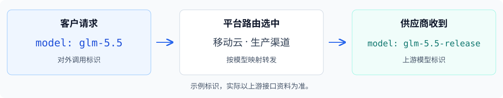

# 模型运营

> 资料接入、服务创建、模型映射及单渠道路由已提供；后续阶段的待开放操作见[功能设计核对表](MODEL_OPERATIONS_GUIDE_REVIEW.md)。

## 从哪里开始

第一次上架模型，按下图完成配置；已有模型需要调整，直接查看[日常维护](#step-9)。

| 你要做什么 | 查看步骤 |
| --- | --- |
| 新增模型资料 | [创建模型资料](#step-1) |
| 从移动云等供应商接入模型 | [接入模型和渠道](#step-2) |
| 提供客户可调用的服务 | [创建模型服务](#step-3) |
| 设置客户模型与上游模型的对应关系 | [配置模型映射](#step-4) |
| 指定哪条渠道接收请求 | [配置单渠道路由](#step-5) |
| 设置价格和允许使用的客户 | [设置售价和开放范围](#step-6) |
| 正式开放服务 | [验证并上架](#step-7) |
| 订购和调用模型 | [客户开始使用](#step-8) |
| 修改配置、停服或删除资源 | [日常维护](#step-9) |

## 开始前准备

- 模型资料：名称、规范模型标识、类型和能力说明。
- 供应商资料：上游模型标识、协议、API 地址和 API 密钥。
- 价格方案：采购价、平台售价、计费项、货币和单位。
- 客户范围：向全部有效客户开放，或指定客户名单。

本指南用“从移动云 MoMA 接入 GLM-5.5”举例。标识仅作说明，实际参数请向供应商确认。后台操作需要运营维护权限。

## 首次上架一款模型

### 创建模型资料

1. 进入「模型资料 → 模型」，搜索 GLM-5.5。
2. 没有对应资料时，点击「新建资料」。
3. 填写模型名称、规范模型标识和模型类型。
4. 根据模型说明补充模态、上下文、发布日期和简介。
5. 点击「保存」。

保存后，可在供应商的「接入新模型」中选择这款模型。已有同款资料时直接使用，未知信息留空。创建服务前，需确认作者、发布时间、支持任务、输入／输出模态和简介。

### 在供应商下接入模型

1. 进入「模型接入」，选择「供应商」视图。
2. 在左侧选择「移动云 MoMA」。没有对应供应商时，先点击「添加供应商」。
3. 在「模型渠道」点击「接入新模型」。
4. 搜索并勾选 GLM-5.5，点击「接入所选模型」。

模型出现“待添加渠道”后，继续下一项。找不到模型资料时，点击「维护模型资料」新建，保存后返回原供应商继续选择。

### 添加渠道

渠道用于连接供应商的模型接口。

1. 在 GLM-5.5 所在行点击「接入新渠道」。
2. 填写以下必填信息。

   | 字段 | 填写什么 |
   | --- | --- |
   | 模型 | 选择当前供应商已接入的模型 |
   | 渠道名称 | 填写便于区分的名称，如“移动云生产渠道” |
   | 上游模型标识 | 填写供应商要求的模型参数 |
   | 上游协议 | 选择供应商提供的接口协议 |
   | 上游 API 地址 | 填写供应商提供的地址，按提示核对根地址或完整接口路径 |

3. 默认使用「共享API密钥」，选择密钥组；需要专属密钥时，选择「独立API密钥」并输入 API Key。
4. 在「采购成本」点击「批量添加常用计费项」，填写各项采购价、货币和单位。
5. 点击「保存」。

注意：价格填 0 表示免费；缺少报价时先向供应商确认。共享组没有可用密钥时，点击「添加共享 API 密钥」。

### 测试并启用供给

1. 在渠道行点击「测试连接」。
2. 核对渠道、上游模型标识和密钥组。
3. 阅读用量提示，点击「测试连接（产生用量）」。
4. 等待结果显示“通过”，需要排查时打开「检查详情」。
5. 点击「启用供给」。

检测通过不会自动启用。启用供给后，渠道可以被模型服务选择，尚未向客户开放。旧渠道提示补齐协议时，先按提示保存并验证连接配置。

### 创建模型服务

1. 进入「模型服务」，点击「新增模型服务」。
2. 在「已接入模型」中选择 GLM-5.5。
3. 核对带入的模型资料，选择服务模式。
4. 填写对外调用标识，如 `glm-5.5`。
5. 点击「完成添加」。

| 模式 | 怎样选择 |
| --- | --- |
| 统一服务 | 客户只选模型，使用统一的调用标识和售价 |
| 分供应商 | 客户选择供应商，各供应商分别维护调用标识和售价 |

分供应商模式在创建服务后关联供应商，并配置各供应商的调用标识。已有服务时直接打开原记录，继续维护。模型资料在本页只读；需要补充时，点击「维护模型资料」，保存后继续创建。

### 配置模型映射

模型映射用来确定：客户调用 `glm-5.5` 时，平台应请求供应商的哪个模型。

1. 进入当前服务的「路由及映射 → 模型映射」，点击「新增映射」。
2. 填写映射名称，选择供应商和已验证、启用的渠道。
3. 核对带入的上游标识、协议和地址，选择平台接口；文本模型选择 OpenAI Chat。
4. 点击「预览映射」，确认两侧的模型参数。
5. 点击「保存映射」。
6. 点击「验证映射」。
7. 验证通过后，点击「启用映射」。

分供应商模式只能选择当前供应商的渠道。验证复用当前供给的检测结果，核对标识、接口和协议，不产生新用量。接口不兼容时，按提示处理后再继续；启用映射后，还需配置路由才会接收请求。

只需记住这三个标识：

| 字段 | 用途 |
| --- | --- |
| 规范模型标识 | 在资料库中识别同一款模型 |
| 对外调用标识 | 客户请求平台时填写 |
| 上游模型标识 | 平台请求供应商时填写 |

### 配置单渠道路由

首次接入只有一条渠道时，使用固定渠道即可。

1. 进入「路由及映射 → 路由配置」，点击「配置路由」。
2. 新路由默认使用「固定渠道」，在「目标模型映射」选择刚启用的映射。
3. 点击「预览变更」。
4. 核对渠道，点击「确认保存并生效」。

该渠道将接收当前服务的全部请求，无需填写权重。服务上架前，客户仍不能调用。

### 设置平台售价

1. 进入当前服务的「售价管理」，点击「编辑售价」。
2. 点击「添加计费项」，选择输入 Token、输出 Token 等收费项。
3. 填写各项售价，核对货币和计价单位。
4. 点击「预览变更」。
5. 核对价格及影响客户，点击「确认发布售价」。

注意：平台售价和采购价分别维护。0 表示免费，空白表示未配置。

### 设置开放客户

1. 在「售价管理 → 开放范围」点击「编辑开放范围」。
2. 选择「全部有效客户」，或选择「指定客户」并勾选名单。
3. 点击「预览变更」。
4. 核对客户名单，点击「确认发布开放范围」。

开放范围对整款模型服务生效。客户仍需完成订购和 API Key 授权，才能调用。

### 验证并上架

1. 进入「API 调用指南」，点击「平台试调用」。
2. 选择用于验证的客户；分供应商模式还需选择供应商服务。
3. 确认用量提示后发起请求，核对结果和实际渠道。
4. 验证通过后，点击「发布验证后的配置」并确认。
5. 点击服务页头的「上架」，处理检查中列出的缺项。
6. 核对售价、开放客户和渠道，点击「确认上架」。

服务显示“已上架”后，目标客户可以订购。需要在模型广场展示时，确认页头为「用户可见」。

### 客户开始使用

1. 客户登录前台，在「模型广场」搜索并打开 GLM-5.5。
2. 核对售价，完成模型订购；分供应商模式先选择供应商。
3. 在「API Key」创建或选择 Key，并授权当前模型。
4. 按调用指南填写对外调用标识，或进入「文本生成」发起请求。
5. 在「调用观测」和「用量统计」查看结果。

排查某次调用时，使用 Request ID 查找记录。客户使用自己的 API Key，不使用供应商密钥。

## 日常维护

| 你要做什么 | 查看步骤 |
| --- | --- |
| 修改名称、简介或模型能力 | [修改模型资料](#maint-materials) |
| 添加备用渠道 | [准备备用渠道](#maint-reserve) |
| 让新渠道接收请求 | [替换当前渠道](#maint-route-replace) |
| 调整映射或上游模型标识 | [修改模型映射](#maint-mapping) |
| 更换地址、密钥或共享组 | [更换连接配置](#maint-connection) |
| 调整采购价或售价 | [修改价格](#maint-prices) |
| 增减开放客户 | [调整开放客户](#maint-scope) |
| 隐藏模型或某个供应商 | [控制前台展示](#maint-visibility) |
| 暂停或恢复服务 | [停服与恢复](#maint-serving) |
| 暂停或恢复路由 | [停用与恢复路由](#maint-route-stop) |
| 停用供给或冻结渠道 | [停止供应来源](#maint-supply-stop) |
| 下线服务、删除渠道或模型 | [退出并删除资源](#maint-exit) |
| 更改服务模式或调用标识 | [调整服务模式与调用标识](#maint-identity) |

### 修改模型资料

1. 打开原模型服务，进入「模型卡片」，点击「编辑卡片」。
2. 修改名称、Logo 或简介。
3. 预览受影响的服务，确认发布。

修改类型、模态或能力时，进入「模型资料」维护。按提示处理受影响服务，完成必要验证后再上架。发布新模型版本时另建资料，保留旧模型身份。

### 准备备用渠道

1. 在「模型接入」选择供应商和原模型。
2. 按[添加渠道](#channel-add)的说明接入新渠道。
3. 完成测试，启用供给。

备用准备完成后可以结束。需要使用时，再建立模型映射并切换路由；不用重新创建模型服务。

### 替换当前渠道

先准备新渠道，并完成[模型映射](#step-4)。

1. 进入原服务的「路由配置」，点击「替换渠道」。其他策略从「编辑路由」进入。
2. 在「目标模型映射」改选新映射。需要改为单渠道时，先将策略设为「固定渠道」。
3. 点击「预览变更」，核对新旧渠道，点击「确认保存并生效」。
4. 查看一次新请求，确认命中新渠道。

客户继续使用原调用标识和售价。切换成功前保留旧映射；切换失败时原路由继续生效。

### 停用与恢复路由

1. 先在模型页头点击「下架并停用」。只处理某个供应商时，在对应组点击「停服供应商」。
2. 在「路由配置」点击「停用路由」，核对影响后确认。
3. 需要重新使用原配置时，点击「恢复路由」。
4. 核对渠道检查结果，点击「确认恢复路由」。

停用会清空已保存的路由草稿，保留映射和历史。恢复不会自动恢复服务或上架；渠道已停用、验证过期或有路由草稿时，先处理提示，或点击「修改路由」选择可用映射再发布。

### 修改模型映射

1. 进入「路由及映射 → 模型映射」，点击目标行的「编辑映射」。
2. 修改名称；未参与路由的映射还可修改渠道或平台接口。
3. 点击「预览映射」，核对后点击「保存映射」。
4. 渠道或接口有变更时，点击「验证变更」，通过后点击「应用映射」并确认。

在用映射只允许修改名称。更换供给时，新增映射并切换路由。已保存的候选变更应用前，原映射继续有效；点击「放弃变更」可取消候选配置。

修改上游模型标识，请到「模型接入」编辑对应渠道。已有服务正在使用时，先准备新渠道，再按[替换当前渠道](#maint-route-replace)切换，避免影响正在使用的服务。

### 停用或解除映射

1. 将路由切换到其他可用映射。
2. 在原映射行点击「停用映射」。
3. 不再保留关系时，点击「解除映射」并确认。

只有一条映射且没有替代时，按[退出并删除资源](#maint-exit)处理。解除映射不会删除供应商渠道。

### 更换 API 地址或密钥

1. 进入「模型接入」，在目标渠道行点击「编辑」。
2. 修改 API 地址，或选择共享密钥组、输入新的独立密钥。
3. 核对受影响的模型和服务，点击「保存待验证配置」。
4. 完成必要验证。
5. 点击「应用配置」，确认切换范围。

新配置应用前继续使用原配置。编辑独立密钥时，输入框留空表示保留原密钥。

### 添加共享 API 密钥

1. 在供应商详情进入「共享API密钥」。
2. 选择已有组；需要新组时点击「新建组」。
3. 点击「添加 API 密钥」，输入并保存。
4. 返回渠道编辑，选择该密钥组。

停用或移除旧密钥前，先查看「当前绑定渠道」。密钥泄露时使用「紧急撤销」，并处理受影响服务。

### 修改采购价或平台售价

| 要修改什么 | 从哪里进入 |
| --- | --- |
| 采购价 | 模型接入 → 对应渠道 → 编辑 → 采购成本 |
| 平台售价 | 模型服务 → 售价管理 → 编辑售价 |

1. 修改对应计费项的价格，核对货币和单位。
2. 预览变更及影响范围。
3. 确认保存或发布。

新价用于后续新请求，含已有订购客户；已开始请求和历史记录保留原价。修改采购价不会自动改变客户售价。

### 调整开放客户

按[设置开放客户](#scope-setup)修改名单并发布。

注意：移除客户后，该客户不能发起新调用，已有订购也不例外。新增客户仍需订购和 Key 授权。

### 控制前台展示

| 目的 | 操作 |
| --- | --- |
| 隐藏整个模型 | 在模型服务页头切换为「用户不可见」 |
| 重新展示模型 | 切换为「用户可见」 |
| 隐藏某个供应商 | 分供应商模式下，在该组点击「下架供应商」 |
| 重新展示供应商 | 在该组点击「上架供应商」 |

隐藏只改变展示，已有调用权限保留。需要阻止调用时，使用下面的停服操作。

### 停服与恢复

1. 打开需要停止的模型服务。
2. 点击「下架并停用」，核对影响后确认。
3. 修复问题后，重新完成必要验证。
4. 点击「上架」，通过检查后确认。

停服后不接受新订购和新调用；已开始请求继续完成，历史保留。

只停止某个供应商时，在该供应商组点击「停服供应商」；恢复时点击「恢复服务」。其他供应商不受影响，展示状态单独控制。

### 停用供给、冻结渠道或停用供应商

先把相关服务切换到其他渠道；没有替代时，先[停止服务](#maint-serving)。

| 停止范围 | 操作入口 |
| --- | --- |
| 当前模型在某渠道的供给 | 模型接入 → 对应行 → 停用供给 |
| 整个共享渠道 | 渠道编辑 → 冻结渠道 |
| 供应商下全部供给 | 供应商编辑 → 停用供应商 |

核对受影响对象后确认。恢复资源后，检查映射和路由，再按需恢复服务；不会自动重新上架。

### 下线并归档模型服务

用于不再提供这项服务，并处理最后一条路由和映射。

1. 在服务页头点击「下架并停用」。
2. 等待在途请求结束，处理未完成任务。
3. 在「路由配置」点击「停用路由」。
4. 停用并解除服务的全部模型映射。
5. 分供应商模式下，将供应商下架后点击「解绑」。
6. 点击「归档服务」，核对影响后确认。

无需保存一个空路由。归档后，订单、调用和价格历史继续保留。

### 删除渠道和供应模型

删除前，先[停用并解除服务映射](#mapping-remove)。最后一条映射按[服务退出流程](#maint-exit)处理。

1. 进入「模型接入」，找到目标模型和渠道。
2. 点击「删除渠道」。
3. 核对引用和影响，确认删除。
4. 该模型的全部渠道删除后，点击「删除模型」。

仍被其他服务或任务引用时，点击提示中的对象，先解除引用。共用渠道只移除当前模型关联；其他模型还在使用的渠道和历史保留。

### 归档模型资料或供应商

1. 确认不再有有效服务、渠道或供应登记引用。
2. 打开原模型资料或供应商，点击「归档」。
3. 核对影响后确认。

内置平台供应商不能删除。需要重新使用归档对象时，从原记录显式恢复，再检查依赖。

### 调整服务模式或调用标识

已有客户使用时，先安排客户迁移，再操作；客户需要更新调用配置。

1. 对服务执行「下架并停用」。
2. 在「路由及映射」点击「解锁并切换服务模式」；只改标识时，点击「编辑调用标识」。
3. 核对客户、价格和路由影响，确认修改。
4. 重新配置映射、路由、售价和开放范围。
5. 完成验证，重新上架。

旧标识不会自动转到新标识，旧订购也不会自动变成另一供应商的订购。模型资料和供应商资源保留。

## 常见问题

| 问题 | 怎么处理 |
| --- | --- |
| 接入时找不到模型 | 点击「维护模型资料」建档；已有登记不重复接入 |
| 检测通过，客户仍不能用 | 核对供给和映射已启用、路由已生效、售价与客户范围已配置、服务已上架 |
| 客户看不到或调不通 | 核对登录空间、模型可见性、开放范围、订购、Key 授权和额度 |
| 渠道不能删除 | 打开引用提示，先替换路由、解除映射；仅下架服务不能删除引用 |
| 保存失败、超时或提示冲突 | 保留输入；有「查询原提交」时先查询，冲突时载入最新配置再核对，不重复创建 |

离开未保存页面时，选择「继续编辑」或「放弃本次修改」。刷新不会恢复未提交内容，已保存的记录保留。

保存、启用、路由生效和上架各自独立。看到前一步完成后，继续对应的下一项；不要重新创建已有对象。
