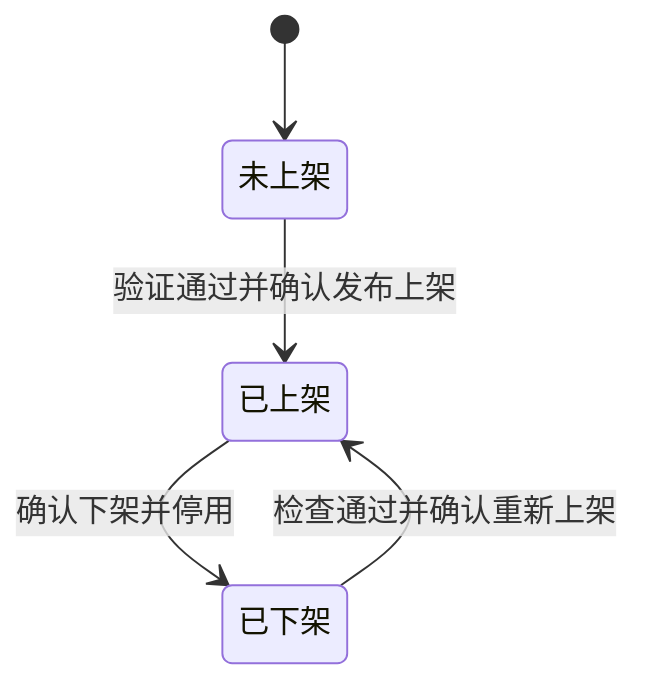
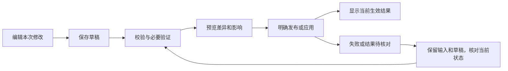

# MoMA 5.12.0 新人运营流程与页面组织设计

版本：v1.0（已确认设计基线）  
日期：2026-11-01  
状态：用户已于 2026-11-01 确认整体方案；规格已同步，P1—P3 已完成本地实现，P4 规则/mock 和受影响界面集成检查已执行；真人新人试用由用户后续安排，整体用户验收保持待完成。

本文整合新人运营访谈，定义目标页面、任务路径、状态、按钮、生效和恢复规则。它不表示现有系统已实现这些行为，不是上线或测试通过记录。相关规格、术语、验收要求及实施计划已同步；实现状态以分阶段计划和实施台账为准，设计确认不代表整体业务已验收。

## 1. 方案与范围

### 1.1 核心方案

以模型为主要工作对象。新人从“接入并上架模型”开始，沿四个阶段完成任务；之后在同一个模型工作区维护供应、售价、客户范围和路由。供应商管理与基础资料提供直接维护入口，不再要求新人自己在三个模块间拼接首次上架流程。

主路径：**选择模型 → 接通供应 → 配置销售 → 验证并上架**。

日常路径：**找到模型或待办 → 修改相关配置 → 保存草稿或预览变更 → 明确发布 → 查看生效结果**。

### 1.2 使用者与职责

- 新运营理解采购、销售和客户业务，但不要求事先理解接口协议、上游模型 ID、渠道或路由。
- 运营负责模型资料、采购条件、平台售价、客户范围和上架决定。
- 供应商或技术人员提供地址、密钥及必要接口信息；运营录入并检查。不要求运营猜测协议、拼接地址或自行设计复杂路由。
- 缺信息时保存任务，明确缺项，通过现有工作方式获取后继续。本版不新建派单、审批或跨岗位交接系统。
- 熟练运营使用同一套数据和页面，可直接进入具体维护区域；不另建“新手版后台”。

### 1.3 保留与不增加的范围

保留独立 5.12.0、现有业务身份与引用、共享资源、采购和销售独立定价、历史版本、审计、权限、冲突及存储失败保护。保留供应商、供应模型、渠道的独立添加能力，以及熟练运营的批量入口。

本版不增加预约调价、客户专属协议价、独立停售状态、执行中请求强制终止、第二套可编辑模型主档或独立协作系统。按量订购不永久锁价；下架包含停止后续调用。

## 2. 对象与术语

沿用 [GLOSSARY.md](GLOSSARY.md) 的领域定义，下表只说明本方案如何呈现，不另建一套术语来源。

| 对象 | 业务含义 | 页面处理 |
| --- | --- | --- |
| 模型资料 | 一款模型的统一身份、类型和能力资料 | 主档唯一；多个入口定位同一主档 |
| 供应商 | 平台直接采购模型服务的主体 | 不与模型作者或供应商模板混为一谈 |
| 供应模型 | 供应商与模型资料的供应关系 | 登记关系不代表可调用 |
| 渠道／模型映射 | 接口、地址、凭证与渠道内上游模型 ID 的关联 | 连接和采购维护在供应侧 |
| 模型服务 | 面向客户的对外调用 ID、售价、客户范围和路由 | 是模型运营默认入口的工作对象 |
| 接入任务 | 为首次上架、准备备用或投入供应保存的工作进度 | 不创建第二份模型身份；完成条件取决于任务目标 |
| 配置草稿／生效配置 | 尚未发布的修改／客户当前使用的配置 | 明确分开，草稿不冒充生效版本 |

模型名称、资料 ID、模型编码、上游模型 ID、对外调用 ID 不互相替代。资源复用依据明确关联，不能按名称相近自动合并。采购价不自动转换为售价，缺价不视为零价。

## 3. 完整页面结构

```text
概览
├─ 开始接入
├─ 继续未完成任务
├─ 处理影响服务的异常
└─ 经营统计

模型运营
├─ 模型服务〔默认入口，包含接入中、未上架和已上架模型〕
│  ├─ 模型清单
│  └─ 选中模型的工作区
│     ├─ 首次接入：选择模型 → 接通供应 → 配置销售 → 验证并上架
│     └─ 日常维护：模型资料 → 路由及映射 → 售价管理 → 操作记录
├─ 供应商管理
│  └─ 供应商、供应关系、共享渠道、密钥及采购条件维护
└─ 基础资料
   ├─ 模型资料库
   └─ 计费项等基础资料

运营入门〔保留帮助入口，并在相关任务提供直接帮助〕
```

侧栏承担工作对象定位；工作区承担业务步骤。新人首次流程、教学和步骤按钮使用同一套四阶段名称，不再把跨管理页跳转作为必经学习路径。

### 3.1 概览

概览直接从统计时间筛选开始，保留经营指标、趋势、排行与明细；移除当前运营任务及接入、待发布变更、供应异常三组汇总。接入与维护在模型和供应商工作区处理，不因为首次登录强制开启新建向导。

### 3.2 模型服务清单

保留熟悉的对象选择与详情工作区结构，复用现有搜索、类型和状态筛选。已上架服务、未上架服务及接入任务通过稳定关联展示；同一任务与其服务不形成两个让用户误认成重复模型的对象。

每项优先展示模型名称、服务状态及一个最需要处理的事项。模式和对外标识按需辅助显示，不把全部状态词堆在名称下面。

主要创建入口为“接入并上架模型”。已有服务时引导进入追加供应或维护，不重复创建同一服务；接入中对象默认继续原任务。熟练运营的直接添加与批量能力保留为次要入口。

### 3.3 模型工作区

| 页签 | 内容 | 典型直接任务 |
| --- | --- | --- |
| 模型资料 | 模型卡片、模型详情、其他信息；编辑同一基础资料主档 | 查看和维护展示资料，保存资料草稿、预览影响及明确发布 |
| 路由及映射 | 服务模式、供应商关联、对外调用 ID、渠道及上游模型映射、路由、试调用与调用指南 | 关联供给、配置映射与调度；连接、密钥和采购仍在供应商管理维护 |
| 售价管理 | 统一模型售价或分供应商售价，计费项、条件、单位、币种与历史 | 独立保存草稿、预览并发布售价，不夹带调用 ID 或客户范围变更 |
| 操作记录 | 时间、操作、操作对象、操作人、结果和失败原因；分页完整查看 | 追溯模型及实际影响它的共享资料、渠道变更，关联范围按操作发生时记录 |

模型资料为默认页签，包含模型卡片、模型详情和其他信息；公共字段仅维护一次，复用基础资料主档。原概况的接入任务、配置检查和未发布草稿移到工作区页头摘要，并直达对应维护区域。客户范围不单设页签，保留“全部客户/指定客户”及独立发布入口，不新增按客户类型或成员授权。内置 Logo 和多语言内容本轮暂缓。

工作区页头保持对象身份和服务级操作。编辑区负责本区域的保存、预览、发布按钮；移除随页签切换含义的通用“保存”。长表单操作区固定在当前编辑区域底部，不要求滚回页头。

### 3.4 供应商与基础资料

供应商管理保留“添加供应商／添加供应模型／添加渠道”三个独立能力，按当前对象带入上下文。新增供应商与已有供应商选择明确分开；模板用于新增，不与真实主体平铺为同类候选。疑似重复时提示查看或复用已有主体，不自动合并。

基础资料维护统一主档与计费项。模型工作区的资料维护入口定位同一主档，发布时展示共享影响。供应商级连接、密钥的共享维护同样显示实际影响范围。

### 3.5 导航和返回

- 模型或供应商工作区的处理入口直接定位相应对象及配置区域。
- 从模型转往供应商或资料维护，保留原模型、页签、筛选和草稿上下文；完成或取消后返回原位置。
- 从供应商页面发起接入，带入供应商，但仍明确选择本次模型和任务目标。
- 接入向导面包屑为“模型运营 > 接入并上架模型”；返回按钮说明实际来源，例如“返回模型服务”或“返回供应商管理”。
- 明确指向的模型不存在或被筛选排除时，说明原因并提供返回或清除筛选，不静默换成另一款模型。
- 切换对象、页签和跨页离开均遵守未保存保护；正常查看、取消和返回不隐式保存业务配置。

## 4. 首次接入与上架

### 4.1 四阶段路径

| 阶段 | 运营输入或确认 | 系统帮助与复用 | 完成证据 |
| --- | --- | --- | --- |
| ① 选择模型 | 选择已有资料，或登记最少身份信息 | 检索已有主档、接入任务、服务及供应；重复对象引导复用 | 本次模型和任务目标明确 |
| ② 接通供应 | 供应商、渠道、上游模型 ID、必要连接信息和采购条件 | 复用已有连接和密钥；仅补缺项；明确发起连接检查 | 本次映射检查结果明确，采购缺项可追踪 |
| ③ 配置销售 | 完整展示资料、销售模式、对外 ID、售价、客户范围和路由方案 | 已有事实预填；单渠道方案直观展示；复杂路由按需展开 | 销售配置及其依赖满足校验 |
| ④ 验证并上架 | 处理缺项、发起平台试调用、核对摘要、确认提交 | 汇总当前配置和检查证据，提交前复核依赖与版本 | 发布与上架成功，允许客户可订购并调用 |

采购价归供应阶段；完整展示资料归销售阶段，不强迫在第一步一次补齐。缺少报价等信息允许保存并稍后补齐，不使最终检查自动通过。仅登记资料、保存资源或连接测试通过均不等于上架。

### 4.2 销售模式和客户范围

| 展示解释 | 领域模式 | 需要确认的业务结果 |
| --- | --- | --- |
| 客户购买同一个服务 | 统一服务 | 统一对外调用 ID 和售价，平台在供应来源间调度 |
| 客户按供应商分别购买 | 分供应商 | 各供应商分别维护对外调用 ID、售价和路由；同供应商渠道共用售价 |

可以推荐统一服务，但运营需明确确认；已有模式不自动重选。客户范围必须明确选择，不能因为简化流程自动向全部客户开放。

单一有效渠道可呈现“该渠道承接 100% 流量”的方案供确认，不能隐式生效。已有路由不得被首次接入默认方案覆盖。

### 4.3 最终提交

最终摘要至少展示：模型、销售模式、对外调用 ID、售价及计费单位／币种、客户范围、供应与流量安排、检查结果。采购内容仅出现在有权限的后台，不能进入客户接口。

“确认发布并上架”是首次面客的单一明确提交。它基于当前候选和仍有效的验证证据；依赖变化时要求补足检查，不能复用不匹配的旧通过结果。

对客配置与上架状态不得形成半完成结果：首次失败不能显示已上架；已建好的独立供应资源可以保留供继续使用，不因服务发布失败删除。共享已有资源的修改仍单独确认，不能隐藏在普通下一步里。

### 4.4 完成页

持续显示“已上架”、适用客户、对外调用 ID、当前有效版本及时间，并提供“查看调用指南／进入日常维护”。完成依据来自当前有效状态，不只显示短暂成功提示。

若本次目标是增加新供应，已有服务原本已上架不能作为本次任务完成证据。

## 5. 日常运营完整路径

每项任务直接进入对应区域。草稿与生效内容同时可辨；一次提交仅发布本任务范围，相互依赖的字段一起校验，其他任务草稿不被捎带发布。

| 任务 | 路径 | 生效与结束条件 |
| --- | --- | --- |
| 修改平台售价 | 模型 → 售价管理 → 修改售价 → 保存草稿或预览差异 → 确认发布售价 | 发布成功后新请求使用新价；展示和计价同版本 |
| 修改客户范围 | 模型 → 页头维护客户范围 → 调整范围 → 查看新增／移除客户及影响 → 确认发布范围 | 新范围成为后续访问检查依据；移出客户不能凭已有订购绕过范围 |
| 准备备用供应 | 模型 → 路由及映射 → 添加供应 → 补连接和采购条件 → 检查 → 明确完成备用准备 | 必要条件完整、检查有效；明确未加入当前路由，不承接流量 |
| 将备用投入服务 | 模型 → 路由及映射选择备用 → 关联服务 → 路由及映射 → 调整方案及必要验证 → 发布路由 | 本次供应按发布方案投入，不重填既有资料、售价和客户范围 |
| 调整流量或换渠道 | 模型 → 路由及映射 → 编辑草稿 → 校验与必要验证 → 差异确认 → 发布路由 | 新路由生效；失败保留旧路由 |
| 维护地址或密钥 | 模型供应入口或供应商 → 候选配置 → 核对共享范围 → 明确测试 → 确认应用 | 当前所需引用范围全部满足检查后应用；不提前覆盖旧配置 |
| 修改采购条件 | 模型供应入口或供应商 → 采购配置 → 校验单位、币种、金额和条件 → 确认发布 | 使用明确采购版本，保留历史；不自动调整平台售价 |
| 修改共享资料 | 模型 → 模型资料 → 编辑资料，或基础资料直接进入 → 预览共享影响 → 发布 | 按第 6 节区分展示与能力变更 |
| 下架并停用 | 模型页头／服务级操作 → 查看影响客户 → 确认下架并停用 | 后续请求被拒绝；保留恢复配置和历史 |
| 重新上架 | 已下架模型 → 检查当前配置 → 修复失效项 → 核对恢复摘要 → 确认重新上架 | 当前条件合格后开放，失败保持下架 |
| 切换销售模式 | 模型 → 路由及映射 → 解锁并切换服务模式 → 影响确认 → 按目标模式重配及验证 | 保留现有显式下架、关联和路由重置边界及历史保护；不得作为普通资料编辑 |
| 移除供应关联 | 模型 → 路由及映射 → 移除关联 → 检查生效及草稿引用 → 确认影响 | 仅解除明确范围；不暗中删除共享主体、渠道或历史 |

### 5.1 调价契约

- 按量服务第一版只提供发布成功后立即生效，不增加预约或客户专属协议价。
- 发布前继续使用旧价；发布后的新请求使用新价，包括已有订购客户的后续请求。
- 已开始请求及历史用量保留原价格快照，不用新价追算；“请求开始”在同一请求各处理阶段保持一致，不能因内部重试换用新售价。
- 后台、客户价格展示及实际计价必须引用一致的生效版本。保存新价格记录本身不能作为全链路已生效的证明。
- 售价变更不得带出其他未完成配置；需要更新相关对客快照时，也必须保留未发布任务的隔离。

### 5.2 下架与恢复契约

下架后已有订购和 API Key 不豁免后续调用限制；不增加“只停售、不停服”的独立状态。下架也不能继续开放新的订购入口或允许绕过后台状态建立新订购。

已开始请求按原配置完成，不使用普通下架强行终止。资料、价格版本、供应、路由、订单和用量历史保留；下架不等于删除、退订或退款。

重新上架检查资料、有效价格、客户范围、供应资格和路由。相关事实未改变且验证仍有效时可以复用；失效部分重测。摘要明确恢复后的价格、客户范围与路由，确认后才开放。

## 6. 共享资料与供应变更

### 6.1 共享主档

共享资料编辑入口显示当前模型及其他受影响服务，不能让运营误以为只修改当前页面。

| 变更类型 | 草稿期 | 发布条件 | 发布结果 |
| --- | --- | --- | --- |
| 名称、介绍、图标等展示内容 | 当前客户展示不变 | 预览差异与全部受影响服务，明确确认 | 同步更新引用主档的展示，不因文案修改重测连接 |
| 类型、模态、能力等调用相关内容 | 保留当前生效内容 | 专门影响检查，完成必要重测；不兼容依赖先修复或明确下架 | 发布合格的新资料及相关有效状态，不把不兼容内容直接覆盖在线配置 |

主档始终唯一；草稿和历史版本不是第二套可编辑主档。本版不增加同一主档在不同服务长期维护不同介绍的机制。稳定身份和关联不因改名或变更能力重建。

### 6.2 共享连接和密钥

共享修改先列出真实引用的渠道、模型及受影响服务。测试候选不改当前配置；应用前重新确认引用范围、版本和验证有效性，所需范围不完整时不能部分切换。

正常轮换与紧急撤销继续区分；正常轮换不自动撤销旧 Key。候选失败保留当前配置，原始密钥不得进入可恢复草稿、日志、审计或交付证据。

### 6.3 验证的复用与失效

检查针对实际变化范围，不一律要求从头接入，也不把旧检查当永久有效。

- 纯展示变化不触发连接重测。
- 价格、单位、币种、客户范围变化重新验证相关业务规则；若依赖的发布证据失效，应明确补足对应验证。
- 地址、凭证、上游映射、路由或能力变化，重新检查受影响调用路径与发布依赖。
- 共享资源被他人修改后，原候选的适用范围和证据需要重新核对。
- 成功的测试只证明本次范围，不自动等同于全部能力、全部客户和所有渠道均可用。

## 7. 状态表达与流转

将服务状态、任务进度和未发布修改分开，避免“草稿”同时代指多个对象。列表只展示必要状态；具体检查结果留在对应工作区。

| 维度 | 建议文字 | 判断依据与展示位置 |
| --- | --- | --- |
| 服务生命周期 | 未上架／已上架／已下架 | 是否曾上架及当前开放状态；清单和工作区标题 |
| 接入任务 | 第几步、待补具体内容／已完成 | 本次任务目标与实际证据；进度区和待办 |
| 本次修改 | 未保存修改／已保存草稿／已生效 | 当前编辑、草稿和生效版本；编辑区与结果区 |
| 检查结果 | 未检查／检查中／通过／未通过／结果待核对 | 具体对象、范围及检查时间；检查区域 |
| 供应健康或资格 | 实际状态及原因 | 供应区域；不能把主动停用、未测试和运行异常视为同一状态 |

状态颜色配合文字或图标，不能只靠色点。失败是本次操作结果，不应把仍正常运行的旧版本标成整体失败。





日常草稿不改变服务生命周期。备用准备可以显示任务已完成、未加入路由；只有目标为投入服务时，才以实际发布路由为完成条件。

## 8. 按钮与反馈规则

### 8.1 动作词与实际效果

| 按钮 | 行为 | 不应产生的隐式效果 |
| --- | --- | --- |
| 接入并上架模型 | 开始任务或识别已有对象 | 不自动创建重复服务 |
| 保存草稿 | 保存当前任务的安全输入 | 不发布、不改客户正在使用的配置 |
| 保存并继续 | 保存后进入下一阶段 | 不因跨步骤自动启用已有共享资源或上架 |
| 保存草稿并退出／离开 | 成功保存后离开 | 失败时不能跳走 |
| 测试连接／平台试调用 | 明确范围、必要用量提示后发起检查 | 不自动发布；结果未知不冒充失败或成功 |
| 预览变更 | 展示本次差异、影响和阻塞项 | 不保存生效配置 |
| 确认发布售价／客户范围／路由／资料 | 发布明确任务范围 | 不夹带其他未发布草稿 |
| 确认应用连接配置 | 应用已验证的地址或凭证候选 | 不部分更新所需共享范围 |
| 完成备用准备 | 确认本次备用任务满足条件 | 不自动加入服务路由或分配流量 |
| 确认发布并上架 | 提交首次对客配置和上架 | 失败不显示已上架 |
| 确认下架并停用 | 停止后续订购与调用 | 不删除配置和历史、不强行终止已开始请求 |
| 确认重新上架 | 经当前检查后恢复服务 | 不复活失效价格、凭证或路由 |
| 放弃本次修改 | 回到最近一次保存内容 | 不删除此前保存的草稿 |
| 丢弃草稿 | 明确丢弃所选未发布草稿 | 不撤销当前生效配置，不删除已建独立资源 |

按钮使用对象和效果明确的文案，不常驻解释普通控件；必要业务影响留在确认区。步骤按钮与阶段标题保持相同词汇。

### 8.2 操作位置和可用性

每个当前任务区域突出一个主动作，其他动作使用次级样式。页头不再提供目标漂移的通用保存。固定底部操作区不能遮挡表单和错误信息。

不可执行时说明具体缺项或权限原因并定位可修复字段，不能只有一个无法解释的灰色按钮。提交中保持按钮位置、展示执行状态并避免重复提交；焦点、键盘操作及关闭后焦点恢复遵循现有设计规范。

### 8.3 持续结果反馈

不能只依赖短暂通知。发布后在本区域持续显示对象、结果、版本及生效时间。例如：

- “售价 v3 已生效；后续新请求使用新价。”
- “备用供应已就绪；尚未加入当前路由。”
- “路由 v2 已生效；服务仍处于已下架状态。”
- “草稿已保存；客户仍使用当前生效配置。”

示例中的版本和时间必须来自实际结果，不能预设或补造。

## 9. 异常恢复、离开与冲突

| 场景 | 保留什么 | 运营可执行的下一步 |
| --- | --- | --- |
| 缺信息 | 已填写的安全内容和对象引用 | 保存进度，按明确缺项补齐 |
| 连接检查失败 | 当前输入、旧生效配置、真实失败信息 | 就地修正并明确重测 |
| 保存失败或存储不足 | 当前内存输入；不宣称已持久化 | 处理原因并重试保存，成功前不离开 |
| 发布失败 | 原生效配置、本次草稿及已建独立资源 | 修复失败项，再验证并发布 |
| 提交超时、结果不确定 | 本次任务与操作上下文 | 先核对是否成功；未核实前不重复创建或发布 |
| 他人修改相同配置 | 自己的输入和最新版本差异 | 查看冲突，基于最新内容重新编辑；不自动覆盖 |
| 刷新／重新打开 | 已确认保存的进度及可持久化内容 | 恢复后重查依赖；提示重新输入不可恢复的密钥 |
| 资源被停用或关联改变 | 本次草稿及明确阻塞原因 | 定位失效资源，修复或重新选择 |
| 准备离开未保存页面 | 当前编辑内容 | 保存草稿并离开／放弃本次修改／继续编辑 |

重试只重复失败动作，不重新走完整接入，不重复登记已成功建立的资源。有调用或费用的测试不在后台自动重放。

“放弃本次修改”与“丢弃草稿”分开。放弃编辑回到最近保存点；丢弃草稿不删除已建立的供应商、渠道，也不撤销线上配置。共享资源删除仍走独立影响和引用检查。

## 10. 视觉与交互实施约束

视觉按当前任务中用户选定的方向与参考实施，工程与验收遵守[后台视觉实施与验收](../../docs/PAGE-SPEC.md#后台视觉实施与验收)；复用版本内组件，保留无障碍要求。

- 对象选择与工作内容保持明确关联，切换时保护未保存内容。
- 新人流程在当前模型内逐步展开，熟练操作直接定位对应区域。
- 说明只用于必须理解的业务决定、影响、错误和缺项，不重复解释明显的控件。
- 成功、错误、禁用、空态、加载、冲突与结果未知均需可见且可操作。
- 从帮助进入任务不隐式测试、保存、发布或上架。
- 页面放大、常见桌面窗口和键盘导航下，核心字段、确认及取消可达。

## 11. 验收方案

本节定义未来验收，不表示已执行。通过条件同时覆盖操作理解和真实状态结果，不能以截图或测试数量代替业务证据。

### 11.1 完整任务矩阵

| 编号 | 场景 | 必须观察到的结果 |
| --- | --- | --- |
| AC01 | 新供应商、新模型首次接入 | 新运营可沿四步完成，最终允许客户能订购和调用；未授权客户不能调用；不依赖研发现场解释 |
| AC02 | 复用已有资料、供应或接入任务 | 正确定位同一对象，不重复建主档、供应或服务；能说清复用了什么 |
| AC03 | 准备备用，再投入服务 | 备用就绪可完成任务但无流量；明确发布后才按方案参与服务 |
| AC04 | 发布新售价 | 发布前后新请求价格边界正确；已开始请求和历史不追算；已有订购客户的新请求使用新价 |
| AC05 | 发布客户范围 | 差异包含新增／移除客户；发布后权限与确认范围一致，已有订购不绕过限制 |
| AC06 | 路由、地址与共享密钥维护 | 展示实际影响；候选检查和发布失败保留旧配置；不部分切换共享范围 |
| AC07 | 下架并重新上架 | 后续订购与调用受阻，执行中请求按原配置完成；恢复发现失效依赖，失败保持下架 |
| AC08 | 展示资料及能力变更 | 草稿不影响客户；展示发布同步引用；能力变化未经合格检查或必要下架不能破坏在线服务 |
| AC09 | 中断、保存失败与结果未知 | 恢复已保存进度；当前输入保留；先核实提交结果；无重复资源或重复发布、无误报成功 |
| AC10 | 并发冲突与跨页返回 | 不覆盖他人发布；从共享维护返回原模型、页签及草稿；无静默切换对象 |
| AC11 | 独立任务草稿与取消 | 改价不夹带路由草稿；放弃编辑与丢弃草稿效果不同；不误删资源和生效配置 |
| AC12 | 销售模式与共享删除边界 | 模式切换仍显式确认、下架和重配；移除检查活动及草稿引用；历史与稳定身份保留 |

### 11.2 新人试用

邀请未参与设计、符合目标背景的运营，在具备所需业务资料的前提下执行首次接入和典型维护任务。允许使用产品内帮助，不要求先读完教程；技术信息缺失应被识别为缺项，不能当成用户失败或让用户猜测。

记录任务是否独立完成、误选对象／入口、求助、反复返回、误判生效、输入丢失和实际耗时。关键任务应独立完成，不能出现选错影响对象、误判对客生效或数据丢失。未完成及需要主持人解释的路径记录为问题，不自行换算成通过率。

不在没有基线和实测的情况下承诺固定完成分钟数。熟练运营验证直达维护路径，确认不被迫重走首次向导。

### 11.3 行为与原型边界

检查状态、版本、引用、权限、价格快照和失败恢复；交互试用与自动化检查分别记录。先跑受影响行为的既有检查及有意义的新增覆盖，再按跨模块范围执行必要回归；不因文档更新运行应用构建。

当前是浏览器本地原型。原型可以验收模拟订购与调用链路的一致性，但不能据此声称已验证真实供应商、生产鉴权、实际扣费或生产计费准确性；这些需在真实系统中单独验收。

## 12. 与现状的差异及后续同步

以下来自本轮源码核对，仅用于说明实施工作，不表示已修复；开始实施时仍需重新核对基线和并行改动。

| 现状 | 本方案目标 | 依据 |
| --- | --- | --- |
| 已有四步向导，但采购、销售子页和内部确认较分散 | 复用现有能力，按业务四阶段组织，首次明确一次发布上架 | [ModelOnboarding.jsx](src/admin-v2/ModelOnboarding.jsx)、[ModelOnboardingSales.jsx](src/admin-v2/ModelOnboardingSales.jsx) |
| 页头保存按面板绑定不同目标 | 分任务、具名保存和发布 | [ServiceManagementWorkspace.jsx](src/admin-v2/ServiceManagementWorkspace.jsx) |
| 保存售价创建立即有效价格记录；前台串联 mock 仍使用已发布服务快照 | 草稿与发布分开，展示、后台和客户计价统一生效边界 | [model-operations.js](src/admin-v2/model-operations.js)、[domain.js](src/admin-v2/domain.js)、[mock-onboarding-service.js](src/admin-v2/mock-onboarding-service.js) |
| 主档名称、介绍保存会直接同步引用服务 | 保存草稿不更新客户，明确发布后同步共享展示 | [model-operations.js](src/admin-v2/model-operations.js) |
| 现有下架已停止已有客户新调用 | 保留该业务效果并明确命名，补齐执行中请求、订单入口及恢复验收 | [model-management.js](src/admin-v2/model-management.js)、[service-access.mjs](src/service-access.mjs) |
| 已有服务追加供应在技术接入后转回维护；完成判定与投入路由相关 | 区分备用就绪和投入服务两种任务终点 | [guided-onboarding.js](src/admin-v2/guided-onboarding.js) |
| 概览以统计下钻为主 | 保留统计筛选、指标、趋势及下钻，不设置任务汇总 | [OperationsOverview.jsx](src/admin-v2/OperationsOverview.jsx) |

已同步 [PAGE-SPEC.md](PAGE-SPEC.md)、[MODEL_ONBOARDING_SPEC.md](MODEL_ONBOARDING_SPEC.md)、[GLOSSARY.md](GLOSSARY.md) 和 [MODEL_ONBOARDING_ACCEPTANCE.md](MODEL_ONBOARDING_ACCEPTANCE.md)。运营入门与研发说明的目标内容已纳入规格；页面内文案随实施更新，本轮不改 JSX。分阶段工作、依赖和出口条件见 [实施计划](MODEL_OPERATIONS_UX_IMPLEMENTATION_PLAN.md)。同步前接入规格保存在 [历史快照](docs/history/MODEL_ONBOARDING_SPEC_PRE_UX_V1_20261101.md)，旧验收记录保持历史证据口径。

本方案没有选择新数据库、框架或跨服务提交技术；一致性、结果核对及恢复需要在现有事务边界内做实现设计。整体确认不等于代码变更、真实调用、提交或部署授权。

## 13. 决定追踪与整体确认

| 访谈决定 | 已整合位置 |
| --- | --- |
| Q1—Q3 新人、完成标准、重组范围 | 第 1 节 |
| Q4—Q7 模型起点、职责、概览、共用界面 | 第 1、3 节 |
| Q8—Q9 页面组织、四阶段首次接入 | 第 3、4 节 |
| Q10 保存与生效 | 第 4、5、8、9 节 |
| Q11 备用与投入服务 | 第 5、7 节 |
| Q12 销售模式表达 | 第 2、4 节 |
| Q13 改价 | 第 5.1 节 |
| Q14 下架 | 第 5.2 节 |
| Q15—Q17 分任务发布、页签、离开 | 第 3、5、8、9 节 |
| Q18 异常恢复 | 第 9 节 |
| Q19 共享资料 | 第 6 节 |
| Q20 下架与恢复 | 第 5.2 节 |
| Q21 最终导航与返回 | 第 3 节 |
| Q22 完整任务验收 | 第 11 节 |

整体确认结论：用户已确认模型服务主入口与辅助资源页面的分工、四步首次接入、独立任务发布、调价对已有客户后续请求生效、下架停止后续调用、共享修改影响确认，以及异常恢复和验收标准，作为一致的 v1.0 设计基线。

分项及整体确认均已收口。用户已另行授权 P1 本地实施，该阶段相关验证已完成；P2—P4 未启动，当前不部署。
