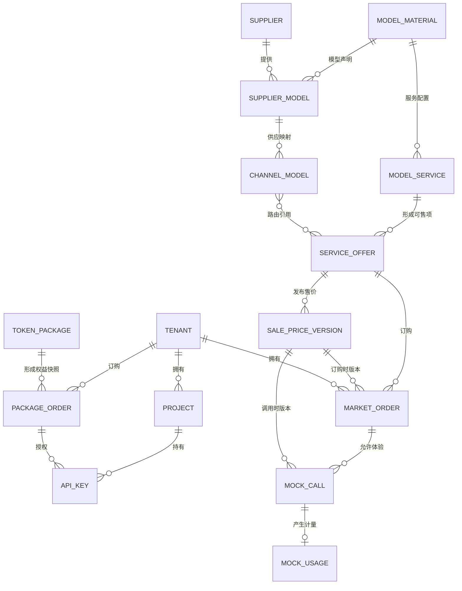

# 5.12.0 D1 原型后端

用户面和后台使用同源 Worker API `/api/5120/`。模型服务、供给、价格、上架、客户、订单、套餐、组织、Key、智能路由、模拟用量及运维配置共用一个 D1 工作区。网关、模型输出、部署、扣减和账单只模拟业务交互。媒体文件、对话草稿、页面筛选和独立的注册／验证码表单示例留在浏览器。

## 本地运行

在原型仓库运行 `npm run dev:backend:5120`，另开终端运行 `npm run dev:5120`。在 Vite 输出的地址打开 `/moma_5.12.0_estack/`。如果端口 8787 已使用，在两个命令前设相同的 `MOMA_5120_BACKEND_PORT`。

| 内置账号 | 使用入口 |
| --- | --- |
| `yyg` | 后台，系统管理员 |
| `zqzh` | 前台，政企客户 |
| `grzh` | 前台，个人客户 |

首次启动在版本目录 `database/.local/demo-logins.json` 生成随机演示密码，权限为 0600。后端只输出文件路径。也可通过环境变量 `MODEL_OPS_LOGIN_HASHES` 提供指定账号的 SHA-256 摘要。数据库保存在同一忽略目录，重启保留修改。登录使用 HttpOnly、Secure、SameSite Cookie；客户端写入校验同源 Origin 和当前账号。

首次初始化预置下列模拟供给。服务商和模型资料可在后台查看；渠道按原流程验证、启用和关联，验证服务、配置销售范围及价格后才可上架。已有的「研发人员注意 → 导入模型运营演示包」流程仍可使用。

| 服务商 | 渠道与模型 |
| --- | --- |
| 移动云 | 自营：GLM 5.3；原厂转售：DeepSeek V4.1 Flash |
| 阿里云 | 自营：DeepSeek V4 Pro；原厂转售：Seedance 2.5 |
| 深度求索 | 自营：DeepSeek V4 Pro |
| 智谱 | 自营：GLM 5.3 |

`npm run test:backend:5120` 使用 Miniflare/workerd 验证真实 D1 binding。测试使用独立临时库，不访问云端。

## 数据与事务

空 D1 通过 `0001`—`0012` migration 建表，再初始化后台账号定义、`src/data/tariff-dictionary.json` 的 135 条计费字典记录和 `src/data/builtin-model-catalogue.json` 的 17 份参考主档。已有工作区启动时读取原数据。导出的空库初始化 SQL 采用同一数据范围。

平台管理员可在模型运营页面打开「研发人员注意 → 导入模型运营演示包」。`src/mock/model-operations.json` 提供 GLM-5.3、DeepSeek-V4-Flash-0731 和试调用所需的演示租户。导入在现有命令事务中插入缺失业务记录，复用相同 ID、编码和类型的主档。冲突时整包拒绝。检测与平台试调用通过模拟器执行，结果来源单独展示。其余模块在业务工作区首次开启时写入演示数据，后续从 D1 读取。

`0004` 将模型文档转换为目录字段：模型展示名 `name`、规范模型标识 `canonical_slug`、上下文 `context_length`、模态 `architecture.input_modalities/output_modalities`、支持参数 `supported_parameters`、默认参数 `default_parameters`。资料表使用 `canonical_slug` 和 `metadata_json`；服务供给表以 `record_id` 保存原内部主键，以 `id` 保存对外调用标识。历史调用、价格、审计和幂等回执不重写。`created` 在资料查询接口中为平台收录时间的 Unix 秒，`release_date` 单独保存原厂发布日期。应用领域对象仅在存储边界转换，业务关联不改号。

`0005` 解除计费项必须绑定单位的旧约束，保留已有单位关联在 `record_json.unitId`，不改写价格条目的单位或历史。新计费项只要求名称，单位仍由每条价格独立引用。发布这批代码前须同步应用该结构变更；本地迁移验收覆盖旧数据与外键保留。

`0006` 新增套餐和自定义套餐类型存储。套餐工作区独立读取，复用会话、幂等回执和原子审计；本地浏览器旧存档保留。

`0007` 新增按模型资料主档保存的平台抵扣配置。 `0008` 将原模型级系数保留为历史值，启用按计费项 ID 和输入 Token 区间维护的规则。已有套餐的模型引用原样保留，历史值不自动分配给计费项。

`0009` 新增用户全局默认限流记录，初始值为 60 RPM 和 3,000,000 TPM。`0010` 保留已保存的用户全局默认和审计，初始化模型默认 600 RPM 和 30,000,000 TPM，并增加账号额度、一客一策与模型覆盖记录。发布限流页面与接口前先应用 `0010`。

`0011` 允许同一连接下保存同款模型的不同上游标识，并把上架阶段与灰度客户保存到具体渠道服务。客户使用 D1 工作区中有效且在 `MODEL_OPS_LOGIN_HASHES` 中配置了凭据的客户编号登录。客户会话、订单及模拟调用分别写入 `market_sessions`、`market_orders`、`market_calls`；每次调用同时保存使用量、售价和路由引用。

`record_json` 按资源保存标准属性，所有者、稳定身份、有效价格/路由/发布引用仍由关系列和外键检查。模拟资源按 kind/id 保存；幂等回执统一在 operations，模拟器不再重复保存整份回执。源码 JSON 不在刷新时重放，用户浏览器旧存档不隐式导入、合并或删除。

业务命令由现有领域规则在服务端执行，带 expectedRevision 和 operationId；业务修改、模拟状态、回执、审计在单个 D1 batch 中提交。失败保留输入；未知结果查询 `/operations/:id`。后台测试的未知提交通过原 operationId 找回任务，不能重复创建。供应密钥只保存掩码、版本、指纹及状态，不访问真实上游。

### 前后台数据关系

`0012` 增加业务工作区修订号、客户操作回执和活动索引，保留渠道订单与其原始售价关联。退订保留订单，释放该客户与服务的活动订单占位。套餐订单冻结当时的套餐版本和抵扣规则。账单生成使用当月仍在保留窗口的模拟用量及调用价；不触发支付或结算。

### D1 Free 控制

高频数据只在实际操作时写入。客户模拟调用保留最多 400 条、最近 7 天；登录事件保留最多 200 条、最近 7 天。后续操作按索引清理过期会话、回执和用量副本。后台较旧的回执压缩掉可重新读取的模拟工作区快照，配置、订单和版本历史保留。工作区文档上限 1.5 MB，不写对话正文或附件，不开采集轮询和定时写入。

免费额度按账户累计，迁移和索引更新也计入用量。查看 [Cloudflare D1 免费用量与限制](https://developers.cloudflare.com/d1/platform/pricing/)。本地通过不代表已经验证云端额度或延迟。

## 接口

- `POST /auth/login`、`POST /auth/logout`、`GET /auth/me`、`GET /health`。
- `GET /traffic-limits` 读取两类默认、账号额度、一客一策、单模型覆盖和可配置的模型资料主档。`POST /traffic-limits` 按操作更新限流配置，并原子提交审计和回执。两者要求平台管理员或运营人员会话，写入还校验当前账号、修订号和幂等标识。每分钟请求数和 Token 数均存整数。
- `GET /traffic-limits/history` 使用同一后台会话按时间倒序查询已提交的配置变更。`limit` 控制每次读取的操作数，批量操作展开实际改动的对象，`after` 续查更早的操作。
- `GET /model-operations`：当前原型资源视图；由 SQLite 组合 JSON，Worker 直接返回，避免整库解析再序列化。
- `POST /model-operations/commands`：模型运营、模型服务和供应维护命令；不接受客户端身份或任意集合替换。
- `GET /package-management`、`POST /package-management/commands` 处理套餐读写和生命周期命令。模型选项来自未归档的模型服务，规则和套餐关联使用模型主档 ID。平台管理员可管理共享套餐类型。「套餐数据」通过此读取接口显示当前模拟订购和权益；保留单独的演示数据视图。
- `saveFactorDraft` 保存「允许加入套餐」状态和抵扣规则草稿。 `publishFactorRules` 校验草稿后原子切换生效版本并写入审计。计费项来自模型当前服务模式下的生效售价，保存和发布均校验归属。允许加入套餐至少需要一条规则，且不能关闭被套餐引用的模型。已有规则且被套餐引用的旧配置保留可选状态。 `GET /package-management/factor-history?model=<模型主档ID>` 读取该模型的发布记录。
- `GET /application`、`POST /application/open`、`POST /application/commands` 提供后台客户、业务、网关和运维工作区。
- `GET /market/workspace` 和 `POST /market/commands` 提供当前客户的组织、Key、智能路由与套餐订购。
- `GET /market/catalogue` 读取已发布的 D1 目录、当前客户订单和可订购套餐。`GET /market/ranking` 只统计公开正式上架模型的模拟调用。 `POST /market/login`、`/market/logout` 维护独立客户会话；`POST /market/orders` 与 `/market/completions` 校验当前渠道、客户范围及订单归属后写入 D1。后者仅运行原型模拟器。
- `/simulation/*`：管理端模拟接入、任务、候选、试调用及发布；轮询读取精简资源，不加载整份编辑工作区。
- 资料、服务、服务商、渠道及字典的分页查询，服务 workspace/history，可见性命令，账号自己的操作回执查询。

路径均以 `/api/5120` 开头；角色复用版本内导航规则。网络失败不回退为本地成功。

## 发布与恢复

1. `npm run build` 生成 Sites Worker 和 Pages advanced mode `_worker.js`；`_routes.json` 仅将 `/api/5120` 交给函数，静态页面和图表不消耗 Functions 请求。
2. `export-initial.js` 只对独立空库生成初始化 SQL，不读取 QA 库/浏览器。大字段按 D1 单条 SQL 长度预算分段，循环价格/路由指针在资源插入后设置。只对首次创建的空远程库导入，不对已有库重放初始化包。
3. 生产绑定 `moma-prototype-5120-model-ops`，预览绑定独立 `moma-prototype-5120-model-ops-preview`，绑定名均为 `MODEL_OPS_DB`。密码摘要放 Pages secret `MODEL_OPS_LOGIN_HASHES`。
4. 云端演示访问码仅以 SHA-256 摘要写入平台 secret，和本地生成的密码独立。已有 D1 库应用新结构后，`yyg` 首次登录会补充缺失的演示数据，不覆盖已有业务配置。空库也可离线导出相同初始数据。
5. `verify-preview.js` 固定指向预览库，执行模拟检测/试调用/发布/下架和资源维护。禁止改为生产地址运行完整案例上架验收。
6. 正式发布使用现有 `moma-prototype`、production 分支。此字段升级须与新代码配套；旧代码不能直接连接升级后的字段结构。数据库不随代码回退而删除。数据库恢复前先导出备份并核对 D1 Time Travel 恢复点，不能以删除 `.local` 或重建生产库替代恢复。

当前证据及运行限制见 [PROGRESS](../docs/model-operations-d1/PROGRESS.md)。
